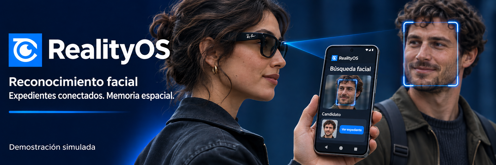
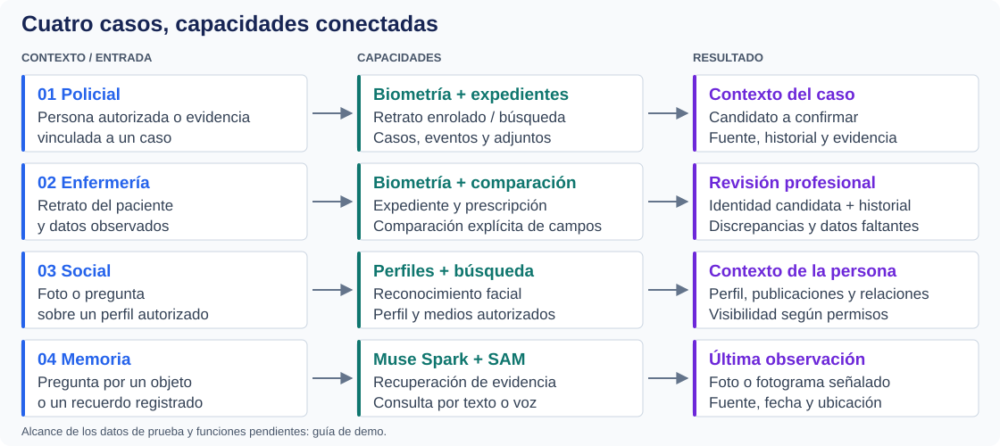
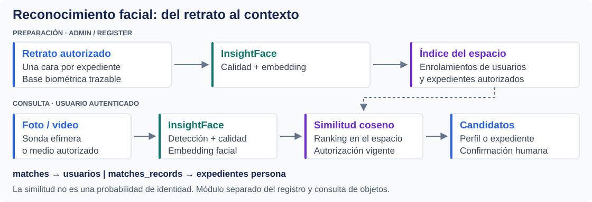
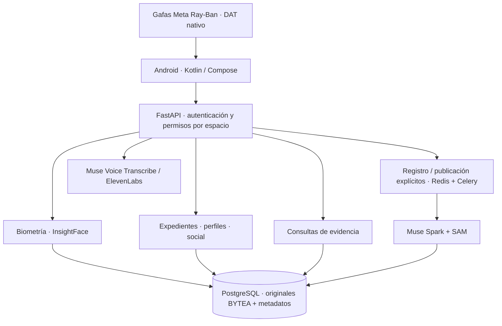

<a id="top"></a>

<p align="center">
  <a href="README.md"></a>
  <a href="README.es.md"></a>
</p>

# RealityOS

**Reconocimiento facial, expedientes conectados y memoria visual en Android y gafas Meta Ray-Ban.**
Relaciona una persona con su perfil o expediente autorizado, consulta su contexto y recupera evidencia de objetos y eventos por foto, video, texto o voz.

<p align="center">
  
</p>

<p align="center">
  <a href="#cases"><strong>Casos de uso</strong></a> · <a href="#biometrics"><strong>Reconocimiento facial</strong></a> · <a href="#evaluate"><strong>Probar</strong></a> · <a href="#architecture"><strong>Arquitectura</strong></a> · <a href="#hackathon"><strong>Hackathon</strong></a>
</p>

<p align="center">
  <a href="https://github.com/Luxisoft/realityos-spatial-memory/actions/workflows/ci.yml"></a>
  · <a href="LICENSE">Apache 2.0</a> · <a href="README.md">English</a>
</p>

<a id="cases"></a>

## Qué resuelve

En un encuentro presencial, la imagen de una persona, su expediente y los hechos observados suelen estar separados. RealityOS conecta esos contextos: **quién podría ser, qué información autorizada existe y qué evidencia respalda la respuesta**. Mantiene el reconocimiento facial, los expedientes y la búsqueda de objetos como módulos distintos dentro de la misma experiencia.



| Caso | Recorrido concreto | Resultado y alcance actual |
| --- | --- | --- |
| **Policial** | Consultar una persona previamente enrolada y abrir su contexto autorizado; relacionar casos, eventos, notas y evidencia del turno. | Candidatos faciales y expedientes consultables. El conjunto policial actual prueba casos y objetos; los retratos enrolados de evaluación están en los espacios clínico y de memoria. Las alertas policiales automáticas siguen pendientes. |
| **Enfermería** | Buscar por retrato a **Ana Solis**, confirmar identidad, abrir atención y prescripción; comparar la etiqueta ficticia de **20 mg** con la prescripción de **10 mg**. | Expediente e historial relacionados, discrepancias de campos, vigencia, alergias y administraciones previas. Los campos observados se introducen explícitamente; no hay OCR de envases ni prescripción automática. |
| **Social** | Buscar una cara autorizada, abrir su perfil y preguntar qué información o publicaciones ha compartido. | Perfil, contexto y medios visibles según permisos; grupos, comentarios y relaciones disponibles en la app. Las referencias importadas de Facebook tienen visibilidad restringida. |
| **Memoria** | Abrir el expediente de **Luis Moreno** o preguntar «¿Dónde se vieron mis documentos por última vez?». | Recordatorios y eventos relacionados; foto o fotograma señalado, fuente, fecha y ubicación observada. No afirma que el objeto siga allí. |

[Pasos de prueba y resultados esperados por caso →](docs/DEMO.es.md)

<a id="biometrics"></a>

## Reconocimiento facial y acceso al contexto

**InsightFace compara una foto o video de consulta con enrolamientos autorizados del espacio.** Devuelve candidatos ordenados por similitud, con evidencia facial, y permite abrir el perfil de usuario o el expediente de persona correspondiente.



| Contrato | Función |
| --- | --- |
| `POST /v1/faces/consent` · `/faces/enroll` | Consentimiento versionado y enrolamiento de medios propios. |
| `POST /v1/faces/record-enroll` | Enrolar explícitamente un retrato de un expediente autorizado, con base trazable. |
| `POST /v1/faces/search` | Buscar con foto, video o medio autorizado; la sonda subida es efímera. |
| `matches` · `matches_records` | Resultados separados para usuarios y expedientes; evidencias y enlaces sujetos a permisos. |

La similitud **no es una probabilidad de identidad**: el profesional confirma al candidato. Una persona importada no se convierte en cuenta ni se enrola automáticamente. Este módulo permanece separado del registro y consulta de objetos. [Contrato y filtros →](docs/API.md)

<a id="architecture"></a>

## Arquitectura y uso de Meta AI



| Tecnología | Aporte al producto | Implementación |
| --- | --- | --- |
| **Muse Spark 1.3** | Interpreta imágenes y preguntas, estructura hechos visibles, prepara respuestas y textos EN/ES con contexto autorizado. | [Proveedores](backend/app/providers/) · [contratos Meta](docs/META_INTEGRATION.md) |
| **SAM 3.1** | Localiza y segmenta objetos; conserva geometría y evidencia de fotogramas durante procesamiento explícito. | [Procesamiento](backend/app/processing/) |
| **Muse Voice Transcribe** | Convierte consultas de voz en texto. | [Integración Meta](docs/META_INTEGRATION.md) |
| **Meta Wearables DAT** | Conecta cámara, voz y Display nativo de las gafas con Android. | [Android y gafas](android/README.es.md) |
| **InsightFace / ElevenLabs** | Reconocimiento facial local / respuestas habladas desde el servidor. Son componentes independientes de los modelos Meta. | [API facial](docs/API.md) · [TTS](docs/TTS.md) |

La API de expedientes importa personas, casos, atenciones, objetos, prescripciones, alergias y administraciones mediante lotes versionados, relaciones y adjuntos. Los conectores HTTPS usan un contrato explícito. [Integración de datos →](docs/WORKSPACE_DATA.md)

**Decisiones de ingeniería:** originales en PostgreSQL BYTEA; permisos por espacio en cada recurso; consentimiento biométrico; consultas de evidencia sin iniciar captura; claves de proveedores solo en servidor; fallos Live visibles y mock rotulado. El gateway Meta restringido es un respaldo de conexión. Android es la única app; el panel del navegador y la web Display están retirados.

<a id="evaluate"></a>

## Probar como jurado

1. Descarga `realityos-android-debug-apk` de una [ejecución aprobada](https://github.com/Luxisoft/realityos-spatial-memory/actions/workflows/ci.yml), descomprime e instala. GitHub puede pedir iniciar sesión. El APK habitual usa `https://realityos.luxisoft.com/v1`.
2. Elige **Continuar con correo** e inicia sesión con una cuenta de evaluación y la contraseña demo de tu invitación.
3. Selecciona el espacio y sigue el [guion de pruebas](docs/DEMO.es.md): búsqueda facial, apertura de expediente, contexto y evidencia visual.

| Espacio ficticio | Cuenta | Prueba inicial |
| --- | --- | --- |
| Pacific Ridge Police Department | `alex-rivera` | Caso de prueba 1, notas y evidencia del turno. |
| California Valley Medical Center | `elena-marquez` | Retrato de Ana Solis → expediente → comparación de medicación. |
| Sonoran Neurological Institute | `noah-brooks` | Luis Moreno → recordatorio → última evidencia de documentos. |

El conjunto contiene **47 registros, 27 adjuntos y seis retratos de personas enrolados**. Las personas y escenas son ficticias; la API, el almacenamiento y los proveedores Live son reales. Los MP4 sintéticos son escenas estáticas. El operador conserva las contraseñas demo en el archivo privado `.runtime/jury-access.json`; `@jury.example.test` no recibe correo. [Directorio social de pruebas →](simulator/social-directory/README.es.md)

<a id="watch"></a>

[▶ Policial](demo-video/policial_case.mp4) · [▶ Enfermería](demo-video/nurse_case.mp4) · [▶ Personas / social](demo-video/profile_found.mp4) · [▶ Memoria](demo-video/memory.mp4)

Estos videos y la portada son representaciones conceptuales; no sustituyen una grabación de la app funcionando. Los videos existentes contienen texto en inglés. La prueba HTTP de reconocimiento sobre Ana Solis está documentada; la validación física de teléfono/gafas, las fuentes institucionales reales y la demo final grabada siguen pendientes. [Estado verificado →](docs/IMPLEMENTATION_STATUS.md)

<a id="hackathon"></a>

## Meta Global AI Developer Hackathon

El proyecto se presenta como **memoria contextual asistida por visión**, con casos del mundo real y uso combinado de modelos Meta. Su encaje propuesto es *Build for Your World*; la selección de track y los datos del equipo deben coincidir con la inscripción.

| Criterio oficial | Evidencia en RealityOS |
| --- | --- |
| Impacto · 30 % | Cuatro recorridos concretos que conectan personas, información y evidencia. |
| Herramientas Meta · 25 % | Muse Spark + SAM + transcripción, con responsabilidades distintas y DAT como interfaz. |
| Profundidad técnica · 20 % | API, procesamiento, biometría aislada, permisos, trazabilidad y pruebas automatizadas. |
| Demo · 25 % | APK instalable, cuentas y guion reproducible; falta enlazar la grabación final del producto. |

Fuentes: [evento](https://cerebralvalley.ai/e/meta-ai-developer-hackathon) y [bases oficiales](https://cerebralvalley.ai/e/meta-ai-developer-hackathon/waiver), consultadas el 3 de noviembre de 2026. [Requisitos, evidencias y pendientes de entrega →](docs/HACKATHON.es.md)

<a id="install"></a>

## Instalar y desarrollar

| Android | Servidor | Windows independiente |
| --- | --- | --- |
| [Compilar e instalar APK](android/README.es.md#build) | [Conexión directa](docs/DEPLOYMENT_DIRECT.es.md) · [gateway](docs/DEPLOYMENT_GATEWAY.es.md) | [Docker Desktop + app local](docs/DEPLOYMENT_LOCALHOST.es.md) |

<details>
<summary><strong>Mapa del repositorio y comprobaciones</strong></summary>

| Ruta | Responsabilidad |
| --- | --- |
| `backend/` | API, contratos, procesamiento, migraciones y biometría. |
| `android/` | App Kotlin/Compose y Display nativo DAT. |
| `meta-gateway/` | Egress permitido a Meta. |
| `simulator/` | Fixtures sintéticos y cargadores de prueba. |
| `tests/` · `gateway-tests/` | Regresiones, aislamiento y contrato OpenAPI. |

Después de `make install`:

```bash
make lint
make test
make architecture-check
make android-check
```

</details>

<a id="docs"></a>

[Arquitectura](docs/ARCHITECTURE.md) · [API](docs/API.md) · [Base de datos](docs/DATABASE.md) · [Seguridad](docs/SECURITY.md) · [Gafas](docs/WEARABLES.md)

[Recursos y prompts](docs/assets/readme/PROMPTS.md) · [Referencia de formato: awesome-readme](https://github.com/matiassingers/awesome-readme) · [Apache 2.0](LICENSE) · [↑ Volver arriba](#top)
