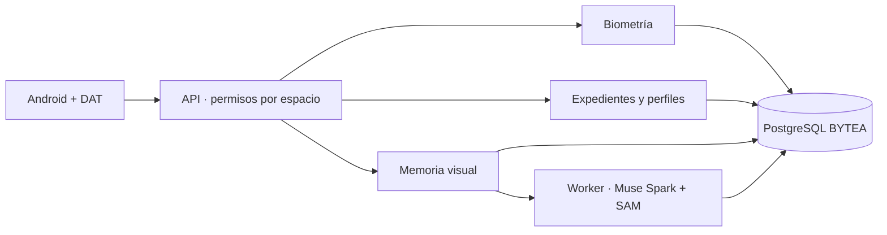

<a id="top"></a>

<p align="center">
  <a href="README.md"></a>
  <a href="README.es.md"></a>
</p>

# RealityOS

**Una plataforma de reconocimiento facial, contexto autorizado y memoria visual para Android y gafas Meta.**
Permite encontrar personas y objetos, consultar información relacionada y recuperar evidencia por foto, video, texto o voz. Sus capacidades se aplican a distintos entornos, según los datos y permisos de cada espacio.

<p align="center">
  
</p>

<p align="center">
  <a href="#cases"><strong>Casos de uso</strong></a> · <a href="#biometrics"><strong>Reconocimiento facial</strong></a> · <a href="#evaluate"><strong>Probar</strong></a> · <a href="#architecture"><strong>Arquitectura</strong></a> · <a href="#hackathon"><strong>Hackathon</strong></a>
</p>

<p align="center">
  <a href="https://github.com/Luxisoft/realityos-spatial-memory/actions/workflows/ci.yml"></a>
  · <a href="LICENSE">Apache 2.0</a> · <a href="README.md">English</a>
</p>

## Capacidades de la plataforma

| Capacidad | Qué aporta |
| --- | --- |
| **Reconocimiento facial** | Busca candidatos entre usuarios o expedientes autorizados a partir de una foto o video. |
| **Expedientes e integración** | Importa registros versionados, relaciona personas y eventos, y conserva notas y adjuntos con su fuente. |
| **Contexto social** | Consulta perfiles, publicaciones y grupos según su visibilidad. |
| **Memoria visual** | Encuentra objetos en evidencia almacenada y muestra dónde y cuándo se observaron. |
| **Interacción multimodal** | Ofrece captura explícita y consultas por imagen, texto o voz desde Android y Display nativo. |

<a id="cases"></a>

## Ejemplos de aplicación

**Son ejemplos independientes, no una lista cerrada de lo que puede hacer RealityOS.** Cada organización configura sus datos y espacios; estos escenarios no comparten información entre sí por defecto.

| Vista previa | Ejemplo | Qué permite hacer | Resultado |
| --- | --- | --- | --- |
| <a href="demo-video/policial_case.mp4"></a> | **Policial** | Revisar un caso y consultar una persona previamente enrolada. | Contexto autorizado, notas y evidencia para revisión humana. |
| <a href="demo-video/nurse_case.mp4"></a> | **Enfermería** | Localizar el expediente de un paciente y comparar campos registrados. | Historial y discrepancias de datos para verificación profesional. |
| <a href="demo-video/profile_found.mp4"></a> | **Social** | Encontrar un perfil autorizado a partir de un rostro. | Información y publicaciones que el usuario puede consultar. |
| <a href="demo-video/memory.mp4"></a> | **Memoria** | Preguntar dónde se observó un objeto por última vez. | Foto o fotograma señalado, ubicación, fecha y fuente. |

Las miniaturas y los videos enlazados son conceptuales. [Pruebas disponibles y alcance de cada conjunto de datos →](docs/DEMO.es.md)

<a id="biometrics"></a>

## Reconocimiento facial y acceso al contexto

**InsightFace compara una foto o video de consulta con enrolamientos autorizados del espacio.** Devuelve candidatos ordenados por similitud, con evidencia facial, y permite abrir el perfil de usuario o el expediente de persona correspondiente.


**1. Foto/video → 2. Representación facial → 3. Comparación con enrolamientos autorizados → 4. Candidatos → 5. Perfil o expediente.**

El enrolamiento se realiza antes, de forma explícita. La búsqueda usa InsightFace y devuelve `matches` para usuarios y `matches_records` para expedientes. La sonda subida es efímera; los resultados se limitan al espacio y a la autorización vigente.

La similitud no es probabilidad de identidad: el profesional confirma al candidato. La biometría permanece separada del procesamiento de objetos. [Contrato facial y permisos →](docs/API.md)

<a id="architecture"></a>

## Arquitectura y uso de Meta AI



| Tecnología | Aporte al producto | Implementación |
| --- | --- | --- |
| **Muse Spark 1.3** | Interpreta imágenes y preguntas, estructura hechos visibles, prepara respuestas y textos EN/ES con contexto autorizado. | [Proveedores](backend/app/providers/) · [contratos Meta](docs/META_INTEGRATION.md) |
| **SAM 3.1** | Localiza y segmenta objetos; conserva geometría y evidencia de fotogramas durante procesamiento explícito. | [Procesamiento](backend/app/processing/) |
| **Muse Voice Transcribe** | Convierte consultas de voz en texto. | [Integración Meta](docs/META_INTEGRATION.md) |
| **Meta Wearables DAT** | Conecta cámara, voz y Display nativo de las gafas con Android. | [Android y gafas](android/README.es.md) |
| **InsightFace / ElevenLabs** | Reconocimiento facial local / respuestas habladas desde el servidor. Son componentes independientes de los modelos Meta. | [API facial](docs/API.md) · [TTS](docs/TTS.md) |

El worker procesa capturas/publicaciones explícitas; consultar evidencia no lo activa.

La API de expedientes importa personas, casos, atenciones, objetos, prescripciones, alergias y administraciones mediante lotes versionados, relaciones y adjuntos. Los conectores HTTPS usan un contrato explícito. [Integración de datos →](docs/WORKSPACE_DATA.md)

**Decisiones de ingeniería:** originales en PostgreSQL BYTEA; permisos por espacio en cada recurso; consentimiento biométrico; consultas de evidencia sin iniciar captura; claves de proveedores solo en servidor; fallos Live visibles y mock rotulado. El gateway Meta restringido es un respaldo de conexión. Android es la única app; el panel del navegador y la web Display están retirados.

<a id="evaluate"></a>

## Probar como jurado

1. Descarga `realityos-android-debug-apk` de una [ejecución aprobada](https://github.com/Luxisoft/realityos-spatial-memory/actions/workflows/ci.yml), descomprime e instala. GitHub puede pedir iniciar sesión. El APK habitual usa `https://realityos.luxisoft.com/v1`.
2. Elige **Continuar con correo** e inicia sesión con una cuenta de evaluación y la contraseña demo de tu invitación.
3. Selecciona el espacio y sigue el [guion de pruebas](docs/DEMO.es.md): búsqueda facial, apertura de expediente, contexto y evidencia visual.

| Espacio ficticio | Cuenta | Prueba inicial |
| --- | --- | --- |
| Pacific Ridge Police Department | `alex-rivera` | Caso de prueba 1, notas y evidencia del turno. |
| California Valley Medical Center | `elena-marquez` | Retrato de Ana Solis → expediente → comparación de medicación. |
| Sonoran Neurological Institute | `noah-brooks` | Luis Moreno → recordatorio → última evidencia de documentos. |

El conjunto contiene **47 registros, 27 adjuntos y seis retratos de personas enrolados**. Las personas y escenas son ficticias; la API, el almacenamiento y los proveedores Live son reales. Los MP4 sintéticos son escenas estáticas. El operador conserva las contraseñas demo en el archivo privado `.runtime/jury-access.json`; `@jury.example.test` no recibe correo. [Directorio social de pruebas →](simulator/social-directory/README.es.md)

<a id="watch"></a>

[▶ Policial](demo-video/policial_case.mp4) · [▶ Enfermería](demo-video/nurse_case.mp4) · [▶ Personas / social](demo-video/profile_found.mp4) · [▶ Memoria](demo-video/memory.mp4)

Estos videos y la portada son representaciones conceptuales; no sustituyen una grabación de la app funcionando. Los videos existentes contienen texto en inglés. La prueba HTTP de reconocimiento sobre Ana Solis está documentada; la validación física de teléfono/gafas, las fuentes institucionales reales y la demo final grabada siguen pendientes. [Estado verificado →](docs/IMPLEMENTATION_STATUS.md)

<a id="install"></a>

## Instalar y desarrollar

| Android | Servidor | Windows independiente |
| --- | --- | --- |
| [Compilar e instalar APK](android/README.es.md#build) | [Conexión directa](docs/DEPLOYMENT_DIRECT.es.md) · [gateway](docs/DEPLOYMENT_GATEWAY.es.md) | [Docker Desktop + app local](docs/DEPLOYMENT_LOCALHOST.es.md) |

<details>
<summary><strong>Mapa del repositorio y comprobaciones</strong></summary>

| Ruta | Responsabilidad |
| --- | --- |
| `backend/` | API, contratos, procesamiento, migraciones y biometría. |
| `android/` | App Kotlin/Compose y Display nativo DAT. |
| `meta-gateway/` | Egress permitido a Meta. |
| `simulator/` | Fixtures sintéticos y cargadores de prueba. |
| `tests/` · `gateway-tests/` | Regresiones, aislamiento y contrato OpenAPI. |

Después de `make install`:

```bash
make lint
make test
make architecture-check
make android-check
```

</details>

<a id="hackathon"></a>

## Construido durante la hackathon

El repositorio distingue la **base previa al 27 de octubre (ET)** de las aportaciones posteriores: video y segmentación avanzada, Android/DAT, reconocimiento facial, perfiles sociales e integración de expedientes. [Cambios y commits de referencia →](docs/HACKATHON.es.md#contributions)

**Meta Global AI Developer Hackathon · encaje propuesto: Build for Your World.** El uso de modelos Meta y los ejemplos muestran la aplicación práctica; el track registrado debe confirmarse con la inscripción.

La guía exige repositorio público y una **demo accesible de tres minutos** centrada en lo construido durante el evento. El enlace al video final sigue pendiente; los videos conceptuales anteriores no lo sustituyen.

[Requisitos, revisión de exclusiones y pendientes →](docs/HACKATHON.es.md) · [Guía del evento](https://cerebralvalley.ai/e/meta-ai-developer-hackathon/details)

<a id="docs"></a>

[Arquitectura](docs/ARCHITECTURE.md) · [API](docs/API.md) · [Base de datos](docs/DATABASE.md) · [Seguridad](docs/SECURITY.md) · [Gafas](docs/WEARABLES.md)

[Recursos y prompts](docs/assets/readme/PROMPTS.md) · [Referencia de formato: awesome-readme](https://github.com/matiassingers/awesome-readme) · [Apache 2.0](LICENSE) · [↑ Volver arriba](#top)
