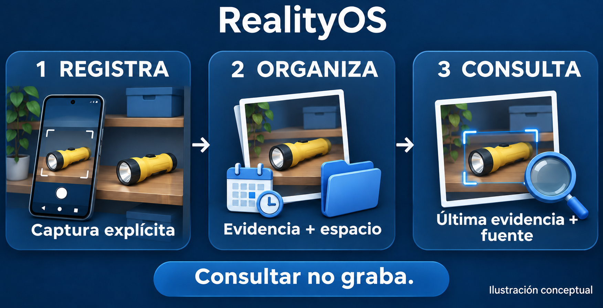
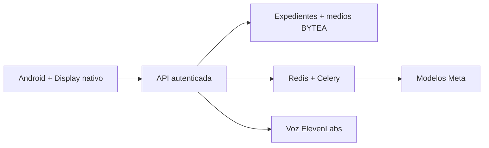

<a id="top"></a>

<p align="center">
  <a href="README.md"></a>
  <a href="README.es.md"></a>
</p>

# RealityOS

**Encuentra la última evidencia verificada de un objeto, con foto, fuente y fecha.**
Una app Android para memoria espacial, expedientes por espacio de trabajo y experiencias con gafas Meta.


<p align="center">
  <a href="#evaluate"><strong>Probar la demo</strong></a> ·
  <a href="#watch"><strong>Ver los conceptos</strong></a> ·
  <a href="#install"><strong>Instalar</strong></a> ·
  <a href="#docs"><strong>Explorar las guías</strong></a>
</p>

<p align="center">
  <a href="https://github.com/Luxisoft/realityos-spatial-memory/actions/workflows/ci.yml"></a>
  · <a href="LICENSE">Apache 2.0</a> · <a href="README.md">English</a>
</p>

## Así funciona



| Tú haces | RealityOS devuelve |
| --- | --- |
| Registras una foto o un video de forma intencional | El medio original y observaciones trazables dentro de tu espacio. |
| Preguntas dónde se vio un objeto por última vez | Evidencia existente, fecha, fuente y confianza visual. |
| Abres un expediente del espacio | Notas, relaciones y adjuntos autorizados. |
| Utilizas gafas compatibles | La experiencia nativa de captura y consulta mediante Android y DAT. |

**Capturar requiere consentimiento. Consultar lee evidencia existente. «Visto por última vez» nunca significa «sigue allí».**
La búsqueda facial es una función separada, con autorización explícita; sus candidatos requieren confirmación humana.

<a id="evaluate"></a>

## Pruébalo como jurado

| ① Instala | ② Inicia sesión | ③ Explora |
| --- | --- | --- |
| Abre una [ejecución de CI aprobada](https://github.com/Luxisoft/realityos-spatial-memory/actions/workflows/ci.yml), descarga `realityos-android-debug-apk`, descomprime e instala el APK. GitHub puede pedir que inicies sesión. | Elige **Continuar con correo** y utiliza una cuenta de evaluación de la tabla. | Selecciona un espacio, abre un expediente o busca evidencia fotográfica. |

El APK habitual apunta a `https://realityos.luxisoft.com/v1`. La dirección del servidor se elige **al compilar**. Para localhost, utiliza la [guía independiente de Windows](docs/DEPLOYMENT_LOCALHOST.es.md).

| Espacio ficticio | Cuenta de evaluación | Prueba esto |
| --- | --- | --- |
| Pacific Ridge Police Department | `alex-rivera` | Encuentra la linterna amarilla o el destornillador rojo. |
| California Valley Medical Center | `elena-marquez` | Abre el expediente de Ana Solis; compara la etiqueta ficticia de 20 mg con la prescripción de 10 mg. |
| Sonoran Neurological Institute | `noah-brooks` | Pregunta dónde se vieron por última vez los documentos de Luis Moreno. |

Utiliza las contraseñas demo entregadas con la invitación de evaluación. Los operadores pueden recuperarlas del archivo privado `.runtime/jury-access.json`; las claves de servicios siguen siendo privadas. Las direcciones `@jury.example.test` no reciben correo.

<details>
<summary><strong>Más cuentas y cómo interpretar la demo</strong></summary>

| Espacio | Otras cuentas |
| --- | --- |
| Pacific Ridge | `maya-johnson`, `daniel-kim` |
| California Valley | `mateo-rios`, `sarah-chen` |
| Sonoran | `lucia-vega`, `owen-patel` |

Las personas, los retratos y los escenarios son ficticios y están rotulados como `simulated`. Las personas importadas son expedientes, no cuentas de acceso. El almacenamiento, la autorización y el procesamiento usan el sistema real. El ejemplo de medicación compara campos; no prescribe ni registra una administración. Buscar un expediente por foto requiere un retrato enrolado con autorización y los permisos biométricos de la función.

</details>

<a id="watch"></a>

## Mira los conceptos

| Memoria espacial | Consulta de personas | Escenario clínico | Gestión de casos |
| :---: | :---: | :---: | :---: |
| [▶ Ver video](demo-video/memory.mp4) | [▶ Ver video](demo-video/profile_found.mp4) | [▶ Ver video](demo-video/nurse_case.mp4) | [▶ Ver video](demo-video/policial_case.mp4) |

Las ilustraciones y los videos son conceptuales: no son capturas de la app ni pruebas de validación del hardware. Los videos existentes contienen texto en inglés. Consulta el [estado de implementación verificado](docs/IMPLEMENTATION_STATUS.md).

<a id="install"></a>

## Elige tu instalación

| Usar la app alojada | Montar tu servidor | Ejecutar en Windows |
| --- | --- | --- |
| [Android y gafas →](android/README.es.md) | [Conexión directa a Meta →](docs/DEPLOYMENT_DIRECT.es.md) | [Docker Desktop + Android local →](docs/DEPLOYMENT_LOCALHOST.es.md) |
| Instala el APK Debug y usa las cuentas de evaluación. | [Respaldo mediante gateway restringido →](docs/DEPLOYMENT_GATEWAY.es.md) | Cuentas, datos y claves de proveedores independientes. |

**Android es la única app.** El antiguo panel del navegador y la web Display están retirados; `/` y `/display/` responden HTTP 410. Los enlaces de confirmación y recuperación de correo siguen disponibles. El Display nativo de las gafas forma parte de Android.

## Qué lo hace funcionar

| Componente | Función |
| --- | --- |
| Meta Muse Spark | Comprende imágenes y prepara información estructurada en ambos idiomas. |
| Meta SAM | Segmenta y sigue objetos durante el procesamiento o refinamiento explícito. |
| Meta Muse Voice Transcribe | Transcribe la voz a texto. |
| ElevenLabs | Genera respuestas habladas en solicitudes autenticadas. |
| InsightFace local | Compara enrolamientos faciales autorizados explícitamente. |
| PostgreSQL + Redis/Celery | Conservan originales en BYTEA y procesan trabajos en segundo plano. |

Las claves de proveedores permanecen en el servidor. `META_MODE=mock` es determinista y se identifica como simulado; un fallo en Live no se convierte silenciosamente en un resultado ficticio. [Contratos de modelos y detalles de procesamiento →](docs/META_INTEGRATION.md)

<details>
<summary><strong>Arquitectura, mapa del repositorio y comprobaciones</strong></summary>



| Directorio | Contenido |
| --- | --- |
| [`backend/`](backend/) | API, worker, migraciones y contratos de proveedores. |
| [`android/`](android/README.es.md) | App del teléfono, gafas nativas y compilación Debug. |
| [`meta-gateway/`](meta-gateway/) | Salida restringida hacia Meta. |
| [`simulator/`](simulator/social-directory/README.es.md) | Datos sintéticos de evaluación. |
| [`infrastructure/`](infrastructure/) | Configuración de Compose y Nginx. |

Después de instalar las dependencias de desarrollo con `make install`:

```bash
make lint
make test
make architecture-check
```

Las instrucciones de compilación y la ruta única del APK Debug están en el [README de Android](android/README.es.md#build).

</details>

<a id="docs"></a>

## Más información

[Arquitectura](docs/ARCHITECTURE.md) · [API REST](docs/API.md) · [Base de datos](docs/DATABASE.md) · [Expedientes por espacio](docs/WORKSPACE_DATA.md) · [Gafas](docs/WEARABLES.md) · [Seguridad](docs/SECURITY.md) · [Estado de validación](docs/IMPLEMENTATION_STATUS.md)

Los documentos técnicos conservan su idioma propio. El README principal, el de Android, el de datos de prueba y las guías de instalación permiten cambiar entre español e inglés.

Diseño inspirado en [awesome-readme](https://github.com/matiassingers/awesome-readme). [Imágenes e instrucciones de generación](docs/assets/readme/PROMPTS.md) · [Licencia Apache 2.0](LICENSE) · [↑ Volver arriba](#top)
