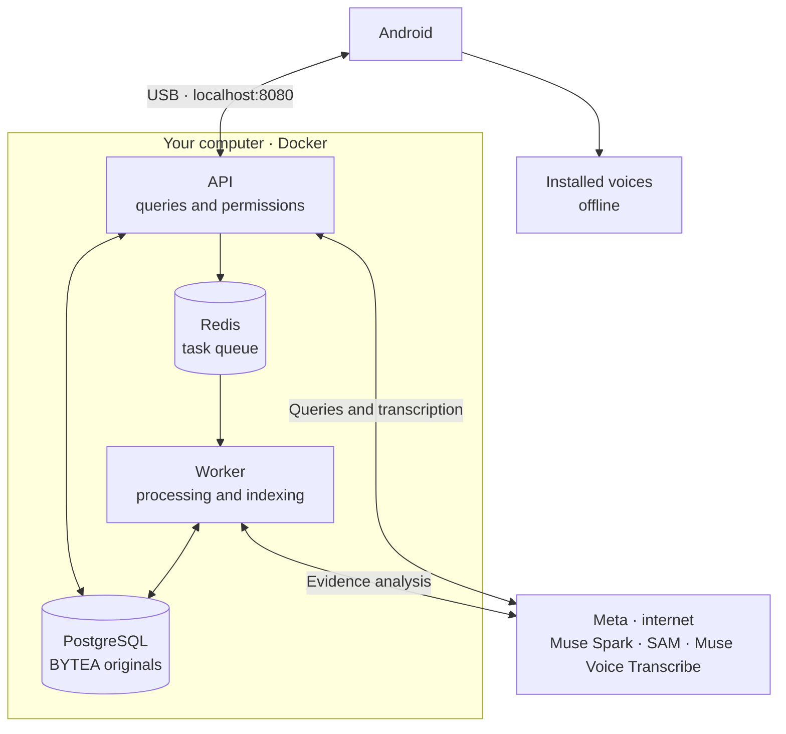

<!-- Generated from docs/en/README.md. Edit the EN/ES originals, then run python3 scripts/check_docs.py --sync-readme. -->

<a id="top"></a>

<p align="center">
  <a href="docs/en/README.md"></a>
  <a href="docs/es/README.md"></a>
</p>

# RealityOS

<p align="center">
  
</p>

Android app for saving photos, videos and records in groups and searching evidence with AI. The local server runs PostgreSQL, Redis, API and worker in Docker.

**[APK in the repository](android/app/build/outputs/apk/debug/app-debug.apk)** · [Download APK for Android 12+](https://media.githubusercontent.com/media/Luxisoft/realityos-spatial-memory/main/android/app/build/outputs/apk/debug/app-debug.apk) · [Phone commands](#android)

<p align="center">
  <a href="#linux-server"></a>
</p>

## Requirements

- Windows x64 with [Docker Desktop](https://docs.docker.com/desktop/setup/install/windows-install/) and WSL2, or Linux x64 with [Docker Engine and Compose](https://docs.docker.com/engine/install/). Allocate **4 CPU cores, 8 GiB RAM and 25 GiB free storage** to Docker.
- Phone running Android 12+, USB cable and USB debugging. Download Platform Tools (`adb`): [Windows ZIP](https://dl.google.com/android/repository/platform-tools-latest-windows.zip) · [Linux ZIP](https://dl.google.com/android/repository/platform-tools-latest-linux.zip). Extract the ZIP, add its `platform-tools` folder to `Path` and open a new terminal.
- Internet and your own Meta `MODEL_API_KEY` with access to Muse Spark, SAM and Muse Voice Transcribe.

<a id="evaluate"></a>
<a id="deploy"></a>

## 1. Start

With Git and [Git LFS](https://git-lfs.com/) installed, download the project:

```bash
git lfs install
git clone https://github.com/Luxisoft/realityos-spatial-memory.git
cd realityos-spatial-memory
```

If you already have it, open its folder and follow the [update and installation commands](#android). You can also extract the [ZIP](https://github.com/Luxisoft/realityos-spatial-memory/archive/refs/heads/main.zip) and download the APK using the link above.

<a id="deploy-muse"></a>

<details>
<summary><strong>Muse · install everything on localhost (copy prompt)</strong></summary>

Paste this prompt into a **Muse session with terminal access to your computer**:

```text
You are Muse, my installation agent. Install RealityOS and leave it running on
localhost on this computer. Execute the work through verification; respect the
session permissions and request my involvement when necessary.

1. Read AGENTS.md, MUSE.md, docs/en/README.md, the scripts in scripts/local/ and
   infrastructure/docker-compose.local.yml. Work on this checkout and the
   realityos-local Docker project. Preserve my changes, credentials and data;
   leave other services and remote servers intact.

2. Detect Windows x64/PowerShell or Linux x64/Bash. Prepare missing dependencies
   and check local Docker, Linux containers, Compose, at least 4 CPU cores,
   8 GiB RAM and 25 GiB free Docker storage. Use port 8080; if occupied, identify
   the process and explain the conflict before stopping another service.
   On Windows, verify Docker Desktop with WSL2. If system permission or a reboot
   is needed, explain the step and continue after it is completed.

3. If .env.local is missing, create it from .env.local.example. Ask me to enter
   my Meta MODEL_API_KEY in that private file or my local terminal, never in
   chat. Do not expose keys or copy production credentials. The launcher
   generates internal secrets. Preserve existing local configuration.

4. Run the appropriate launcher from the repository root:
   Windows: powershell.exe -NoProfile -ExecutionPolicy Bypass -File .\scripts\local\Start-RealityOS.ps1
   Linux: bash scripts/local/start.sh
   Wait for PostgreSQL, Redis, API and worker; inspect errors and fix their cause.
   Use the existing initialization for three groups and nine accounts. Preserve
   edits and deletions on restart, along with permissions and consent.

5. Prepare Platform Tools (adb). The APK built on the server is at
   android/app/build/outputs/apk/debug/app-debug.apk. In a Git checkout, run
   git lfs install and git lfs pull to retrieve it. For a project ZIP, download
   the APK from the README link to that same path. Check that it is a complete
   APK and its SHA-256 matches the commit's LFS object.
   This path does not require Java, Android SDK 36 or Android Studio locally.
   If Android or API contract changes are newer than the published APK, request
   a new server build or follow the README's build section.

6. Check adb devices. On the selected Android 12+ phone or emulator, run
   adb reverse tcp:8080 tcp:8080 and install the APK with adb install -r. If
   multiple devices are connected, ask me to choose one and use adb -s with its
   serial. If connection or device authorization is missing, explain the pending
   step. Verify the local account selector and installed offline ES/EN voices
   when device access is available.
   Open the app with:
   adb shell am start -n com.luxisoft.realityos.local/com.luxisoft.realityos.MainActivity

7. Run Test-RealityOS.ps1 with PowerShell or bash scripts/local/test.sh.
   Check http://localhost:8080/health/ready, /docs, /v1/openapi.json and
   /v1/auth/local-accounts. Verify sign-in and an evidence query with existing
   data; wait for indexing or report its actual error. Distinguish model
   availability from an AI query that was actually executed.

8. Report the local URL, APK path, status of all four services, start/stop
   commands and completed checks. State any pending device or provider
   validation. Leave the installation running.
```

</details>

To start manually, run from the project folder:

**Windows — PowerShell**

Install Docker Desktop first. On its first launch, open the application and complete its setup, using Linux containers with WSL2. The command below opens an installed Docker Desktop if the engine is unavailable and waits up to two minutes for it to respond.

```powershell
powershell.exe -NoProfile -ExecutionPolicy Bypass -File .\scripts\local\Start-RealityOS.ps1
```

If you see `docker_engine` / `The system cannot find the file specified` or the wait expires, open Docker Desktop and resolve any startup or WSL2 message. Run `docker info`: it must show the **Server** section without connection errors. Check `docker context ls` if it still fails and select your local Docker Desktop context before retrying the command. Having the Docker CLI installed is not enough; the engine must be running.

**Linux**

Start the local Docker Engine service before running:

```bash
bash scripts/local/start.sh
```

Enter your Meta key when prompted. The launcher generates `.env.local`; keep it private. The first run downloads dependencies and prepares the data. Restarting preserves edits and deletions.

Start, diagnostics and stop commands show an English progress bar based on completed steps. Console output is limited to phase summaries, warnings, errors and success messages; package download logs are hidden. A long build stage can keep the same percentage while it works. Reaching 100% means the command finished; background indexing can continue afterward.

On Windows, append `-NoCache` to the start command to rebuild the backend dependencies without reusing build layers. This does not reset data: a first-run data test also requires removing the `realityos-local` containers and its `postgres_data`/`redis_data` volumes, which deletes local data. Keep `.env.local` to reuse your private configuration. The progress bar uses plain text to avoid overlapping output in VS Code terminals.

<a id="android"></a>

## 2. Download, install and open Android

The APK built on the server is included at [`android/app/build/outputs/apk/debug/app-debug.apk`](android/app/build/outputs/apk/debug/app-debug.apk), for Android 12+ and `http://localhost:8080/v1`. Git LFS downloads it when you clone or update. Installation needs `adb`; **you do not need Android Studio, a JDK or SDK 36**.

With the backend running, connect your phone by USB and accept its debugging prompt. From **the project root**, update, install and open the app:

```powershell
git lfs install
git pull --ff-only
git lfs pull
adb devices
adb reverse tcp:8080 tcp:8080
adb install -r android/app/build/outputs/apk/debug/app-debug.apk
adb shell am start -n com.luxisoft.realityos.local/com.luxisoft.realityos.MainActivity
```

Configure `git lfs install` once per computer. If Git does not recognize `lfs`, install [Git LFS](https://git-lfs.com/) and repeat the commands. For a project ZIP, skip the three Git commands and save the [direct APK download](https://media.githubusercontent.com/media/Luxisoft/realityos-spatial-memory/main/android/app/build/outputs/apk/debug/app-debug.apk) at the indicated path; create its folders if missing.

The phone must appear as `device`; if it says `unauthorized`, accept the prompt on its screen. With multiple devices, add `-s SERIAL` after `adb` in each command. To open the app again, use the last command or tap its icon; repeat `adb reverse` after reconnecting USB. The same APK works through the [private Linux server tunnel](#linux-server).

<a id="android-build"></a>

<details>
<summary><strong>Optional: build from current source</strong></summary>

If you change Android, generate a new APK on the server or on a computer with [JDK 21 and Android SDK 36](#java-windows). A downloaded APK only contains the code from its build; Docker prepares the backend. From the repository root:

**Windows — PowerShell**

```powershell
$env:REALITYOS_API_BASE_URL = "http://localhost:8080/v1"
.\android\gradlew.bat -p android -PlocalDevelopment=true :app:assembleDebug
if ($LASTEXITCODE -ne 0) { throw "Android build failed. Do not install an older APK." }
```

**Linux**

```bash
REALITYOS_API_BASE_URL=http://localhost:8080/v1 ./android/gradlew -p android -PlocalDevelopment=true :app:assembleDebug
```

Wait for **BUILD SUCCESSFUL**. This replaces `android/app/build/outputs/apk/debug/app-debug.apk`. Install and open it from the repository root:

```bash
adb reverse tcp:8080 tcp:8080
adb install -r android/app/build/outputs/apk/debug/app-debug.apk
adb shell am start -n com.luxisoft.realityos.local/com.luxisoft.realityos.MainActivity
```

</details>

<a id="android-updates"></a>

**For each update:**

| What changed | What to run |
| --- | --- |
| Android code or resources | The server builds and pushes the APK to the repository. Repeat the update and installation commands above; you can also [build it yourself](#android-build). |
| Backend code or server configuration | Run `Start-RealityOS.ps1` on Windows or `bash scripts/local/start.sh` on Linux to rebuild/start the local services. Existing data is preserved. |
| The API contract used by Android | Update both the backend and the APK. |
| Documentation only | No app or container rebuild is needed. |

`adb install -r` retains data with the same application ID and signing key. Builds published from this server keep that signature; another computer or CI may use a different one. Do not uninstall automatically after a mismatch. See [ADB installation](https://developer.android.com/tools/adb#move).

`git pull` retrieves the updated APK with Git LFS enabled; `adb install -r` updates the phone. The Debug version name includes the build timestamp. Each Android change requires building and committing the APK alongside the code.

<a id="cases"></a>

Open the app and choose one of the **9 accounts across 3 groups: police, nursing and memory**. Explore the gallery and records; to publish, select a group, category and tag. Wait for indexing to finish before searching.

| Preview / video | Use |
| --- | --- |
| <a href="demo-video/policial_case.mp4"></a> | **Police:** consult group records and evidence. |
| <a href="demo-video/nurse_case.mp4"></a> | **Nursing:** review authorized records, notes and attachments. |
| <a href="demo-video/memory.mp4"></a> | **Memory:** find where and when an object was last seen. |
| <a href="demo-video/profile_found.mp4"></a> | **Profiles:** open a face candidate's authorized information. |

Images and videos are [conceptual illustrations](docs/en/project/GRAPHICS.md). Click a thumbnail to open its video.

<a id="biometrics"></a>

### Face search

Face search requires explicit consent and enrollment. InsightFace returns candidates for human review; profiles or records open according to permissions.


For spoken replies, install an offline ES/EN voice on Android. Repeat `adb reverse` after reconnecting the phone.

<a id="architecture"></a>

### Local architecture



## 3. Diagnostics, shutdown and Postman

From the project folder:

| Action | Windows — PowerShell | Linux |
| --- | --- | --- |
| Diagnostics | `powershell.exe -NoProfile -ExecutionPolicy Bypass -File .\scripts\local\Test-RealityOS.ps1` | `bash scripts/local/test.sh` |
| Stop | `powershell.exe -NoProfile -ExecutionPolicy Bypass -File .\scripts\local\Stop-RealityOS.ps1` | `bash scripts/local/stop.sh` |

API: [documentation](http://localhost:8080/docs) · [health](http://localhost:8080/health/ready). Stopping preserves data; `down -v` deletes it. If the Meta key fails, correct `MODEL_API_KEY` in `.env.local` and start again.

**Postman:** import the [collection](docs/postman/RealityOS.postman_collection.json), choose **No environment → Localhost requests → 00 Quick start** or **00 Local scenarios**. Sign-in is automatic; enable `enable_write_requests=true` to write. **Server requests** is disabled, with no URL or credentials.

<a id="java-windows"></a>

## 4. Java and the Android SDK — for building only

To [build from source](#android-build), use **JDK 21 LTS** and **Android SDK 36**. Skip this section when installing the published APK. On Windows:

1. Install [Temurin 21 x64](https://adoptium.net/temurin/releases/?version=21&os=windows&arch=x64&package=jdk), choosing the **JDK** package and MSI installer.
2. In **Environment Variables**, set `JAVA_HOME` to the installed JDK directory, without quotes or `\bin`. **The user variable takes precedence over the system variable**: if both exist, use the same valid path. Also correct `JDK_HOME` if it points to an old installation.
3. Place `%JAVA_HOME%\bin` before other Java entries in `Path`. Fully close the editor and terminals, then open a new PowerShell:

```powershell
$env:JAVA_HOME
Test-Path "$env:JAVA_HOME\bin\java.exe"
& "$env:JAVA_HOME\bin\java.exe" -version
java -version
javac -version
```

Expect `True` and version **21**. If the editor retains an old path, remove it from `java.home` or `java.jdt.ls.java.home`. In Android Studio, select JDK 21 under **Settings → Build, Execution, Deployment → Build Tools → Gradle → Gradle JDK**.

Install Android SDK Platform 36, Build-Tools 36.0.0 and Platform Tools through Android Studio's SDK Manager. Set `ANDROID_HOME` to your SDK directory, or set `sdk.dir` in the ignored `android/local.properties`. Add the SDK's `platform-tools` directory to `Path` so `adb devices` works.

Once these tools are ready, follow [Build from source](#android-build). Gradle uses the existing Wrapper; no separate Gradle installation is needed.

<a id="linux-server"></a>

## 5. Private evaluation on a Linux server

Run the same **four services and prepared scenarios** on a Linux x64 server. The API stays on the server's `127.0.0.1:8080`; your computer connects through SSH. No domain or public HTTPS endpoint is needed. Keep port 8080 private: the evaluation account selector has no passwords.

**1. Prepare the server.** Use at least 4 CPU cores, 8 GiB RAM and 25 GiB free Docker storage. Install Git, curl, [Docker Engine and the Compose plugin](https://docs.docker.com/engine/install/ubuntu/), and start Docker. Connect using your own SSH account; replace `deploy@YOUR_SERVER` throughout this section:

```bash
ssh deploy@YOUR_SERVER
uname -m
docker info
docker compose version
```

Expect `x86_64`, a responding Linux engine and Compose. Docker commands must work from this account. Run the following server commands **inside that SSH session**.

**2. Download and start RealityOS.** Use a separate checkout for this evaluation:

```bash
git clone https://github.com/Luxisoft/realityos-spatial-memory.git
cd realityos-spatial-memory
bash scripts/local/start.sh
```

Enter your own Meta key when prompted. The launcher creates a private `.env.local` on the server, generates internal secrets and prepares the three groups and nine accounts once. Existing local configuration and data are preserved on restart. PostgreSQL and Redis stay internal; Android uses its installed offline voices.

**3. Verify on the server.** Wait for setup to finish, then run:

```bash
curl --fail --silent --show-error http://127.0.0.1:8080/health/ready
curl --fail --silent --show-error http://127.0.0.1:8080/v1/openapi.json -o /dev/null
bash scripts/local/test.sh
```

Diagnostics check service status, model availability and local accounts. Background indexing can continue after startup; wait for it before searching the prepared evidence.

**4. Connect from your computer.** Open another terminal **on your computer**, ensure local port 8080 is free, and keep this [SSH tunnel](https://man.openbsd.org/ssh#L) running:

```bash
ssh -N -o ExitOnForwardFailure=yes -L 127.0.0.1:8080:127.0.0.1:8080 deploy@YOUR_SERVER
```

Open [http://localhost:8080/docs](http://localhost:8080/docs) on your computer. Postman uses **Localhost requests** through the tunnel; leave **Server requests** disabled. If your computer already runs a local RealityOS instance, stop that instance first to free port 8080.

**5. Connect Android.** With the tunnel open and the phone connected to your computer by USB, install the [local Debug APK](#android), then run on your computer:

```bash
adb reverse tcp:8080 tcp:8080
```

The app keeps `http://localhost:8080/v1` and reaches the server through your computer. Select one of the nine accounts. Repeat `adb reverse` after reconnecting the phone. Closing the tunnel disconnects clients but leaves the server running.

**6. Stop or resume.** Inside the server's checkout, use `bash scripts/local/stop.sh` to stop and `bash scripts/local/start.sh` to resume. Stopping preserves data. Do not remove volumes or use `down -v` unless you intend to delete the evaluation data.

These steps reuse the existing Linux launcher. The SSH/USB path must be verified on your own server and phone; this documentation change does not deploy a server.

<a id="hackathon"></a>

[](https://github.com/Luxisoft/realityos-spatial-memory/actions/workflows/ci.yml)

[Technical reference](docs/en/INDEX.md) · [Verified status](docs/en/project/IMPLEMENTATION_STATUS.md) · [Third-party licenses](docs/en/project/THIRD_PARTY.md) · [Apache 2.0](LICENSE)
