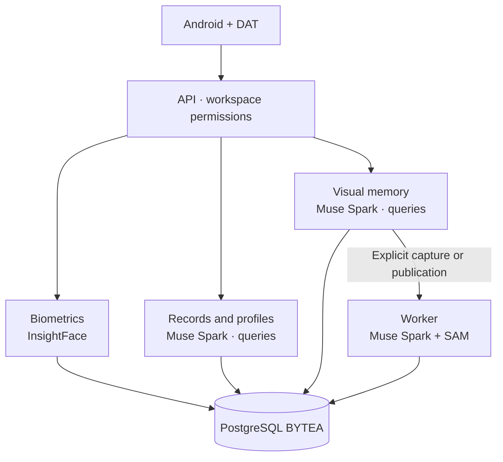

<a id="top"></a>

<p align="center">
  <a href="README.md"></a>
  <a href="README.es.md"></a>
</p>

# RealityOS

[API / Postman](docs/API.md) · [All guides](docs/README.md)


**A platform for facial recognition, authorized context and visual memory on Android and Meta glasses.**
Find people and objects, query related information and retrieve evidence through photos, video, text or voice. Its capabilities apply across domains, using each workspace's data and permissions.

<p align="center">
  
</p>

<p align="center">
  <a href="#cases"><strong>Use cases</strong></a> · <a href="#biometrics"><strong>Facial recognition</strong></a> · <a href="#evaluate"><strong>Try it</strong></a> · <a href="#architecture"><strong>Architecture</strong></a> · <a href="#hackathon"><strong>Hackathon</strong></a>
</p>

<p align="center">
  <a href="https://github.com/Luxisoft/realityos-spatial-memory/actions/workflows/ci.yml"></a>
  · <a href="LICENSE">Apache 2.0</a> · <a href="README.es.md">Español</a>
</p>

## Platform capabilities

| Capability | What it provides |
| --- | --- |
| **Facial recognition** | Finds candidates among authorized users or person records from a photo or video. |
| **Records and integration** | Imports versioned records, relates people and events, and preserves notes, attachments and provenance. |
| **Social context** | Queries profiles, posts and groups according to their visibility. |
| **Visual memory** | Finds objects in stored evidence and shows where and when they were observed. |
| **Multimodal interaction** | Provides explicit capture and image, text or voice queries through Android and native Display. |

<a id="cases"></a>

## Example applications

**These are independent examples, not an exhaustive list of RealityOS capabilities.** Each organization configures its data and workspaces; these scenarios do not share information by default.

| Preview | Example | What you can do | Result |
| --- | --- | --- | --- |
| <a href="demo-video/policial_case.mp4"></a> | **Police** | Review a case and look up a previously enrolled person. | Authorized context, notes and evidence for human review. |
| <a href="demo-video/nurse_case.mp4"></a> | **Nursing** | Locate a patient record and compare recorded fields. | History and field discrepancies for professional verification. |
| <a href="demo-video/profile_found.mp4"></a> | **Social** | Find an authorized profile from a face. | Information and posts the user is allowed to access. |
| <a href="demo-video/memory.mp4"></a> | **Memory** | Ask where an object was last observed. | Highlighted photo or frame, location, date and source. |

Thumbnails and linked videos are conceptual. [Available tests and fixture coverage →](docs/DEMO.md)

<a id="biometrics"></a>

## Facial recognition and contextual lookup

**InsightFace compares a probe photo or video with authorized workspace enrollments.** It returns candidates ranked by similarity, with facial evidence, and lets the user open the corresponding user profile or person record.


**1. Photo/video → 2. Face representation → 3. Compare authorized enrollments → 4. Candidates → 5. Profile or record.**

Enrollment is a prior, explicit operation. Search uses InsightFace and returns `matches` for users and `matches_records` for person records. Uploaded probes are ephemeral; results are scoped to the workspace and current authorization.

Similarity is not identity probability: the professional confirms the candidate. Biometrics remains separate from object processing. [Face contract and permissions →](docs/API.md)

<a id="architecture"></a>

## Architecture and Meta AI integration



| Technology | Product role | Implementation |
| --- | --- | --- |
| **Muse Spark 1.3** | Interprets images and questions, answers record and profile queries, and prepares EN/ES text from authorized context. | [Providers](backend/app/providers/) · [Meta contracts](docs/META_INTEGRATION.md) |
| **SAM 3.1** | Localizes and segments objects; preserves geometry and frame evidence during explicit processing. | [Processing](backend/app/processing/) |
| **Muse Voice Transcribe** | Converts spoken queries into text. | [Meta integration](docs/META_INTEGRATION.md) |
| **Meta Wearables DAT** | Connects glasses camera, voice and native Display to Android. | [Android and glasses](android/README.md) |
| **InsightFace · biometric AI** | Detects faces and computes facial representations for comparison with authorized enrollments. Runs locally on the server, independently of Meta. | [Face API](docs/API.md) |
| **ElevenLabs** | Generates spoken answers on the server. A provider independent of Meta. | [TTS](docs/TTS.md) |

Contextual record, profile and visual-memory queries can call Muse Spark from the API. The worker analyzes explicit captures/publications using Muse Spark and SAM; retrieving evidence does not start that processing. Reading or importing records does not itself imply an AI call.

The records API imports people, cases, encounters, objects, prescriptions, allergies and administrations through versioned batches, relationships and attachments. HTTPS connectors use an explicit contract. [Data integration →](docs/WORKSPACE_DATA.md)

**Engineering decisions:** PostgreSQL BYTEA originals; workspace checks on every resource; biometric consent; evidence queries that never start capture; server-only provider keys; explicit Live failures and labelled mock output. A restricted Meta gateway provides connection fallback. Android is the only app; the browser panel and web Display are retired.

<a id="evaluate"></a>

## Evaluate the project

1. Download `realityos-android-debug-apk` from a [successful run](https://github.com/Luxisoft/realityos-spatial-memory/actions/workflows/ci.yml), unzip and install. GitHub sign-in may be required. The regular APK targets `https://realityos.luxisoft.com/v1`.
2. Choose **Continue with email** and use an evaluation account with the demo password from your invitation.
3. Select the workspace and follow the [test walkthrough](docs/DEMO.md): face search, record lookup, context and visual evidence.

| Fictional workspace | Account | First scenario |
| --- | --- | --- |
| Pacific Ridge Police Department | `alex-rivera` | Test case 1, notes and shift evidence. |
| California Valley Medical Center | `elena-marquez` | Ana Solis portrait → record → medication comparison. |
| Sonoran Neurological Institute | `noah-brooks` | Luis Moreno → reminder → last evidence of documents. |

The fixture contains **47 records, 27 attachments and six enrolled person portraits**. People and scenes are fictional; the API, storage and Live providers are real. Synthetic MP4s are static scenes. Operators keep demo passwords in the private `.runtime/jury-access.json`; `@jury.example.test` does not receive email. [Synthetic social directory →](simulator/social-directory/README.md)

<a id="watch"></a>

[▶ Police](demo-video/policial_case.mp4) · [▶ Nursing](demo-video/nurse_case.mp4) · [▶ People / social](demo-video/profile_found.mp4) · [▶ Memory](demo-video/memory.mp4)

These videos and the header are conceptual representations; they do not replace a recording of the working app. The HTTP recognition check for Ana Solis is documented; physical phone/glasses validation, real institutional sources and the final recorded demo remain pending. [Verified status →](docs/IMPLEMENTATION_STATUS.md)

<a id="install"></a>

## Install and develop

| Android | Server | Independent Windows setup |
| --- | --- | --- |
| [Build and install the APK](android/README.md#build) | [Direct connection](docs/DEPLOYMENT_DIRECT.md) · [gateway](docs/DEPLOYMENT_GATEWAY.md) | [Docker Desktop + local app](docs/DEPLOYMENT_LOCALHOST.md) |

<details>
<summary><strong>Repository map and checks</strong></summary>

| Path | Responsibility |
| --- | --- |
| `backend/` | API, contracts, processing, migrations and biometrics. |
| `android/` | Kotlin/Compose app and native DAT Display. |
| `meta-gateway/` | Allowlisted Meta egress. |
| `simulator/` | Synthetic fixtures and test loaders. |
| `tests/` · `gateway-tests/` | Regression, isolation and OpenAPI contract checks. |

After `make install`:

```bash
make lint
make test
make architecture-check
make android-check
```

</details>

<a id="hackathon"></a>

## Built during the hackathon

The repository distinguishes the **baseline before October 27 (ET)** from later contributions: video and advanced segmentation, Android/DAT, facial recognition, social profiles and record integration. [Changes and reference commits →](docs/HACKATHON.md#contributions)

**Meta Global AI Developer Hackathon · proposed fit: Build for Your World.** The Meta model integration and examples demonstrate practical use; the registered track must be confirmed against the entry.

The guide requires a public repository and an **accessible three-minute demo** focused on work created during the event. The final video link remains pending; the concept videos above do not replace it.

[Requirements, exclusions review and outstanding items →](docs/HACKATHON.md) · [Event guide](https://cerebralvalley.ai/e/meta-ai-developer-hackathon/details)

<a id="docs"></a>

[Architecture](docs/ARCHITECTURE.md) · [API](docs/API.md) · [Database](docs/DATABASE.md) · [Security](docs/SECURITY.md) · [Wearables](docs/WEARABLES.md)

[Assets and prompts](docs/assets/readme/PROMPTS.md) · [Format reference: awesome-readme](https://github.com/matiassingers/awesome-readme) · [Apache 2.0](LICENSE) · [↑ Back to top](#top)
