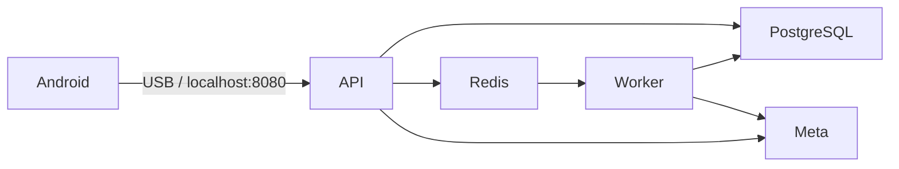

<!-- Generated from docs/en/README.md. Edit the EN/ES originals, then run python3 scripts/check_docs.py --sync-readme. -->

<a id="top"></a>
[Español](docs/es/README.md) · [Documentation](docs/en/INDEX.md)

# RealityOS

Local evaluation on Windows and Linux x64, with Android as the only app. RealityOS keeps its existing evidence processing, visual search, workspace permissions and isolated consent-based face search.


<a id="evaluate"></a>

## Start testing

1. Download or clone this public repository and install Docker. Follow the [local installation guide](docs/en/deployment/DEPLOYMENT_LOCALHOST.md).
2. Run `scripts/local/start.sh` on Linux, or `scripts/local/Start-RealityOS.ps1` on Windows. Supply **only your own Meta `MODEL_API_KEY`**. Internal secrets are generated locally.
3. Install the local Debug APK on Android 12+, connect USB and run `adb reverse tcp:8080 tcp:8080`.
4. Choose a local account. Explore its gallery and group records; publish, edit, delete and query local data. Allow the worker to finish real Meta indexing before checking visual-search results.

The first start prepares **3 groups, 9 users, 47 records, 27 attachments and 48 existing licensed gallery scenes**. Restarting preserves edits and deletions. Fictional records are labelled simulated; AI answers and indexes use real models. No biometric enrollment or consent is seeded.

**[Download the local Android APK](https://github.com/Luxisoft/realityos-spatial-memory/releases/download/local-evaluation/app-debug.apk)** — public download, no GitHub sign-in required.

The installable artifact is `android/app/build/outputs/apk/debug/app-debug.apk`. [Build and USB connection instructions](docs/en/deployment/DEPLOYMENT_LOCALHOST.md#android). Debug defaults to localhost; provider credentials never enter the APK.

To build Android, use **JDK 21 LTS** and Android SDK 36. [Configure Java and fix `JAVA_HOME` on Windows](docs/en/deployment/DEPLOYMENT_LOCALHOST.md#java-windows).

Import the [Postman collection](docs/postman/RealityOS.postman_collection.json), choose **No environment**, and open **Localhost requests → 00 Quick start** or **00 Local scenarios**. Account selection and session renewal are automatic. **Server requests** is disabled, without a configured endpoint or passwords. [API guide](docs/en/api/API.md#quick-start).

<a id="cases"></a>

## Existing scenarios

| Scenario | Group | Accounts |
| --- | --- | --- |
| Police | Pacific Ridge Police Department | Alex Rivera, Maya Johnson, Daniel Kim |
| Nursing | California Valley Medical Center | Elena Marquez, Mateo Rios, Sarah Chen |
| Memory | Sonoran Neurological Institute | Noah Brooks, Lucia Vega, Owen Patel |

Gallery is the main view. Publications require an existing group, one category and at least one tag. The owner manages the group catalog. Filters, profiles, records, attachments and search retain their existing behavior and permissions. [Walkthrough](docs/en/guides/DEMO.md#access) · [Publication classification](docs/en/guides/PUBLICATION_CLASSIFICATION.md).

<a id="biometrics"></a>

## Facial recognition and context

InsightFace remains an isolated, consent-gated feature. Explicitly authorize and enroll a person before using biometric search. Local account selection only bypasses facial verification at login; it does not bypass search consent, workspace authorization or enrollment. Probe results are candidates with evidence, never a guarantee of identity. [Architecture](docs/en/architecture/ARCHITECTURE.md) · [Security](docs/en/architecture/SECURITY.md).

<a id="architecture"></a>

## Local architecture

Four Docker services: **PostgreSQL + Redis + API + worker**. PostgreSQL is the one application database and stores original media as BYTEA; Redis holds the processing queue. Public starting files are ordinary repository folders under `simulator/`. Uploads and all account/workspace changes stay in the local database volume.

Muse Spark, SAM and Muse Voice Transcribe keep their existing processing and search logic, using your Meta key directly. Audio replies use Android's installed offline voices; text remains available if a voice is missing. Internet is required for Meta and the first dependency/model downloads.



<a id="deploy"></a>

## Start with Docker

Windows:

```powershell
powershell.exe -NoProfile -ExecutionPolicy Bypass -File .\scripts\local\Start-RealityOS.ps1
```

Linux:

```bash
bash scripts/local/start.sh
```

Keep `.env.local` private. `.env.example` and `.env.local.example` contain placeholders, not credentials. See [requirements, persistence, diagnostics and stop commands](docs/en/deployment/DEPLOYMENT_LOCALHOST.md). macOS is outside this setup's supported scope.

<a id="hackathon"></a>

## Evaluation and validation

Use the public repository instructions and a three-minute video showing the real features. Never publish provider keys, database/JWT secrets or private media. The hosted system is not required for this local walkthrough. Read [verified implementation status](docs/en/project/IMPLEMENTATION_STATUS.md) for checks actually performed and remaining device/provider validation; consult the organizers for final rule interpretation.

[Apache 2.0](LICENSE) · [Third parties](docs/en/project/THIRD_PARTY.md) · [Test checklist](docs/en/testing/IMPLEMENTATION_CHECKLIST.md)
