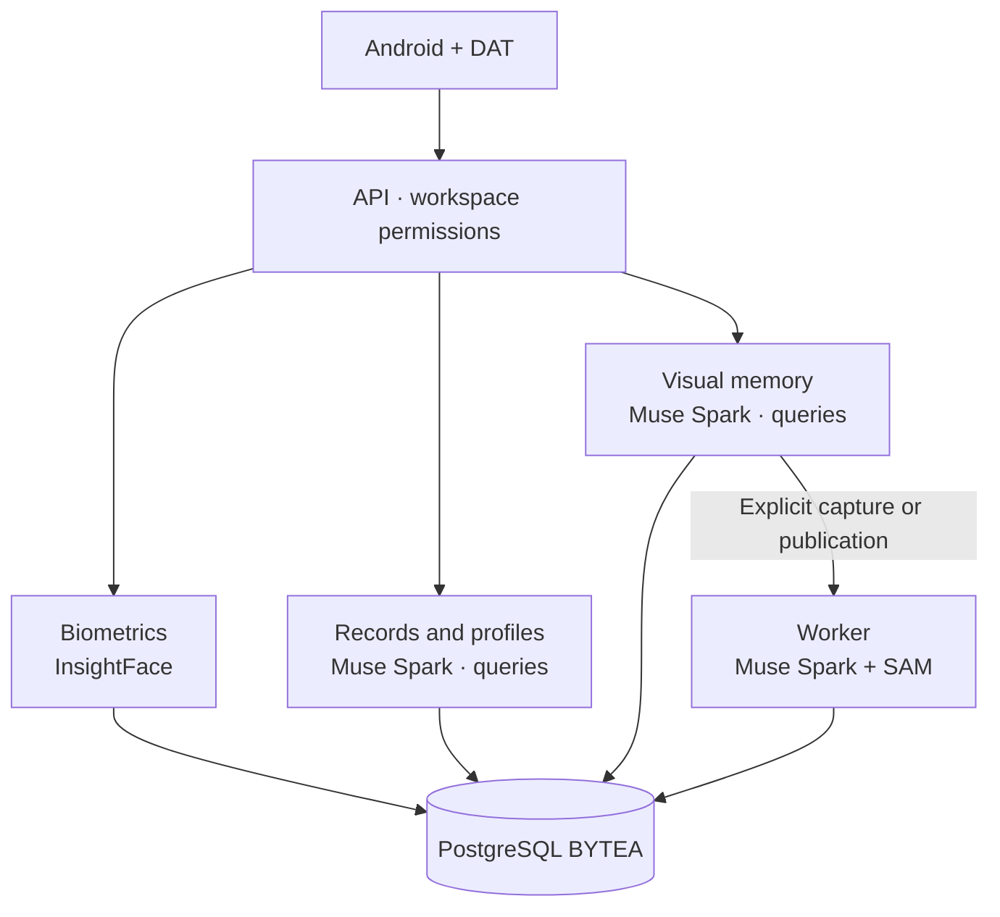

<!-- Generated from docs/en/README.md. Edit the EN/ES originals, then run python3 scripts/check_docs.py --sync-readme. -->

<a id="top"></a>

<p align="center">
  <a href="docs/en/README.md"></a>
  <a href="docs/es/README.md"></a>
</p>

# RealityOS

[Start testing](#evaluate) · [Deploy with AI](#deploy) · [Test checklist](docs/en/testing/IMPLEMENTATION_CHECKLIST.md) · [API / Postman](docs/en/api/API.md) · [All guides](docs/en/INDEX.md)

**A platform for facial recognition, authorized context and visual memory on Android and Meta glasses.**
Find people and objects, query related information and retrieve evidence through photos, video, text or voice. Its capabilities apply across domains, using each workspace's data and permissions.

<p align="center">
  
</p>

<p align="center">
  <a href="#cases"><strong>Use cases</strong></a> · <a href="#biometrics"><strong>Facial recognition</strong></a> · <a href="#evaluate"><strong>Try it</strong></a> · <a href="#architecture"><strong>Architecture</strong></a> · <a href="#deploy"><strong>Deploy with AI</strong></a> · <a href="#hackathon"><strong>Hackathon</strong></a>
</p>

<p align="center">
  <a href="https://github.com/Luxisoft/realityos-spatial-memory/actions/workflows/ci.yml"></a>
  · <a href="LICENSE">Apache 2.0</a> · <a href="docs/es/README.md">Español</a>
</p>

<a id="evaluate"></a>

## Start testing

**Your test account comes ready: profile photo, posts and an assigned work group.** Records and their portraits are already loaded on the server. For the first walkthrough, you only need the APK and your username/password.

1. **Install the app.** Get **app-debug.apk** from the organizer or download it from a [successful build](https://github.com/Luxisoft/realityos-spatial-memory/actions/workflows/ci.yml): open the run → **Artifacts** → **realityos-android-debug-apk**, unzip it and install the APK on Android 12 or newer. GitHub may require sign-in.
2. **Sign in.** Open RealityOS → **Continue with email** → **Sign in**. In **Username or email**, enter the supplied account, such as `elena-marquez`, and paste its password. The account is already created and confirmed.
3. **Explore the prepared data.** In the main **Gallery**, choose your assigned group to see its publications. Open the group menu → **Workspace records** and open a record. Portraits are available inside the record.

| Scenario | Primary account | Assigned group | Open first |
| --- | --- | --- | --- |
| Nursing | `elena-marquez` | California Valley Medical Center | Ana Solis's record: portrait, notes and related records. |
| Police | `alex-rivera` | Pacific Ridge Police Department | Case 1 and shift evidence. |
| Memory | `noah-brooks` | Sonoran Neurological Institute | Luis Moreno's record and reminder. |

**The three primary accounts and their passwords are public:** see the [access table](docs/en/api/API.md#quick-start). Choose the account for the scenario you want to evaluate.

[Step-by-step walkthrough and all nine accounts →](docs/en/guides/DEMO.md#access)

The three scenarios contain **47 records, 27 attachments and six enrolled person portraits**. People and scenes are fictional; the server and its providers are real. Synthetic videos show static scenes.

<details>
<summary><strong>I only want to try the API with Postman</strong></summary>

Import [the public collection](https://raw.githubusercontent.com/Luxisoft/realityos-spatial-memory/main/docs/postman/RealityOS.postman_collection.json), open **Server requests** or **Localhost requests → 00 Quick start**, and click **Send**. Police, Nursing and Memory remain under **Server requests → 00 Live scenarios**. All 39 requests include existing accounts, passwords, workspace IDs, resource IDs and questions. Login and renewal are automatic; requests use the current server data. [Guide and public accounts →](docs/en/api/API.md#quick-start)

</details>

The regular app already connects to the server. [Windows local](docs/en/deployment/DEPLOYMENT_LOCALHOST.md) is an additional installation that starts empty.

[Connect an R2/S3 bucket →](docs/en/guides/STORAGE_CONNECTIONS.md)

Scenario and QA accounts already have their test bucket connected under **Menu → My connections**; resources are uploaded and verified in R2.

## Platform capabilities

| Capability | What it provides |
| --- | --- |
| **Facial recognition** | Finds candidates among authorized users or person records from a photo or video. |
| **Records and integration** | Imports versioned records, relates people and events, and preserves notes, attachments and provenance. |
| **Social context** | Queries profiles, posts and groups according to their visibility. |
| **Visual memory** | Finds objects in stored evidence and shows where and when they were observed. |
| **Multimodal interaction** | Provides explicit capture and image, text or voice queries through Android and native Display. |

<a id="cases"></a>

The **Gallery** is the single main view. Publications always belong to a work group: join or create one before publishing. The bottom bar contains the menu, avatar, separate profile editor, expandable account details, glasses and Muse search/chat. Tapping the avatar returns to the gallery while preserving the selected group. Group creation, selection, filters, publishing and more actions remain above the gallery. Meta preview controls sit beside its own title.

## Publication categories, tags and gallery filters

Each work group has its own closed category and tag catalog. The group owner manages it when creating the group and under **Manage group**. Authors select **one category and at least one tag** when publishing; they can correct that selection later. Archiving a catalog value preserves existing publications and prevents new selections.

Gallery thumbnails show the category and tags, with a play icon for videos. The **filter icon** opens category, tag and author selectors, a publication date range and description search. Filters apply to all authorized publications before pagination. Different filter types combine; multiple choices within one selector match any selected value.

Bucket synchronization continues every 15 minutes. New files remain private and **await classification** in Connections until the connection owner chooses values from the destination group and continues. API imports may provide `category_id` and `tag_ids` per file. Copies into another group require that group’s classification for each publication.

See [publication catalogs and filters](docs/en/guides/PUBLICATION_CLASSIFICATION.md) for the API fields, review workflow and permissions.

## Example applications

**These are independent examples, not an exhaustive list of RealityOS capabilities.** Each organization configures its data and workspaces; these scenarios do not share information by default.

| Preview | Example | What you can do | Result |
| --- | --- | --- | --- |
| <a href="demo-video/policial_case.mp4"></a> | **Police** | Review a case and look up a previously enrolled person. | Authorized context, notes and evidence for human review. |
| <a href="demo-video/nurse_case.mp4"></a> | **Nursing** | Locate a patient record and compare recorded fields. | History and field discrepancies for professional verification. |
| <a href="demo-video/profile_found.mp4"></a> | **Social** | Find an authorized profile from a face. | Information and posts the user is allowed to access. |
| <a href="demo-video/memory.mp4"></a> | **Memory** | Ask where an object was last observed. | Highlighted photo or frame, location, date and source. |

Thumbnails and linked videos are conceptual. [Available tests and fixture coverage →](docs/en/guides/DEMO.md)

<a id="biometrics"></a>

## Facial recognition and contextual lookup

**InsightFace compares a probe photo or video with authorized workspace enrollments.** It returns candidates ranked by similarity, with facial evidence, and lets the user open the corresponding user profile or person record.


**1. Consent → 2. Explicit enrollment → 3. Photo/video probe → 4. Ranked candidates → 5. Human-confirmed profile or record.**

### Consent first, enrollment explicit

| Step | What happens |
| --- | --- |
| **Consent** | `POST /v1/faces/consent` with `{"confirm": true}` records versioned consent. Enroll and search return `403` without it, and guests are always blocked. `DELETE /v1/faces/consent` revokes and deletes the user's enrollments. |
| **People** | Login users enroll a single-face selfie (`POST /v1/faces/profile-photo`) or their own capture media (`POST /v1/faces/enroll`). Candidates come only from workspace members with active consent. |
| **Records** | Person records enroll authorized record media (`POST /v1/faces/record-enroll`); the record must stay active and biometric-authorized with a recorded basis. |

Nothing enrolls automatically: every enrollment is an explicit call over authorized media. At entry, the app takes a mandatory private face capture and verifies it against the account's own synced Facebook faces when present (`POST /v1/faces/verify-identity`: verified, pending, failed or locked, with attempt limits and a temporary lockout).

### Search returns candidates, never an identity verdict

`POST /v1/faces/search` takes a workspace plus an ephemeral probe upload (JPEG/PNG/WebP photo, or MP4/MOV/WebM video sampled into frames) or a stored `media_id`. Uploaded probes are never persisted. Multi-face probes keep the best faces (quality-sorted, capped, skipped faces counted); matching is cosine similarity over facial representations (default threshold `0.5`) with quality and face-size gates.

Each candidate carries `similarity`, `probe_box`, `probe_face_index` and an evidence thumbnail: `matches` for users (with profile link) and `matches_records` for person records (with record link). Responses also report `probe_faces`, `threshold` and whether the output is `simulated`. Results stay scoped to workspace membership and record authorization; synced Facebook media is searched only within its authorized flows, never as global Facebook search.

### Where it appears

Android **Find person** and the Ray-Ban Display **Buscar persona** action share this endpoint: numbered color boxes over a group photo (rendered from an ephemeral in-memory probe, never stored), per-candidate thumbnails through short-lived signed links, and opening the profile or record inside the app under the same permissions.

Similarity is a ranking score, not identity probability: the professional confirms the candidate. Biometrics is an isolated arm — shared auth, membership and BYTEA storage only — never merged into the object Register/Query pipeline, and InsightFace runs locally on the server, independently of Meta. [Face contract →](docs/en/api/API_REFERENCE.md) · [Test walkthroughs →](docs/en/guides/DEMO.md)

<a id="architecture"></a>

## Architecture and Meta AI integration



| Technology | Product role | Implementation |
| --- | --- | --- |
| **Muse Spark 1.3** | Interprets images and questions, answers record and profile queries, and prepares EN/ES text from authorized context. | [Providers](backend/app/providers) · [Meta contracts](docs/en/integrations/META_INTEGRATION.md) |
| **SAM 3.1** | Localizes and segments objects; preserves geometry and frame evidence during explicit processing. | [Processing](backend/app/processing) |
| **Muse Voice Transcribe** | Converts spoken queries into text. | [Meta integration](docs/en/integrations/META_INTEGRATION.md) |
| **Meta Wearables DAT** | Connects glasses camera, voice and native Display to Android. | [Android and glasses](docs/en/integrations/ANDROID.md) |
| **InsightFace · biometric AI** | Detects faces and computes facial representations for comparison with authorized enrollments. Runs locally on the server, independently of Meta. | [Face API](docs/en/api/API.md) |
| **ElevenLabs** | Generates spoken answers on the server. A provider independent of Meta. | [TTS](docs/en/integrations/TTS.md) |

Contextual record, profile and visual-memory queries can call Muse Spark from the API. The worker analyzes explicit captures/publications using Muse Spark and SAM; retrieving evidence does not start that processing. Reading or importing records does not itself imply an AI call.

The records API imports people, cases, encounters, objects, prescriptions, allergies and administrations through versioned batches, relationships and attachments. HTTPS connectors use an explicit contract. [Data integration →](docs/en/guides/WORKSPACE_DATA.md)

**Engineering decisions:** PostgreSQL BYTEA originals; workspace checks on every resource; biometric consent; evidence queries that never start capture; server-only provider keys; explicit Live failures and labelled mock output. A restricted Meta gateway provides connection fallback. Android is the only app; the browser panel and web Display are retired.

<a id="watch"></a>

[▶ Police](demo-video/policial_case.mp4) · [▶ Nursing](demo-video/nurse_case.mp4) · [▶ People / social](demo-video/profile_found.mp4) · [▶ Memory](demo-video/memory.mp4)

These videos and the header are conceptual representations; they do not replace a recording of the working app. The HTTP recognition check for Ana Solis is documented; physical phone/glasses validation, real institutional sources and the final recorded demo remain pending. [Verified status →](docs/en/project/IMPLEMENTATION_STATUS.md)

<a id="deploy"></a>

## Deploy to production with one prompt

**Expand the Muse prompt below, copy the entire block and paste it into a session with terminal or SSH access to your server.** It contains the full deployment task.

Bring your Ubuntu server, domain and provider accounts. The agent will request missing inputs and prepare the API, database, worker, scheduler, HTTPS and an APK for your domain. Facebook, Wearables, buckets and Release signing use your own credentials when enabled.

<a id="deploy-muse"></a>

<details>
<summary><strong>Muse · Deployment prompt</strong></summary>

```text
You are Muse, my deployment engineering agent with access to this server. Use the
available terminal tools and consult MUSE.md during project setup.

Install and deploy the complete RealityOS project in production on this server. Execute
the work through verification and handoff, following the permissions of this agent
session.

Repository: https://github.com/Luxisoft/realityos-spatial-memory

1. Inspect the OS, available CPU/RAM/disk, ports, Docker, existing services and Git
state. Use a supported Ubuntu host. Clone main into an appropriate directory, or reuse
the intended checkout without overwriting local changes. Record the exact commit. Scope
all operations to my installation; example Luxisoft domains and accounts are not my
deployment targets.

2. Read AGENTS.md, MUSE.md and docs/en/project/PROJECT_CONTEXT.md. Then read
docs/en/deployment/DEPLOYMENT.md, DEPLOYMENT_DIRECT.md and DEPLOYMENT_GATEWAY.md in that
directory, plus docs/en/integrations/ANDROID.md, META_INTEGRATION.md and TTS.md. Inspect
the Makefile, Compose files, .env.example and backend/app/config.py before choosing
commands. Follow repository constraints; preserve the isolated biometric module,
consent, workspace permissions and original media.

3. Ask together for only the missing operator inputs: API domain, certificate email, and
private file locations for my Meta MODEL_API_KEY, ElevenLabs key and SMTP configuration.
Also establish whether I have Facebook Login, Meta Wearables, R2/S3, a gateway host and
Android release-signing credentials. Never invent credentials or copy the project's
published evaluation accounts. Continue independent preparation while required inputs
are supplied.

4. Install the required system dependencies, Git, Docker Engine/Compose v2 and build
tools using official instructions. Create a dedicated Compose project, persistent
volumes and private runtime files with restrictive permissions. Generate unique
database, JWT, device and encryption secrets. Configure ENVIRONMENT=production,
META_MODE=live, real provider keys, working SMTP and
AUTH_PUBLIC_URL=https://<my-domain>. Keep secrets out of Git, terminal output and the
APK. Preserve existing secrets and volumes when upgrading.

5. Build an immutable backend image from the selected commit and deploy PostgreSQL,
Redis, API, worker, scheduler and proxy. Apply Alembic migrations. Use direct Meta
access by default and explicitly disable gateway fallback unless my gateway is
configured. ElevenLabs is the only synthesis provider. If I select a gateway, deploy the
repository's restricted service with its own token, source-IP allowlist and TLS; verify
route restrictions, token rejection and multipart forwarding. Keep model credentials
private on both hosts.

6. Configure host Nginx and Let's Encrypt for my domain, using the repository's
templates and actual loopback proxy port. Verify DNS, HTTPS, certificate renewal and
restart behavior. Keep PostgreSQL/Redis and internal API ports private. Android is the
application; retain backend email-action pages and do not deploy the retired browser
panel or web Display. Configure optional integrations only with my supplied credentials
and permissions; report any external approvals still needed. A new installation starts
with no imported accounts or media.

7. Install Java 21 and Android SDK 36, accept the required licenses with my
authorization, and build the regular Android app for https://<my-domain>/v1 using
REALITYOS_API_BASE_URL. Run the documented Android checks. Keep the installable Debug
APK at android/app/build/outputs/apk/debug/app-debug.apk. Build Release and sign it only
with my private signing configuration; identify an unsigned build accurately. Preserve
production login and enrollment requirements; do not use the isolated localhost
exception.

8. Run the relevant Makefile checks. Verify public /health/ready, the complete
/v1/openapi.json against tests/contracts/openapi.json, Alembic head and worker/scheduler
operation. With my authorized account and small permitted inputs, verify authentication,
email actions, workspace isolation, media processing and the real Meta/ElevenLabs
routes. Do not substitute mock results. Document first-owner registration and any
consent, camera, phone or glasses steps that require me.

9. Before replacing an existing release, save its image/runtime rollback and review
migration reversibility. Preserve unrelated services and data; do not create a routine
database dump. Use only my approved private backup destination. Remove only unused build
artifacts after verification, retaining the rollback image. Keep deployment changes
local unless I request publication.

10. Deliver the deployed commit/image, service URLs, APK path and hash, checks actually
run, first-use steps, exact rollback commands and any remaining external blockers.
Complete every available step; do not declare production ready while required
credentials, DNS, tests or services remain unresolved.
```

</details>

[Project instructions](MUSE.md)

<a id="install"></a>

## Install and develop

| Android | Server | Independent Windows setup |
| --- | --- | --- |
| [Build and install the APK](docs/en/integrations/ANDROID.md#build) | [Direct connection](docs/en/deployment/DEPLOYMENT_DIRECT.md) · [gateway](docs/en/deployment/DEPLOYMENT_GATEWAY.md) | [Docker Desktop + local app](docs/en/deployment/DEPLOYMENT_LOCALHOST.md) |

<details>
<summary><strong>Repository map and checks</strong></summary>

| Path | Responsibility |
| --- | --- |
| `backend/` | API, contracts, processing, migrations and biometrics. |
| `android/` | Kotlin/Compose app and native DAT Display. |
| `meta-gateway/` | Allowlisted Meta egress. |
| `simulator/` | Synthetic fixtures and test loaders. |
| `tests/` · `gateway-tests/` | Regression, isolation and OpenAPI contract checks. |

After `make install`:

```bash
make lint
make test
make architecture-check
make android-check
```

</details>

<a id="hackathon"></a>

## Built during the hackathon

The repository distinguishes the **baseline before October 27 (ET)** from later contributions: video and advanced segmentation, Android/DAT, facial recognition, social profiles and record integration. [Changes and reference commits →](docs/en/project/HACKATHON.md#contributions)

**Meta Global AI Developer Hackathon · proposed fit: Build for Your World.** The Meta model integration and examples demonstrate practical use; the registered track must be confirmed against the entry.

The guide requires a public repository and an **accessible three-minute demo** focused on work created during the event. The final video link remains pending; the concept videos above do not replace it.

[Requirements, exclusions review and outstanding items →](docs/en/project/HACKATHON.md) · [Event guide](https://cerebralvalley.ai/e/meta-ai-developer-hackathon/details)

<a id="docs"></a>

[Architecture](docs/en/architecture/ARCHITECTURE.md) · [API](docs/en/api/API.md) · [Database](docs/en/architecture/DATABASE.md) · [Security](docs/en/architecture/SECURITY.md) · [Wearables](docs/en/integrations/WEARABLES.md)

[Assets and prompts](docs/en/project/GRAPHICS.md) · [Format reference: awesome-readme](https://github.com/matiassingers/awesome-readme) · [Apache 2.0](LICENSE) · [↑ Back to top](#top)
