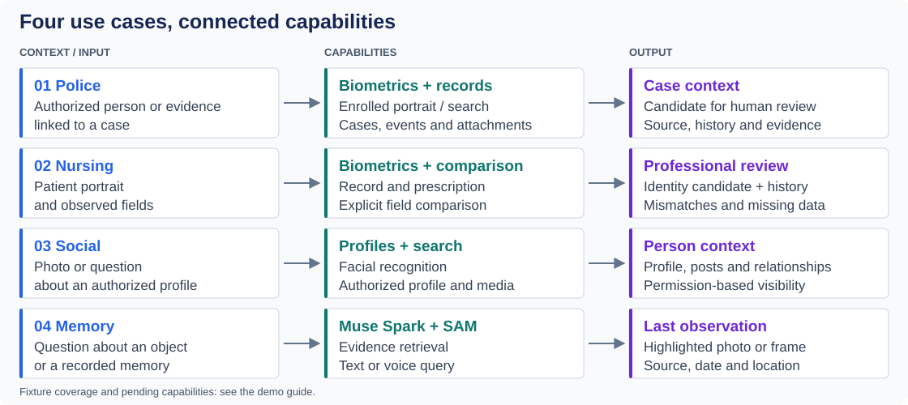
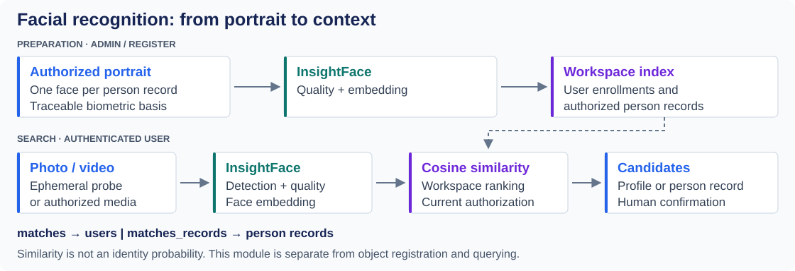
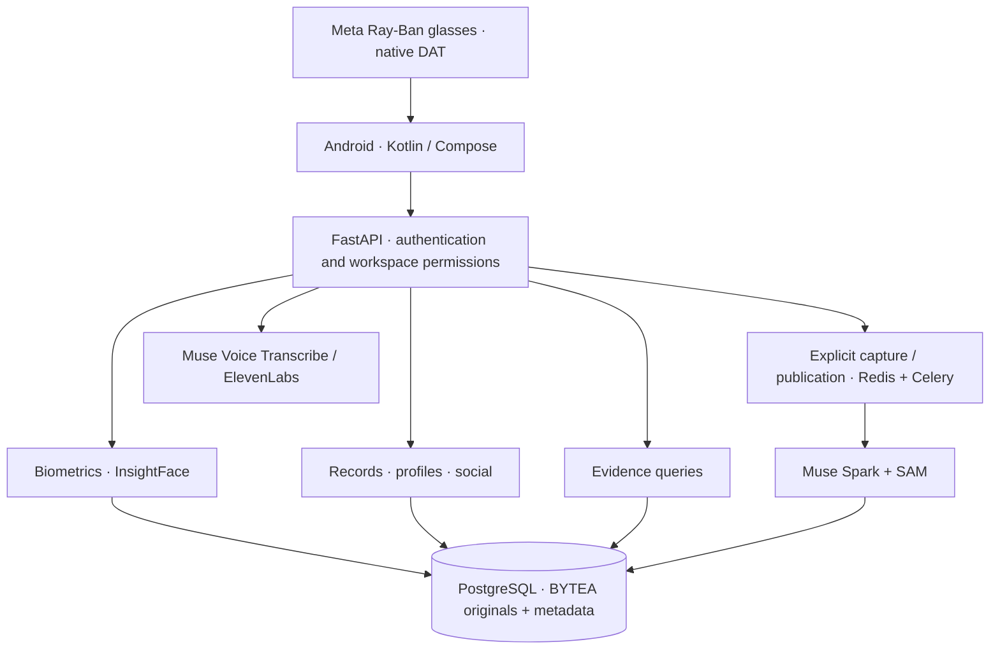

<a id="top"></a>

<p align="center">
  <a href="README.md"></a>
  <a href="README.es.md"></a>
</p>

# RealityOS

**Facial recognition, connected records and visual memory on Android and Meta Ray-Ban glasses.**
Connect a person to their authorized profile or record, query their context, and retrieve evidence about objects and events through photos, video, text or voice.

<p align="center">
  
</p>

<p align="center">
  <a href="#cases"><strong>Use cases</strong></a> · <a href="#biometrics"><strong>Facial recognition</strong></a> · <a href="#evaluate"><strong>Try it</strong></a> · <a href="#architecture"><strong>Architecture</strong></a> · <a href="#hackathon"><strong>Hackathon</strong></a>
</p>

<p align="center">
  <a href="https://github.com/Luxisoft/realityos-spatial-memory/actions/workflows/ci.yml"></a>
  · <a href="LICENSE">Apache 2.0</a> · <a href="README.es.md">Español</a>
</p>

<a id="cases"></a>

## What it solves

During a face-to-face encounter, a person's image, their records and observed events often live in separate places. RealityOS connects these contexts: **who the person might be, what authorized information is available, and what evidence supports the answer**. Facial recognition, records and object retrieval remain distinct modules within one experience.



| Use case | Concrete workflow | Result and current scope |
| --- | --- | --- |
| **Police** | Look up a previously enrolled person and open authorized context; connect cases, events, notes and shift evidence. | Facial candidates and searchable records. The current police fixture exercises cases and objects; enrolled evaluation portraits are in the clinical and memory workspaces. Automatic police alerts remain pending. |
| **Nursing** | Search **Ana Solis** by portrait, confirm identity, open her encounter and prescription; compare the fictional **20 mg** label with the **10 mg** prescription. | Related records and history; field mismatches, validity, allergies and previous administrations. Observed fields are entered explicitly; package OCR and automatic prescribing are not implemented. |
| **Social** | Search an authorized face, open the profile and ask what information or posts the person has shared. | Profile, context and media according to permissions; groups, comments and relationships available in the app. Imported Facebook references have restricted visibility. |
| **Memory** | Open **Luis Moreno's** record or ask “Where were my documents last seen?”. | Related reminders and events; a highlighted photo or frame, source, date and observed location. It does not assert that the object is still there. |

[Step-by-step scenarios and expected results →](docs/DEMO.md)

<a id="biometrics"></a>

## Facial recognition and contextual lookup

**InsightFace compares a probe photo or video with authorized workspace enrollments.** It returns candidates ranked by similarity, with facial evidence, and lets the user open the corresponding user profile or person record.



| Contract | Purpose |
| --- | --- |
| `POST /v1/faces/consent` · `/faces/enroll` | Versioned consent and enrollment of owned media. |
| `POST /v1/faces/record-enroll` | Explicitly enroll a portrait from an authorized person record with a traceable basis. |
| `POST /v1/faces/search` | Search with photo, video or authorized media; uploaded probes are ephemeral. |
| `matches` · `matches_records` | Separate user and person-record results; evidence and links remain permission-scoped. |

Similarity **is not an identity probability**: the professional confirms the candidate. Importing a person does not create a login account or enroll them automatically. This module remains separate from object registration and querying. [Contract and filters →](docs/API.md)

<a id="architecture"></a>

## Architecture and Meta AI integration



| Technology | Product role | Implementation |
| --- | --- | --- |
| **Muse Spark 1.3** | Interprets images and questions, structures visible facts, prepares answers and EN/ES text from authorized context. | [Providers](backend/app/providers/) · [Meta contracts](docs/META_INTEGRATION.md) |
| **SAM 3.1** | Localizes and segments objects; preserves geometry and frame evidence during explicit processing. | [Processing](backend/app/processing/) |
| **Muse Voice Transcribe** | Converts spoken queries into text. | [Meta integration](docs/META_INTEGRATION.md) |
| **Meta Wearables DAT** | Connects glasses camera, voice and native Display to Android. | [Android and glasses](android/README.md) |
| **InsightFace / ElevenLabs** | Local facial recognition / server-side spoken answers. These are independent of Meta's models. | [Face API](docs/API.md) · [TTS](docs/TTS.md) |

The records API imports people, cases, encounters, objects, prescriptions, allergies and administrations through versioned batches, relationships and attachments. HTTPS connectors use an explicit contract. [Data integration →](docs/WORKSPACE_DATA.md)

**Engineering decisions:** PostgreSQL BYTEA originals; workspace checks on every resource; biometric consent; evidence queries that never start capture; server-only provider keys; explicit Live failures and labelled mock output. A restricted Meta gateway provides connection fallback. Android is the only app; the browser panel and web Display are retired.

<a id="evaluate"></a>

## Evaluate the project

1. Download `realityos-android-debug-apk` from a [successful run](https://github.com/Luxisoft/realityos-spatial-memory/actions/workflows/ci.yml), unzip and install. GitHub sign-in may be required. The regular APK targets `https://realityos.luxisoft.com/v1`.
2. Choose **Continue with email** and use an evaluation account with the demo password from your invitation.
3. Select the workspace and follow the [test walkthrough](docs/DEMO.md): face search, record lookup, context and visual evidence.

| Fictional workspace | Account | First scenario |
| --- | --- | --- |
| Pacific Ridge Police Department | `alex-rivera` | Test case 1, notes and shift evidence. |
| California Valley Medical Center | `elena-marquez` | Ana Solis portrait → record → medication comparison. |
| Sonoran Neurological Institute | `noah-brooks` | Luis Moreno → reminder → last evidence of documents. |

The fixture contains **47 records, 27 attachments and six enrolled person portraits**. People and scenes are fictional; the API, storage and Live providers are real. Synthetic MP4s are static scenes. Operators keep demo passwords in the private `.runtime/jury-access.json`; `@jury.example.test` does not receive email. [Synthetic social directory →](simulator/social-directory/README.md)

<a id="watch"></a>

[▶ Police](demo-video/policial_case.mp4) · [▶ Nursing](demo-video/nurse_case.mp4) · [▶ People / social](demo-video/profile_found.mp4) · [▶ Memory](demo-video/memory.mp4)

These videos and the header are conceptual representations; they do not replace a recording of the working app. The HTTP recognition check for Ana Solis is documented; physical phone/glasses validation, real institutional sources and the final recorded demo remain pending. [Verified status →](docs/IMPLEMENTATION_STATUS.md)

<a id="hackathon"></a>

## Meta Global AI Developer Hackathon

The project is presented as **vision-assisted contextual memory**, with real-world workflows and combined Meta model use. Its proposed theme fit is *Build for Your World*; the selected track and team details must match the registration.

| Official criterion | RealityOS evidence |
| --- | --- |
| Impact · 30% | Four concrete workflows connecting people, information and evidence. |
| Meta AI tooling · 25% | Muse Spark + SAM + transcription, each with a distinct role, and DAT as the interface. |
| Technical depth · 20% | API, processing, isolated biometrics, permissions, provenance and automated tests. |
| Demo · 25% | Installable APK, accounts and reproducible walkthrough; the final product recording still needs a link. |

Sources: [event](https://cerebralvalley.ai/e/meta-ai-developer-hackathon) and [official rules](https://cerebralvalley.ai/e/meta-ai-developer-hackathon/waiver), checked November 3, 2026. [Requirements, evidence and submission gaps →](docs/HACKATHON.md)

<a id="install"></a>

## Install and develop

| Android | Server | Independent Windows setup |
| --- | --- | --- |
| [Build and install the APK](android/README.md#build) | [Direct connection](docs/DEPLOYMENT_DIRECT.md) · [gateway](docs/DEPLOYMENT_GATEWAY.md) | [Docker Desktop + local app](docs/DEPLOYMENT_LOCALHOST.md) |

<details>
<summary><strong>Repository map and checks</strong></summary>

| Path | Responsibility |
| --- | --- |
| `backend/` | API, contracts, processing, migrations and biometrics. |
| `android/` | Kotlin/Compose app and native DAT Display. |
| `meta-gateway/` | Allowlisted Meta egress. |
| `simulator/` | Synthetic fixtures and test loaders. |
| `tests/` · `gateway-tests/` | Regression, isolation and OpenAPI contract checks. |

After `make install`:

```bash
make lint
make test
make architecture-check
make android-check
```

</details>

<a id="docs"></a>

[Architecture](docs/ARCHITECTURE.md) · [API](docs/API.md) · [Database](docs/DATABASE.md) · [Security](docs/SECURITY.md) · [Wearables](docs/WEARABLES.md)

[Assets and prompts](docs/assets/readme/PROMPTS.md) · [Format reference: awesome-readme](https://github.com/matiassingers/awesome-readme) · [Apache 2.0](LICENSE) · [↑ Back to top](#top)
