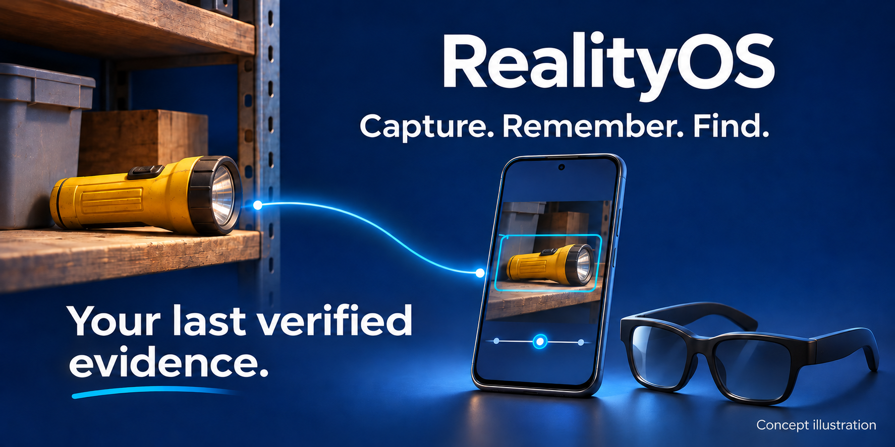
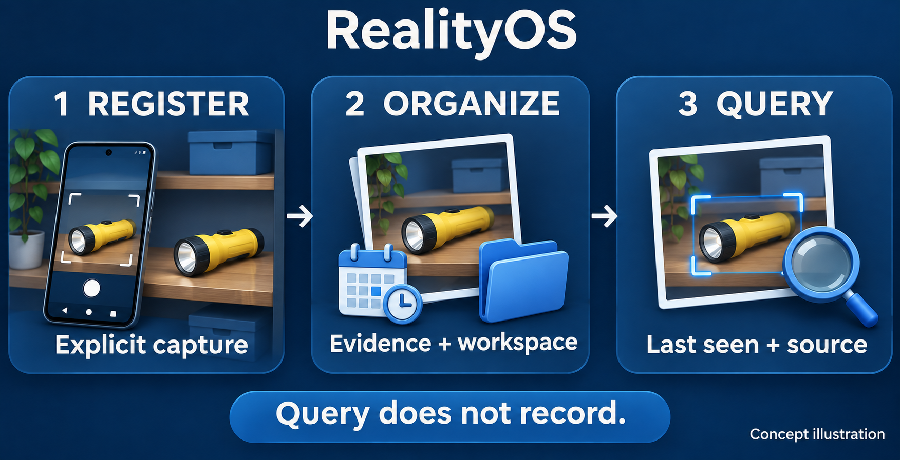
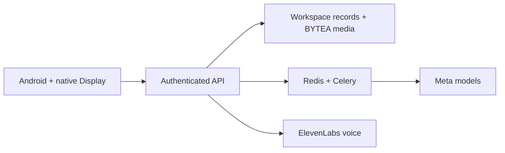

<a id="top"></a>

<p align="center">
  <a href="README.md"></a>
  <a href="README.es.md"></a>
</p>

# RealityOS

**Find the last verified evidence of an object, with a photo, a source and a date.**
An Android app for spatial memory, workspace records and Meta wearable experiences.



<p align="center">
  <a href="#evaluate"><strong>Try the demo</strong></a> ·
  <a href="#watch"><strong>Watch the concepts</strong></a> ·
  <a href="#install"><strong>Install</strong></a> ·
  <a href="#docs"><strong>Explore the docs</strong></a>
</p>

<p align="center">
  <a href="https://github.com/Luxisoft/realityos-spatial-memory/actions/workflows/ci.yml"></a>
  · <a href="LICENSE">Apache 2.0</a> · <a href="README.es.md">Español</a>
</p>

## See how it works



| You do | RealityOS returns |
| --- | --- |
| Register a photo or video intentionally | Original media and traceable observations in your workspace. |
| Ask where an object was last seen | Existing evidence, date, source and visual confidence. |
| Open a workspace record | Authorized notes, relationships and attachments. |
| Use compatible glasses | The native Android DAT capture and query experience. |

**Capture requires consent. Queries read existing evidence. “Last seen” never means “still there.”**
Face search is a separate, explicitly authorized feature; candidates require human confirmation.

<a id="evaluate"></a>

## Try it as an evaluator

| ① Install | ② Sign in | ③ Explore |
| --- | --- | --- |
| Open a successful [CI run](https://github.com/Luxisoft/realityos-spatial-memory/actions/workflows/ci.yml), download `realityos-android-debug-apk`, unzip and install it. GitHub sign-in may be required. | Choose **Continue with email** and use an evaluation account below. | Select a workspace, open a record or search for photographic evidence. |

The regular APK targets `https://realityos.luxisoft.com/v1`. The server URL is selected **at build time**. For localhost, use the separate [Windows guide](docs/DEPLOYMENT_LOCALHOST.md).

| Fictional workspace | Evaluation account | Try this |
| --- | --- | --- |
| Pacific Ridge Police Department | `alex-rivera` | Find the yellow flashlight or red screwdriver. |
| California Valley Medical Center | `elena-marquez` | Open Ana Solis's record; compare the fictional 20 mg medicine label with the 10 mg prescription. |
| Sonoran Neurological Institute | `noah-brooks` | Ask where Luis Moreno's documents were last seen. |

Use the demo passwords supplied with the evaluation invitation. Operators can retrieve them from the private `.runtime/jury-access.json`; service keys stay private. The `@jury.example.test` addresses do not receive email.

<details>
<summary><strong>More accounts and how to interpret the demo</strong></summary>

| Workspace | Other accounts |
| --- | --- |
| Pacific Ridge | `maya-johnson`, `daniel-kim` |
| California Valley | `mateo-rios`, `sarah-chen` |
| Sonoran | `lucia-vega`, `owen-patel` |

People, portraits and scenarios are fictional and labelled `simulated`. Imported people are records, not login accounts. Storage, authorization and processing use the real pipeline. The medication example compares fields; it does not prescribe or record an administration. Photo-to-record matching needs authorized portrait enrollment and the feature's biometric permissions.

</details>

<a id="watch"></a>

## Watch the concepts

| Spatial memory | Person lookup | Clinical scenario | Casework scenario |
| :---: | :---: | :---: | :---: |
| [▶ Play video](demo-video/memory.mp4) | [▶ Play video](demo-video/profile_found.mp4) | [▶ Play video](demo-video/nurse_case.mp4) | [▶ Play video](demo-video/policial_case.mp4) |

The illustrations and videos are conceptual, not app screenshots or proof of hardware validation. See the [verified implementation status](docs/IMPLEMENTATION_STATUS.md).

<a id="install"></a>

## Choose your setup

| Use the hosted app | Run your own server | Run on Windows |
| --- | --- | --- |
| [Android and glasses →](android/README.md) | [Direct Meta connection →](docs/DEPLOYMENT_DIRECT.md) | [Docker Desktop + local Android →](docs/DEPLOYMENT_LOCALHOST.md) |
| Install the Debug APK and use the evaluation accounts. | [Restricted gateway fallback →](docs/DEPLOYMENT_GATEWAY.md) | Independent accounts, data and provider keys. |

**Android is the only app.** The former browser panel and web Display are retired; `/` and `/display/` return HTTP 410. Email verification and reset links remain available. Native Display on the glasses is part of Android.

## What powers it

| Component | Role |
| --- | --- |
| Meta Muse Spark | Understand images and prepare structured, bilingual information. |
| Meta SAM | Segment and track objects during explicit processing or refinement. |
| Meta Muse Voice Transcribe | Transcribe speech into text. |
| ElevenLabs | Synthesize spoken answers on authenticated requests. |
| Local InsightFace | Match explicitly authorized face enrollments. |
| PostgreSQL + Redis/Celery | Keep original media as BYTEA and process work asynchronously. |

Provider keys stay on the server. `META_MODE=mock` is deterministic and visibly simulated; Live failures do not silently become mock results. [Model contracts and processing details →](docs/META_INTEGRATION.md)

<details>
<summary><strong>Architecture, repository map and developer checks</strong></summary>



| Directory | Contents |
| --- | --- |
| [`backend/`](backend/) | API, worker, migrations and provider contracts. |
| [`android/`](android/README.md) | Phone app, native wearables and Debug build. |
| [`meta-gateway/`](meta-gateway/) | Restricted Meta egress. |
| [`simulator/`](simulator/social-directory/README.md) | Synthetic evaluation fixtures. |
| [`infrastructure/`](infrastructure/) | Compose and Nginx configuration. |

After installing development dependencies with `make install`:

```bash
make lint
make test
make architecture-check
```

Build instructions and the single Debug APK path are in the [Android README](android/README.md#build).

</details>

<a id="docs"></a>

## Go deeper

[Architecture](docs/ARCHITECTURE.md) · [REST API](docs/API.md) · [Database](docs/DATABASE.md) · [Workspace records](docs/WORKSPACE_DATA.md) · [Wearables](docs/WEARABLES.md) · [Security](docs/SECURITY.md) · [Validation status](docs/IMPLEMENTATION_STATUS.md)

Technical references retain their own language. The main, Android and fixture READMEs and the installation guides offer an English/Spanish switch.

Layout inspired by [awesome-readme](https://github.com/matiassingers/awesome-readme). [Visual assets and generation prompts](docs/assets/readme/PROMPTS.md) · [Apache License 2.0](LICENSE) · [↑ Back to top](#top)
