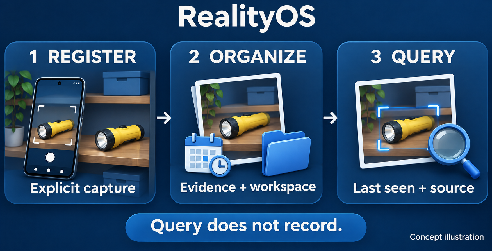

<a id="top"></a>

<p align="center">
  <a href="README.md"></a>
  <a href="README.es.md"></a>
</p>

# RealityOS for Android and glasses

**One Android app, with a native Meta Display experience.**
Capture intentionally, explore workspace records and retrieve the last verified evidence.

[← Project](../README.md) · [Build](#build) · [Phone preview](#preview) · [Real glasses](#glasses) · [Local Windows](../docs/DEPLOYMENT_LOCALHOST.md)



## Choose an experience

| Regular Android app | Debug phone preview | Physical Meta Ray-Ban Display |
| --- | --- | --- |
| Profile, Work, Search and workspace records. | Official Mock Device Kit with the phone's camera and microphone. | Official DAT integration with compatible paired hardware. |
| Sign in with email or Facebook. | Available in the regular Debug build; excluded from Release. | Requires pairing, developer setup and DAT permissions. |

**Android is the only app.** The hosted browser panel and web Display have been retired. The glasses experience remains native to Android.

<a id="build"></a>

## Build and install

Requirements: **Java 21**, **Android SDK 36**, an Android 12+ phone or emulator, and ADB for installation. From the repository root:

```bash
cd android
ANDROID_HOME=/opt/android-sdk ANDROID_SDK_ROOT=/opt/android-sdk ./gradlew :app:assembleDebug
adb install -r app/build/outputs/apk/debug/app-debug.apk
```

The single installable Debug artifact is `android/app/build/outputs/apk/debug/app-debug.apk`. Its build timestamp appears in the version name, not in additional APK filenames.

Alternatively, download `realityos-android-debug-apk` from a successful [CI run](https://github.com/Luxisoft/realityos-spatial-memory/actions/workflows/ci.yml). Artifacts are retained for 14 days and may require GitHub sign-in. Release signing is configured separately.

<details>
<summary><strong>Server URL and private developer configuration</strong></summary>

The API URL is selected at build time: `REALITYOS_API_BASE_URL`, then the `realityosApiBaseUrl` Gradle property, then `https://realityos.luxisoft.com/v1`. It is not an editable account setting.

For local DAT Developer Mode, the ignored `android/local.properties` can contain:

```properties
sdk.dir=/opt/android-sdk
mwdat_application_id=0
mwdat_client_token=0
```

For a Meta release channel, use the Wearables Developer Center values in that private file. Model API keys and RealityOS device credentials remain outside Git and are never placed in this README. Live virtual-device credentials are issued by the server at runtime.

</details>

<a id="preview"></a>

## Try the Display on your phone

| Step | Action |
| --- | --- |
| **1 · Enter** | Install the regular Debug APK, sign in and open Meta Ray-Ban Display. |
| **2 · Preview** | Choose the in-app Display preview and start virtual glasses. The server must use `META_MODE=live` for virtual-device provisioning. |
| **3 · Capture** | Grant camera/audio permission when requested. Phone preview uses real CameraX photos/video and phone speech services. |
| **4 · Query** | Search existing evidence by photo or voice. The result keeps its source and last-seen date. |

The virtual transport simulates glasses; its sensor inputs and authorized server processing are real. Captures are uploaded only after an explicit action. The isolated local Debug variant does not enable automatic virtual-device bootstrap/preview.

<details>
<summary><strong>Chrome SDK preview and camera lifecycle</strong></summary>

If the Debug preview offers Chrome, select it, connect the phone by USB and run the port-forward command displayed by the app:

```bash
adb forward tcp:<port> tcp:<port>
```

Open the displayed localhost URL with Meta Ray-Ban Display Simulator enabled. This is the SDK's local development preview, separate from the retired hosted web Display. Stopping Developer Preview closes its local server.

Search and capture keep the host navigation available. Closing the viewfinder releases sensors; late callbacks must not reopen an old camera session. Pending uploads remain scoped to their account, retain their destinations and use the existing duplicate-confirmation/retry flow.

</details>

<a id="glasses"></a>

## Use physical glasses

1. Have an administrator provision the device identity through the supported setup flow.
2. Pair compatible Meta Ray-Ban Display hardware, enable Meta AI Developer Mode and grant DAT permissions.
3. Register with Meta AI and connect Display to use its native capture, query and evidence screens.

Physical glasses use DAT camera/speech capabilities; the Debug preview uses phone sensors. Spoken responses use the authenticated server speech flow, with audio played on the active phone/Bluetooth route. See the [wearables guide](../docs/WEARABLES.md) for the complete behavior and hardware validation still required.

<details>
<summary><strong>Navigation, evidence viewer and languages</strong></summary>

The phone's bottom navigation groups **Profile / Work / Search**. The drawer provides the Meta Display experience, settings and sign out. Profile contains publications and the private CV; Work contains workspace records.

The evidence viewer keeps the complete image visible and limits its expandable information panel to 45% of the height. Publication date and visual confidence precede title and notes; results are ordered by visual confidence.

English and Spanish information is persisted with publications and reused by search/history. Opening a result reads the prepared information. Older missing text has an explicit preparation/retry flow with a visible pending/error state. The selected language must not silently fall back to another language.

</details>

## Verify a build

From the repository root:

```bash
make android-check
```

With an eligible emulator or device connected, from `android/`:

```bash
./gradlew :app:connectedDebugAndroidTest
./gradlew :app:testDebugUnitTest --tests com.luxisoft.realityos.PhoneCaptureTouchTest
```

Mock Device Kit and Compose/Robolectric tests do not replace physical camera, microphone, Bluetooth or glasses validation. Actual completed checks are recorded in [implementation status](../docs/IMPLEMENTATION_STATUS.md).

## Independent Windows installation

Use [Windows + Docker Desktop](../docs/DEPLOYMENT_LOCALHOST.md). The local build uses `-PlocalDevelopment=true`, loopback HTTP and the separate application ID `com.luxisoft.realityos.local`. It requires the backend to confirm its local realm and uses local password entry. Production and local accounts remain separate; facial features retain their own authorization requirements.

[← Project](../README.md) · [Español](README.es.md) · [↑ Back to top](#top)
