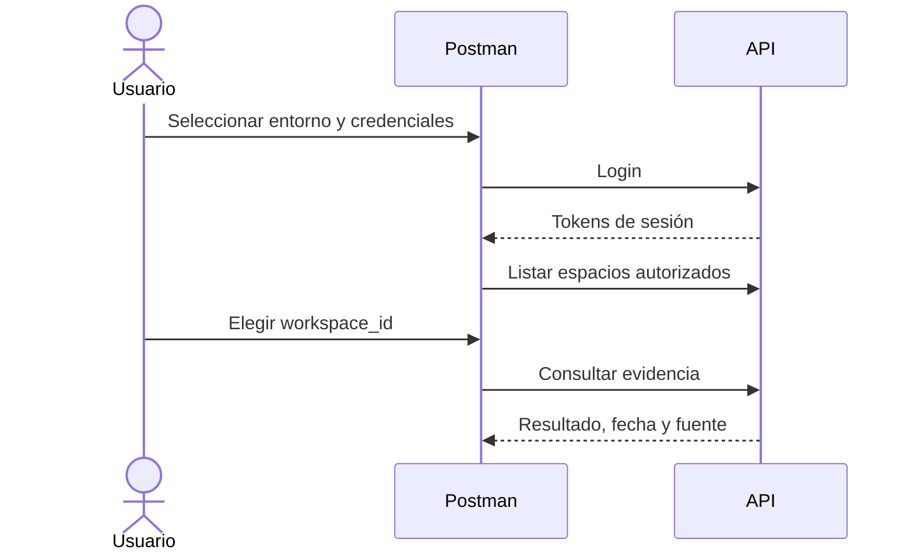

 

# API de RealityOS

**Consulta personas, expedientes y evidencia visual desde tus herramientas.** Esta guía explica qué enviar, qué esperar y cómo comenzar. Los permisos son los mismos que en Android.

[📥 Colección Postman](https://raw.githubusercontent.com/Luxisoft/realityos-spatial-memory/main/docs/postman/RealityOS.postman_collection.json) · [Entorno público](https://raw.githubusercontent.com/Luxisoft/realityos-spatial-memory/main/docs/postman/RealityOS.public.postman_environment.json) · [Entorno local](https://raw.githubusercontent.com/Luxisoft/realityos-spatial-memory/main/docs/postman/RealityOS.local.postman_environment.json) · [Referencia completa](API_REFERENCE.es.md) · [Índice](README.es.md)

## Probar en cinco pasos

| Paso | Acción | Resultado |
| --- | --- | --- |
| 1 | Descarga la colección y un entorno. En Postman, **Import → Files**, selecciona ambos JSON y activa el entorno. | Solicitudes organizadas y variables disponibles. |
| 2 | Completa `email` y `password` localmente. `email` admite también un usuario de evaluación. | Credenciales de tu cuenta confirmada o provisionada. |
| 3 | Ejecuta **00 Inicio rápido → POST /v1/auth/login**. | Guarda `access_token` y `refresh_token` en el entorno tras un acceso correcto. |
| 4 | Ejecuta **GET /v1/workspaces** y copia el ID del espacio que quieres probar a `workspace_id`. | Selección explícita de un espacio al que perteneces. |
| 5 | Envía **POST /v1/queries** con tu pregunta. | Evidencia existente o resultado sin coincidencia; no inicia una captura. |

El registro público requiere confirmar el correo. Las cuentas ficticias del jurado se provisionan por administración: no reciben correo en `example.test`. Solicita la contraseña demo de tu invitación; no uses claves del proveedor como contraseña.

## Qué operación necesito

| Quiero… | Solicitud | Qué obtengo / necesito |
| --- | --- | --- |
| Verificar disponibilidad | `GET /health/live` · `GET /health/ready` | Estado del proceso y disponibilidad de la base de datos. |
| Acceder o renovar sesión | `POST /v1/auth/login` · `/v1/auth/refresh` | Tokens; la renovación rota el refresh token anterior. |
| Elegir organización | `GET /v1/workspaces` | IDs y rol de mis espacios. |
| Buscar un rostro | `POST /v1/faces/search` | Candidatos `matches` y `matches_records`; requiere autorización y enrolamientos previos. |
| Abrir un expediente | `GET /v1/workspaces/{workspace_id}/records/{record_id}` | Datos, fuente y relaciones autorizados. |
| Consultar expedientes | `POST /v1/workspaces/{workspace_id}/records/search` | Respuesta contextual con referencias permitidas. |
| Encontrar un objeto | `POST /v1/queries` · `/v1/queries/image` · `/v1/queries/audio` | Última evidencia observada, no ubicación actual garantizada. |
| Registrar evidencia | `POST /v1/sessions` → `/v1/captures` → `/v1/captures/{capture_id}/process` | Original guardado y trabajo de análisis; requiere rol y sesión consentida. |
| Ver progreso | `GET /v1/jobs/{job_id}` | Estado del trabajo solicitado; no confundir 202 con trabajo terminado. |
| Consultar un perfil | `GET /v1/profiles/{user_id}` | Proyección visible; no devuelve el archivo privado de CV. |
| Importar datos propios | `POST /v1/integrations/imports` | Lote versionado e idempotente con clave de integración. |
| Escuchar una respuesta | `POST /v1/tts` | WAV de ElevenLabs; requiere autenticación y consume proveedor. |

[Todos los métodos, campos y respuestas declaradas →](API_REFERENCE.es.md)

## Servidor y autenticación

| Variable / acceso | Uso |
| --- | --- |
| `base_url` | `https://realityos.luxisoft.com` o `http://localhost:8080`; **sin `/v1` final**, porque cada solicitud ya contiene su ruta. |
| `email`, `password` | Solo en tu entorno local de Postman. |
| `access_token`, `refresh_token` | Se actualizan tras login/renovación; no exportarlos a Git. |
| `workspace_id` y demás IDs | Copiarlos de respuestas autorizadas; la colección no inventa pertenencia ni elige el primer espacio. |
| Bearer | `Authorization: Bearer {{access_token}}` para usuarios. |
| Dispositivo | `X-RealityOS-Device-ID` y `X-RealityOS-Device-Key`; se obtienen al provisionar el dispositivo. |
| Integración | `X-RealityOS-Integration-Key`; se entrega al crear una conexión autorizada. |
| Enlace firmado | Contiene un token temporal para un recurso concreto; no sirve como sesión general. |

El entorno local presupone una instalación Windows ya preparada con credenciales propias. Las rutas de la carpeta **Solo instalación local** no existen en producción. [Instalar Windows](DEPLOYMENT_LOCALHOST.es.md).

## Archivos, ejemplos y ejecución

- En **Body → form-data**, selecciona tu archivo en el campo de tipo File. Activa el campo si es opcional y desactivado. Postman añade el `Content-Type` multipart y su boundary.
- Consulta por imagen: JPEG/PNG/WebP; consulta de voz: WAV. Capturas admiten imagen y video conforme al contrato. Los CV aceptan PDF/DOCX.
- Los cuerpos incluidos son plantillas sintéticas: completa los campos y sustituye IDs antes de enviar. Para un rostro, selecciona una foto/video autorizado o un medio existente; una imagen de enrolamiento repetida solo prueba integración.
- Las escrituras se omiten mientras `enable_write_requests=false`. Actívalo explícitamente para una prueba de captura, enrolamiento o administración. Ejecuta primero una solicitud individual; ejecutar toda la colección incluye operaciones de alta, revocación y borrado.
- Consultas con IA, transcripción y voz pueden consumir proveedores aunque no creen evidencia. La colección no hace llamadas por el mero hecho de importarla.
- Un 200 puede contener `found=false`, resultados parciales o `simulated`. Revisa el cuerpo, la fuente y la fecha. La similitud facial no es probabilidad de identidad.

## Resolver problemas

| Resultado | Qué revisar |
| --- | --- |
| 401 | Sesión ausente, vencida o revocada; renovar o iniciar sesión. |
| 403 | Rol, pertenencia o consentimiento insuficiente; otra credencial no amplía tus permisos. |
| 404 | ID/ruta inexistente, recurso no accesible o ruta local usada en producción. |
| 409 | Conflicto de versión, duplicado o clave idempotente reutilizada con otro contenido. |
| 422 | Campos, formato, límites o calidad del archivo; leer `detail`. |
| 429 | Límite de solicitudes o intentos; respetar la espera indicada. |
| 5xx / trabajo fallido | Disponibilidad del servicio/proveedor; revisar el trabajo antes de repetir una operación con coste. |

## Contrato y mantenimiento

[Swagger interactivo](https://realityos.luxisoft.com/docs) · [OpenAPI](https://realityos.luxisoft.com/v1/openapi.json) · [Contrato versionado](../tests/contracts/openapi.json) · [Datos e importaciones](WORKSPACE_DATA.es.md)

Regenera la referencia y Postman con `python scripts/build_api_docs.py`; verifica diferencias con `python scripts/build_api_docs.py --check`. La colección usa el [formato oficial v2.1](https://schema.postman.com/); la [guía de importación](https://learning.postman.com/docs/getting-started/importing-and-exporting/importing-data/) explica el flujo de Postman. Las notas originales permanecen en [referencia histórica](reference/API.legacy.md).

Prueba offline de scripts: `node scripts/check_postman_scripts.cjs`.
