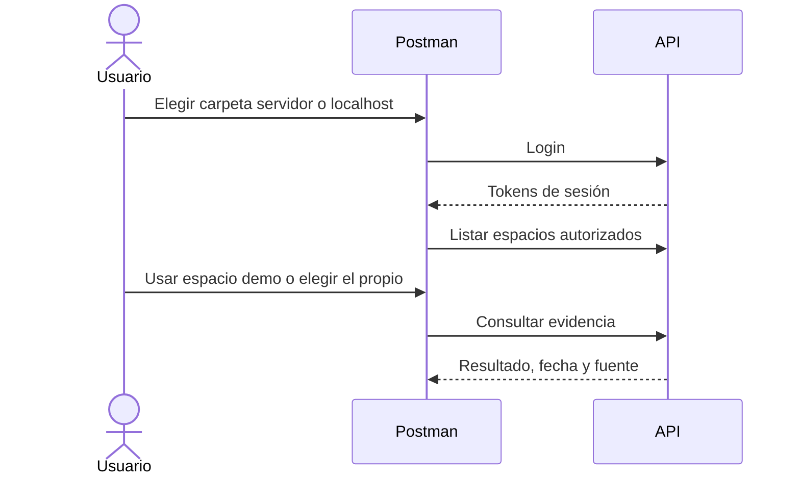

 

# API de RealityOS

**Consulta personas, expedientes y evidencia visual desde tus herramientas.** Esta guía explica qué enviar, qué esperar y cómo comenzar. Los permisos son los mismos que en Android.

[📥 Colección Postman](https://raw.githubusercontent.com/Luxisoft/realityos-spatial-memory/main/docs/postman/RealityOS.postman_collection.json) · [Entorno público](https://raw.githubusercontent.com/Luxisoft/realityos-spatial-memory/main/docs/postman/RealityOS.public.postman_environment.json) · [Entorno local](https://raw.githubusercontent.com/Luxisoft/realityos-spatial-memory/main/docs/postman/RealityOS.local.postman_environment.json) · [Referencia completa](API_REFERENCE.es.md) · [Índice](README.es.md)

## Probar con la cuenta incluida

1. Descarga e importa **RealityOS.postman_collection.json**. El archivo incluye todas las variables: no necesitas importar un entorno ni copiar credenciales para la demo.
2. Abre **Consultas servidor → 00 Quick start / Inicio rápido** y ejecuta esa subcarpeta con **Run**. Hace login, guarda los tokens, consulta tu usuario, lista los espacios y envía una consulta al espacio demo.
3. Para localhost, inicia tu instalación y ejecuta una sola vez `powershell.exe -NoProfile -ExecutionPolicy Bypass -File .\scripts\local\Enable-PostmanDemo.ps1`. Después ejecuta **Consultas localhost → 00 Quick start / Inicio rápido**. Este paso crea una cuenta local independiente; no copia cuentas ni claves del servidor.

| Configuración incluida | Consultas servidor | Consultas localhost |
| --- | --- | --- |
| URL | `https://realityos.luxisoft.com` | `http://localhost:8080` |
| Prefijo de variables | `server_` | `localhost_` |
| Cuenta pública de prueba | `postman-demo@realityos.example.test` | `postman-local@realityos.example.test` |
| Contraseña pública de prueba | `RealityOS-Postman-Demo-2026!` | `RealityOS-Postman-Local-2026!` |
| Espacio | Postman Demo - public test workspace | Postman Demo - localhost test workspace |
| Rol en ese espacio | Consulta, sin administración ni captura | Consulta, sin administración ni captura |

Los IDs de usuario y espacio ya están configurados. El espacio demo está vacío y una consulta puede devolver que no hay coincidencias; no se inventa evidencia. Las cuentas son compartidas y sus contraseñas están publicadas expresamente para esta demo. Las rutas de escritura, dispositivos, integración y recursos existentes requieren una cuenta con los permisos correspondientes y los IDs/archivos de esa cuenta.

Para usar una cuenta propia, edita **Collection → Variables**: cambia `server_email`, `server_password` y `server_workspace_id` (o sus equivalentes `localhost_`), vacía los tokens anteriores y vuelve a ejecutar login. Copia el nuevo espacio de `GET /v1/workspaces`. Los entornos descargables son opcionales y contienen el mismo conjunto de variables de cada destino; si activas uno, edita sus valores porque prevalecen sobre los de la colección. Los tokens reales se guardan después del login, nunca se publican en el JSON de GitHub. Consulta el [alcance de variables de Postman](https://learning.postman.com/docs/sending-requests/variables/variables/).

El registro de cuentas propias requiere confirmar un correo real. La cuenta demo provisionada no necesita confirmación y `example.test` no recibe correos.

## Qué operación necesito

| Quiero… | Solicitud | Qué obtengo / necesito |
| --- | --- | --- |
| Verificar disponibilidad | `GET /health/live` · `GET /health/ready` | Estado del proceso y disponibilidad de la base de datos. |
| Acceder o renovar sesión | `POST /v1/auth/login` · `/v1/auth/refresh` | Tokens; la renovación rota el refresh token anterior. |
| Elegir organización | `GET /v1/workspaces` | IDs y rol de mis espacios. |
| Buscar un rostro | `POST /v1/faces/search` | Candidatos `matches` y `matches_records`; requiere autorización y enrolamientos previos. |
| Abrir un expediente | `GET /v1/workspaces/{workspace_id}/records/{record_id}` | Datos, fuente y relaciones autorizados. |
| Consultar expedientes | `POST /v1/workspaces/{workspace_id}/records/search` | Respuesta contextual con referencias permitidas. |
| Encontrar un objeto | `POST /v1/queries` · `/v1/queries/image` · `/v1/queries/audio` | Última evidencia observada, no ubicación actual garantizada. |
| Registrar evidencia | `POST /v1/sessions` → `/v1/captures` → `/v1/captures/{capture_id}/process` | Original guardado y trabajo de análisis; requiere rol y sesión consentida. |
| Ver progreso | `GET /v1/jobs/{job_id}` | Estado del trabajo solicitado; no confundir 202 con trabajo terminado. |
| Consultar un perfil | `GET /v1/profiles/{user_id}` | Proyección visible; no devuelve el archivo privado de CV. |
| Importar datos propios | `POST /v1/integrations/imports` | Lote versionado e idempotente con clave de integración. |
| Escuchar una respuesta | `POST /v1/tts` | WAV de ElevenLabs; requiere autenticación y consume proveedor. |

[Todos los métodos, campos y respuestas declaradas →](API_REFERENCE.es.md)

## Variables y autenticación

Todas las variables llevan `server_` o `localhost_`. Cada carpeta referencia exclusivamente su prefijo, incluidos tokens, IDs y controles de escritura. Las rutas locales adicionales solo aparecen dentro de **Consultas localhost → Solo instalación local**.

| Variable (añadir el prefijo) | Valor o uso |
| --- | --- |
| `base_url` | URL preconfigurada, sin `/v1`. Si cambias `LOCAL_HTTP_PORT`, actualiza `localhost_base_url`. |
| `email`, `username`, `password`, `display_name` | Cuenta demo preconfigurada; sustituibles por tu cuenta. |
| `access_token`, `refresh_token` | Se guardan por destino después de login y renovación correctos, incluso sin entorno activo. |
| `user_id`, `workspace_id` | IDs de la cuenta y espacio demo; se mantienen separados por destino. |
| `query`, `language` | Pregunta de ejemplo e idioma (`en` o `es`), editables. |
| `new_email`, `new_password` | Destino nuevo o contraseña nueva para corregir/recuperar una cuenta propia; no reemplazan las credenciales actuales. |
| Otros IDs | Declarados y descritos; completar con respuestas autorizadas. No hay IDs ficticios de medios o expedientes inexistentes. |
| `device_id`, `device_key`, `integration_key`, `facebook_access_token`, `token` | Se obtienen al provisionar el dispositivo/integración, iniciar Facebook o recibir un enlace; no son credenciales de la demo. |
| `enable_write_requests` | `false` inicialmente; el control es independiente por destino. |

[Preparar la instalación Windows](DEPLOYMENT_LOCALHOST.es.md). La colección no instala el backend local.

## Archivos, ejemplos y ejecución

- En **Body → form-data**, selecciona tu archivo en el campo de tipo File. Activa el campo si es opcional y desactivado. Postman añade el `Content-Type` multipart y su boundary.
- Consulta por imagen: JPEG/PNG/WebP; consulta de voz: WAV. Capturas admiten imagen y video conforme al contrato. Los CV aceptan PDF/DOCX.
- Los cuerpos incluidos son plantillas sintéticas: completa los campos y sustituye IDs antes de enviar. Para un rostro, selecciona una foto/video autorizado o un medio existente; una imagen de enrolamiento repetida solo prueba integración.
- Las escrituras se omiten mientras `server_enable_write_requests=false` / `localhost_enable_write_requests=false`. Actívalo explícitamente para una prueba de captura, enrolamiento o administración. Ejecuta primero una solicitud individual; ejecutar toda la colección incluye operaciones de alta, revocación y borrado.
- Consultas con IA, transcripción y voz pueden consumir proveedores aunque no creen evidencia. La colección no hace llamadas por el mero hecho de importarla.
- Un 200 puede contener `found=false`, resultados parciales o `simulated`. Revisa el cuerpo, la fuente y la fecha. La similitud facial no es probabilidad de identidad.

## Resolver problemas

| Resultado | Qué revisar |
| --- | --- |
| 401 | Sesión ausente, vencida o revocada; renovar o iniciar sesión. |
| 403 | Rol, pertenencia o consentimiento insuficiente; otra credencial no amplía tus permisos. |
| 404 | ID/ruta inexistente, recurso no accesible o ruta local usada en producción. |
| 409 | Conflicto de versión, duplicado o clave idempotente reutilizada con otro contenido. |
| 422 | Campos, formato, límites o calidad del archivo; leer `detail`. |
| 429 | Límite de solicitudes o intentos; respetar la espera indicada. |
| 5xx / trabajo fallido | Disponibilidad del servicio/proveedor; revisar el trabajo antes de repetir una operación con coste. |

## Contrato y mantenimiento

[Swagger interactivo](https://realityos.luxisoft.com/docs) · [OpenAPI](https://realityos.luxisoft.com/v1/openapi.json) · [Contrato versionado](../tests/contracts/openapi.json) · [Datos e importaciones](WORKSPACE_DATA.es.md)

Regenera la referencia y Postman con `python scripts/build_api_docs.py`; verifica diferencias con `python scripts/build_api_docs.py --check`. La colección usa el [formato oficial v2.1](https://schema.postman.com/); la [guía de importación](https://learning.postman.com/docs/getting-started/importing-and-exporting/importing-data/) explica el flujo de Postman. Las notas originales permanecen en [referencia histórica](reference/API.legacy.md).

Prueba offline de scripts: `node scripts/check_postman_scripts.cjs`.
