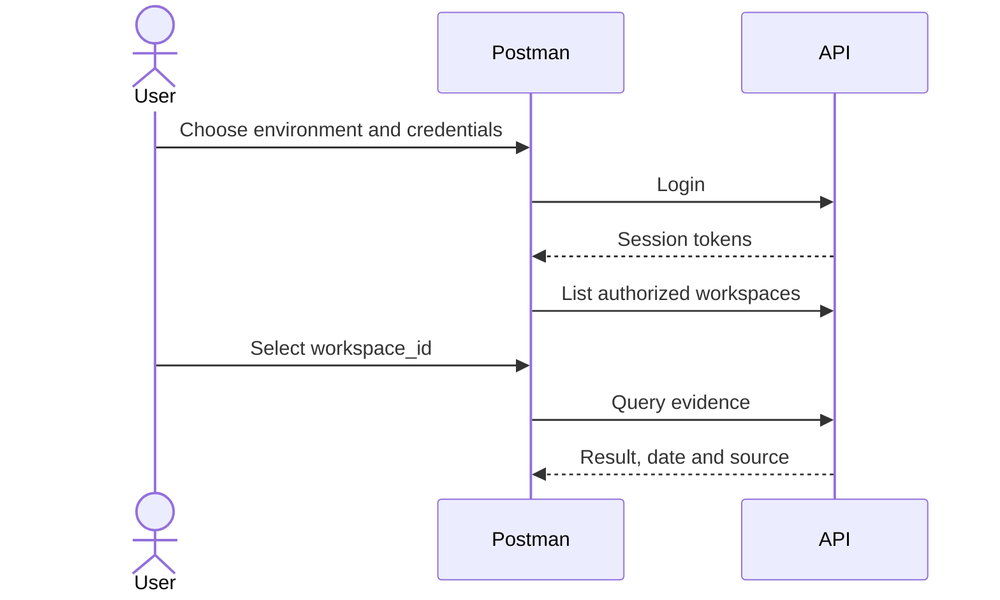

 

# RealityOS API

**Query people, records and visual evidence from your own tools.** This guide explains what to send, what to expect and how to begin. Permissions are the same as in Android.

[📥 Postman collection](https://raw.githubusercontent.com/Luxisoft/realityos-spatial-memory/main/docs/postman/RealityOS.postman_collection.json) · [Public environment](https://raw.githubusercontent.com/Luxisoft/realityos-spatial-memory/main/docs/postman/RealityOS.public.postman_environment.json) · [Local environment](https://raw.githubusercontent.com/Luxisoft/realityos-spatial-memory/main/docs/postman/RealityOS.local.postman_environment.json) · [Full reference](API_REFERENCE.md) · [Documentation index](README.md)

## Start in five steps

| Step | Action | Result |
| --- | --- | --- |
| 1 | Download the collection and one environment. In Postman, choose **Import → Files**, import both JSON files and select the environment. | Organized requests and environment variables. |
| 2 | Enter `email` and `password` locally. The `email` field also accepts an evaluation username. | Your confirmed or provisioned account credentials. |
| 3 | Run **00 Quick start → POST /v1/auth/login**. | Saves `access_token` and `refresh_token` after a successful login. |
| 4 | Run **GET /v1/workspaces** and copy the chosen workspace ID into `workspace_id`. | Explicit selection of a workspace you belong to. |
| 5 | Send **POST /v1/queries** with your question. | Existing evidence or no match; this does not start capture. |

Public registration requires email confirmation. Evaluator accounts are provisioned by an administrator: fictional `example.test` addresses do not receive mail. Use the demo password from your invitation; provider keys are not account passwords.

## Choose an operation

| I want to… | Request | Result / requirement |
| --- | --- | --- |
| Check availability | `GET /health/live` · `GET /health/ready` | Process health and database readiness. |
| Sign in or renew | `POST /v1/auth/login` · `/v1/auth/refresh` | Session tokens; refresh rotates the previous refresh token. |
| Choose an organization | `GET /v1/workspaces` | My workspace IDs and roles. |
| Search a face | `POST /v1/faces/search` | `matches` and `matches_records` candidates; requires authorization and prior enrollments. |
| Open a record | `GET /v1/workspaces/{workspace_id}/records/{record_id}` | Authorized data, source and relationships. |
| Query records | `POST /v1/workspaces/{workspace_id}/records/search` | Contextual answer with permitted references. |
| Find an object | `POST /v1/queries` · `/v1/queries/image` · `/v1/queries/audio` | Last-observed evidence, not a guaranteed current location. |
| Register evidence | `POST /v1/sessions` → `/v1/captures` → `/v1/captures/{capture_id}/process` | Stored original and analysis job; requires a role and consented session. |
| Check progress | `GET /v1/jobs/{job_id}` | Requested job status; 202 does not mean processing is complete. |
| Read a profile | `GET /v1/profiles/{user_id}` | Visible projection; never the private CV file. |
| Import my data | `POST /v1/integrations/imports` | Versioned, idempotent batch using an integration key. |
| Hear an answer | `POST /v1/tts` | ElevenLabs WAV; requires authentication and uses a provider. |

[All methods, fields and declared responses →](API_REFERENCE.md)

## Server and authentication

| Variable / access | Usage |
| --- | --- |
| `base_url` | `https://realityos.luxisoft.com` or `http://localhost:8080`; **no trailing `/v1`**, as requests already include their paths. |
| `email`, `password` | Enter only in your local Postman environment. |
| `access_token`, `refresh_token` | Updated after login/refresh; never export them to Git. |
| `workspace_id` and other IDs | Copy authorized response IDs; the collection neither grants membership nor selects the first workspace. |
| Bearer | `Authorization: Bearer {{access_token}}` for users. |
| Device | `X-RealityOS-Device-ID` and `X-RealityOS-Device-Key`, obtained when provisioning a device. |
| Integration | `X-RealityOS-Integration-Key`, issued when creating an authorized connection. |
| Signed link | A temporary token for one resource, not a general session. |

The local environment assumes an existing Windows installation with your own credentials. **Local installation only** routes do not exist in production. [Install on Windows](DEPLOYMENT_LOCALHOST.md).

## Files, examples and execution

- In **Body → form-data**, choose your file in the File field. Enable it if it is optional and disabled. Postman supplies the multipart `Content-Type` and boundary.
- Image queries: JPEG/PNG/WebP; audio queries: WAV. Captures accept images and video according to the contract. CV uploads accept PDF/DOCX.
- Included bodies are synthetic templates: complete fields and replace IDs before sending. For face search, choose an authorized photo/video or existing media; reusing an enrollment photo tests integration only.
- Writes are skipped while `enable_write_requests=false`. Explicitly enable it for capture, enrollment or administration tests. Start with individual requests; running the entire collection includes creation, revocation and deletion operations.
- AI queries, transcription and speech can use provider credits even when they do not create evidence. Importing the collection sends no requests.
- A 200 may contain `found=false`, partial results or `simulated`. Inspect the body, source and date. Facial similarity is not identity probability.

## Troubleshooting

| Result | Check |
| --- | --- |
| 401 | Missing, expired or revoked session; refresh or sign in. |
| 403 | Insufficient role, membership or consent; another credential does not grant additional permission. |
| 404 | Unknown ID/route, inaccessible resource or a local route used in production. |
| 409 | Version conflict, duplicate or idempotency key reused with different content. |
| 422 | Fields, format, limits or file quality; read `detail`. |
| 429 | Request or attempt limit; respect the indicated delay. |
| 5xx / failed job | Service/provider availability; inspect job state before repeating a billable operation. |

## Contract and maintenance

[Interactive Swagger](https://realityos.luxisoft.com/docs) · [OpenAPI](https://realityos.luxisoft.com/v1/openapi.json) · [Versioned contract](../tests/contracts/openapi.json) · [Data imports](WORKSPACE_DATA.md)

Regenerate the reference and Postman with `python scripts/build_api_docs.py`; detect drift with `python scripts/build_api_docs.py --check`. The collection uses the [official v2.1 format](https://schema.postman.com/); see Postman's [import guide](https://learning.postman.com/docs/getting-started/importing-and-exporting/importing-data/). Original notes remain in the [historical reference](reference/API.legacy.md).

Offline script checks: `node scripts/check_postman_scripts.cjs`.
