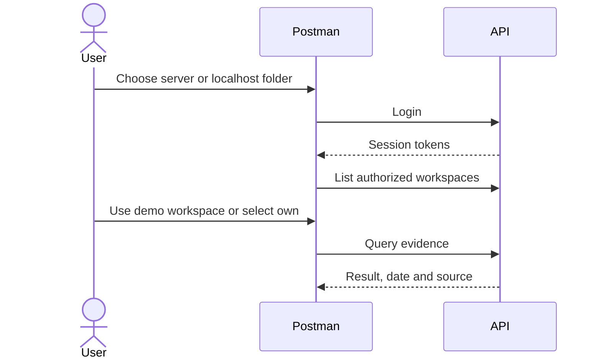

 

# RealityOS API

**Query people, records and visual evidence from your own tools.** This guide explains what to send, what to expect and how to begin. Permissions are the same as in Android.

[📥 Postman collection](https://raw.githubusercontent.com/Luxisoft/realityos-spatial-memory/main/docs/postman/RealityOS.postman_collection.json) · [Public environment](https://raw.githubusercontent.com/Luxisoft/realityos-spatial-memory/main/docs/postman/RealityOS.public.postman_environment.json) · [Local environment](https://raw.githubusercontent.com/Luxisoft/realityos-spatial-memory/main/docs/postman/RealityOS.local.postman_environment.json) · [Full reference](API_REFERENCE.md) · [Documentation index](README.md)

## Try the included account

1. Download and import **RealityOS.postman_collection.json**. All variables are included: no environment import or credential copying is needed for the demo.
2. Open **Consultas servidor → 00 Quick start / Inicio rápido** and **Run** that subfolder. It logs in, saves tokens, reads your user, lists workspaces and submits a query to the demo workspace.
3. For localhost, start your installation and run `powershell.exe -NoProfile -ExecutionPolicy Bypass -File .\scripts\local\Enable-PostmanDemo.ps1` once. Then run **Consultas localhost → 00 Quick start / Inicio rápido**. Setup creates an independent local account; it does not copy server accounts or keys.

| Included setting | Consultas servidor | Consultas localhost |
| --- | --- | --- |
| URL | `https://realityos.luxisoft.com` | `http://localhost:8080` |
| Variable prefix | `server_` | `localhost_` |
| Public test account | `postman-demo@realityos.example.test` | `postman-local@realityos.example.test` |
| Public test password | `RealityOS-Postman-Demo-2026!` | `RealityOS-Postman-Local-2026!` |
| Workspace | Postman Demo - public test workspace | Postman Demo - localhost test workspace |
| Role in that workspace | Query, without administration or capture | Query, without administration or capture |

User and workspace IDs are preconfigured. The demo workspace is empty, so a query may return no matches; it does not fabricate evidence. These shared accounts and passwords are intentionally public for this demo. Write, device, integration and existing-resource operations require an account with the corresponding permissions and that account's IDs/files.

To use your own account, edit **Collection → Variables**: replace `server_email`, `server_password` and `server_workspace_id` (or the `localhost_` equivalents), clear previous tokens and log in again. Copy your workspace from `GET /v1/workspaces`. Downloadable environments are optional and contain the same variables for each target; when one is active, edit its values because they override collection values. Real tokens are saved after login and never published in the GitHub JSON. See [Postman's variable scopes](https://learning.postman.com/docs/sending-requests/variables/variables/).

Your own public registration requires a real confirmation email. The provisioned demo account needs no confirmation; `example.test` does not receive mail.

## Choose an operation

| I want to… | Request | Result / requirement |
| --- | --- | --- |
| Check availability | `GET /health/live` · `GET /health/ready` | Process health and database readiness. |
| Sign in or renew | `POST /v1/auth/login` · `/v1/auth/refresh` | Session tokens; refresh rotates the previous refresh token. |
| Choose an organization | `GET /v1/workspaces` | My workspace IDs and roles. |
| Search a face | `POST /v1/faces/search` | `matches` and `matches_records` candidates; requires authorization and prior enrollments. |
| Open a record | `GET /v1/workspaces/{workspace_id}/records/{record_id}` | Authorized data, source and relationships. |
| Query records | `POST /v1/workspaces/{workspace_id}/records/search` | Contextual answer with permitted references. |
| Find an object | `POST /v1/queries` · `/v1/queries/image` · `/v1/queries/audio` | Last-observed evidence, not a guaranteed current location. |
| Register evidence | `POST /v1/sessions` → `/v1/captures` → `/v1/captures/{capture_id}/process` | Stored original and analysis job; requires a role and consented session. |
| Check progress | `GET /v1/jobs/{job_id}` | Requested job status; 202 does not mean processing is complete. |
| Read a profile | `GET /v1/profiles/{user_id}` | Visible projection; never the private CV file. |
| Import my data | `POST /v1/integrations/imports` | Versioned, idempotent batch using an integration key. |
| Hear an answer | `POST /v1/tts` | ElevenLabs WAV; requires authentication and uses a provider. |

[All methods, fields and declared responses →](API_REFERENCE.md)

## Variables and authentication

Every variable starts with `server_` or `localhost_`. Each folder exclusively references its prefix, including tokens, IDs and write controls. Additional local routes only appear under **Consultas localhost → Local installation only**.

| Variable (add the prefix) | Value or purpose |
| --- | --- |
| `base_url` | Preconfigured origin without `/v1`. If you change `LOCAL_HTTP_PORT`, update `localhost_base_url`. |
| `email`, `username`, `password`, `display_name` | Preconfigured demo account; replace with your own account if needed. |
| `access_token`, `refresh_token` | Saved per target after successful login/refresh, even without an active environment. |
| `user_id`, `workspace_id` | Demo account and workspace IDs; independent per target. |
| `query`, `language` | Editable example question and language (`en` or `es`). |
| `new_email`, `new_password` | New address/password for correcting or recovering your own account; distinct from current credentials. |
| Other IDs | Declared and described; fill from authorized responses. No invented IDs for nonexistent media or records. |
| `device_id`, `device_key`, `integration_key`, `facebook_access_token`, `token` | Issued by device/integration provisioning, Facebook login or an action link; not demo credentials. |
| `enable_write_requests` | Initially `false`; independent per target. |

[Prepare the Windows installation](DEPLOYMENT_LOCALHOST.md). The collection does not install the local backend.

## Files, examples and execution

- In **Body → form-data**, choose your file in the File field. Enable it if it is optional and disabled. Postman supplies the multipart `Content-Type` and boundary.
- Image queries: JPEG/PNG/WebP; audio queries: WAV. Captures accept images and video according to the contract. CV uploads accept PDF/DOCX.
- Included bodies are synthetic templates: complete fields and replace IDs before sending. For face search, choose an authorized photo/video or existing media; reusing an enrollment photo tests integration only.
- Writes are skipped while `server_enable_write_requests=false` / `localhost_enable_write_requests=false`. Explicitly enable it for capture, enrollment or administration tests. Start with individual requests; running the entire collection includes creation, revocation and deletion operations.
- AI queries, transcription and speech can use provider credits even when they do not create evidence. Importing the collection sends no requests.
- A 200 may contain `found=false`, partial results or `simulated`. Inspect the body, source and date. Facial similarity is not identity probability.

## Troubleshooting

| Result | Check |
| --- | --- |
| 401 | Missing, expired or revoked session; refresh or sign in. |
| 403 | Insufficient role, membership or consent; another credential does not grant additional permission. |
| 404 | Unknown ID/route, inaccessible resource or a local route used in production. |
| 409 | Version conflict, duplicate or idempotency key reused with different content. |
| 422 | Fields, format, limits or file quality; read `detail`. |
| 429 | Request or attempt limit; respect the indicated delay. |
| 5xx / failed job | Service/provider availability; inspect job state before repeating a billable operation. |

## Contract and maintenance

[Interactive Swagger](https://realityos.luxisoft.com/docs) · [OpenAPI](https://realityos.luxisoft.com/v1/openapi.json) · [Versioned contract](../tests/contracts/openapi.json) · [Data imports](WORKSPACE_DATA.md)

Regenerate the reference and Postman with `python scripts/build_api_docs.py`; detect drift with `python scripts/build_api_docs.py --check`. The collection uses the [official v2.1 format](https://schema.postman.com/); see Postman's [import guide](https://learning.postman.com/docs/getting-started/importing-and-exporting/importing-data/). Original notes remain in the [historical reference](reference/API.legacy.md).

Offline script checks: `node scripts/check_postman_scripts.cjs`.
