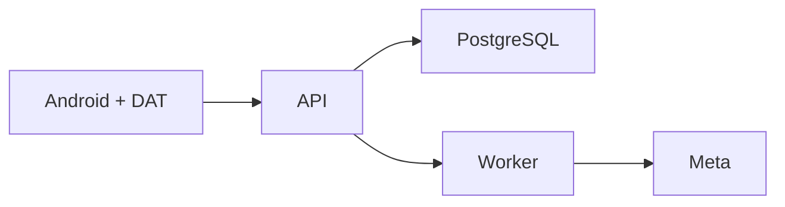

<p align="center"><a href="ARCHITECTURE.md"></a> <a href="ARCHITECTURE.es.md"></a></p>

# Arquitectura

[← Documentación](README.es.md) · [API / Postman](API.es.md)

## Guía de lectura

| Tema | Qué debes saber |
| --- | --- |
| **Cliente** | Android Kotlin/Compose y Display nativo DAT; panel web y Display web retirados. |
| **API** | FastAPI aplica autenticación, roles y pertenencia. API y worker comparten contratos y modelos SQLAlchemy. |
| **Memoria visual** | Captura explícita → original BYTEA → Celery/Redis → hechos y evidencia. Consultar no inicia captura ni procesamiento. |
| **Biometría** | Brazo aislado InsightFace: consentimiento, enrolamientos, candidatos y contexto autorizado. No se mezcla con procesamiento de objetos. |
| **Módulos** | `app.http`, `app.providers`, `app.processing`, `app.social_features`, `app.accounts` y `app.workspaces`; las fachadas conservan compatibilidad. |
| **Escala** | SQLAlchemy síncrono en handlers async; evaluar réplicas o controlador async para concurrencia alta. |



## Comandos

Ejecutar desde la raíz, con dependencias instaladas. Migraciones y procesamiento requieren el entorno elegido y autorización de sus datos.
```bash
make architecture-check
make lint
make test
```

## Procedimientos y evidencia

La referencia original conserva los detalles técnicos, ejemplos y verificaciones fechadas en su idioma de origen. Las instrucciones de componentes retirados son historia; usa las guías de instalación actuales para operar.
[↗ Referencia original completa](reference/ARCHITECTURE.legacy.md)
[DATABASE ](DATABASE.es.md) · [META INTEGRATION ](META_INTEGRATION.es.md) · [WEARABLES ](WEARABLES.es.md)

<details>
<summary>Secciones históricas</summary>

<a id="architecture"></a>
[↗ architecture](reference/ARCHITECTURE.legacy.md#architecture)

<a id="reorganización-modular-2026-10-30"></a>
[↗ reorganización-modular-2026-10-30](reference/ARCHITECTURE.legacy.md#reorganización-modular-2026-10-30)

<a id="despliegue-de-esta-etapa"></a>
[↗ despliegue-de-esta-etapa](reference/ARCHITECTURE.legacy.md#despliegue-de-esta-etapa)

<a id="desarrollo-y-verificación"></a>
[↗ desarrollo-y-verificación](reference/ARCHITECTURE.legacy.md#desarrollo-y-verificación)

<a id="carga-de-contenido-en-android"></a>
[↗ carga-de-contenido-en-android](reference/ARCHITECTURE.legacy.md#carga-de-contenido-en-android)

<a id="resultado-final-verificado"></a>
[↗ resultado-final-verificado](reference/ARCHITECTURE.legacy.md#resultado-final-verificado)

<a id="visor-señalizado-a-resolución-original--2026-10-30"></a>
[↗ visor-señalizado-a-resolución-original--2026-10-30](reference/ARCHITECTURE.legacy.md#visor-señalizado-a-resolución-original--2026-10-30)

<a id="búsqueda-visual-y-revisión-de-publicaciones--2026-10-30"></a>
[↗ búsqueda-visual-y-revisión-de-publicaciones--2026-10-30](reference/ARCHITECTURE.legacy.md#búsqueda-visual-y-revisión-de-publicaciones--2026-10-30)

</details>
