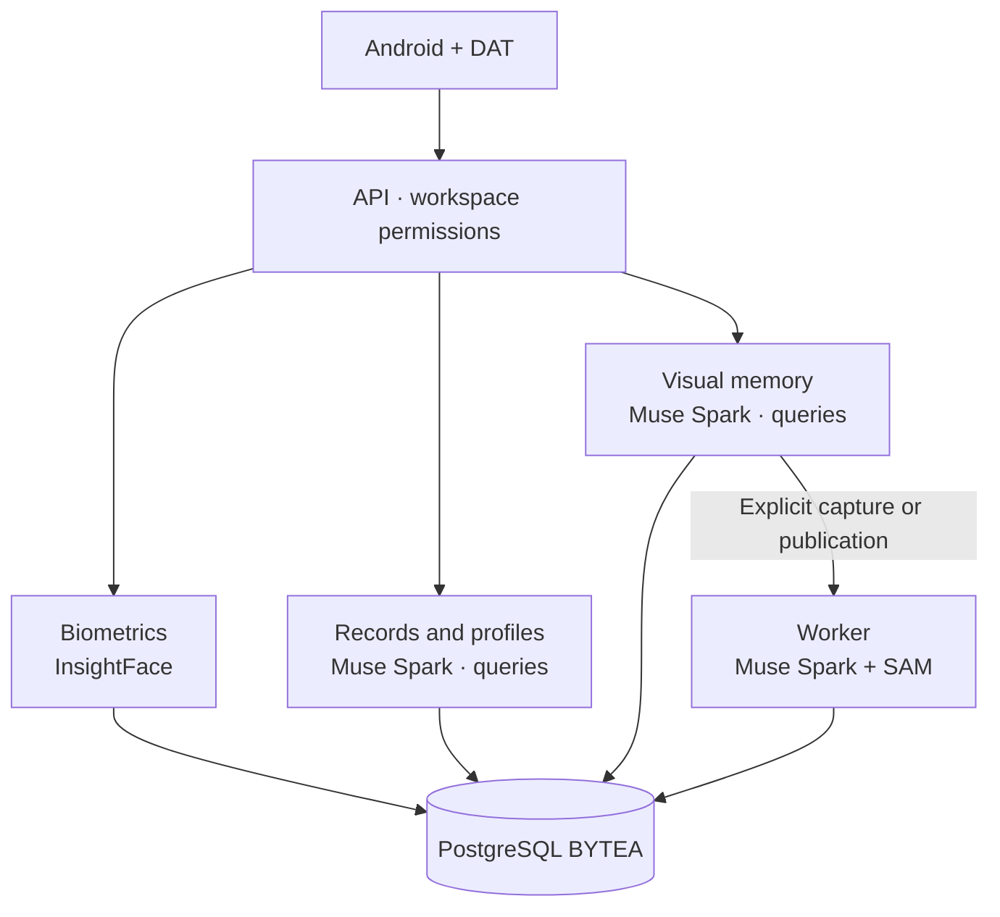

<p align="center"><a href="ARCHITECTURE.md"></a> <a href="ARCHITECTURE.es.md"></a></p>

# Architecture

[← Documentation](README.md) · [API / Postman](API.md)

## Reading guide

| Topic | What to know |
| --- | --- |
| **Client** | Android Kotlin/Compose and native DAT Display; browser panel and web Display retired. |
| **API** | FastAPI enforces authentication, roles and membership. API and worker share contracts and SQLAlchemy models. |
| **Visual memory** | Explicit capture → BYTEA original → Celery/Redis → facts and evidence. Muse Spark also interprets queries from the API, without starting capture or evidence indexing. |
| **Biometrics** | Isolated InsightFace arm: consent, enrollments, candidates and authorized context. Separate from object processing. |
| **Records and profiles** | Muse Spark answers questions about previously authorized context from the API. Record reads/imports retain their own contract and do not always require AI. |
| **Modules** | `app.http`, `app.providers`, `app.processing`, `app.social_features`, `app.accounts` and `app.workspaces`; facades preserve compatibility. |
| **Scaling** | Synchronous SQLAlchemy in async handlers; evaluate replicas or an async driver for high concurrency. |



## Commands

Run from the root with dependencies installed. Migrations and processing require the chosen environment and authorized data.
```bash
make architecture-check
make lint
make test
```

## Procedures and evidence

The original reference preserves technical details, examples and dated checks in their source language. Retired-component instructions are historical; use the current installation guides to operate.
[↗ Complete original reference](reference/ARCHITECTURE.legacy.md)
[DATABASE ](DATABASE.md) · [META INTEGRATION ](META_INTEGRATION.md) · [WEARABLES ](WEARABLES.md)

<details>
<summary>Historical sections</summary>

<a id="architecture"></a>
[↗ architecture](reference/ARCHITECTURE.legacy.md#architecture)

<a id="reorganización-modular-2026-10-30"></a>
[↗ reorganización-modular-2026-10-30](reference/ARCHITECTURE.legacy.md#reorganización-modular-2026-10-30)

<a id="despliegue-de-esta-etapa"></a>
[↗ despliegue-de-esta-etapa](reference/ARCHITECTURE.legacy.md#despliegue-de-esta-etapa)

<a id="desarrollo-y-verificación"></a>
[↗ desarrollo-y-verificación](reference/ARCHITECTURE.legacy.md#desarrollo-y-verificación)

<a id="carga-de-contenido-en-android"></a>
[↗ carga-de-contenido-en-android](reference/ARCHITECTURE.legacy.md#carga-de-contenido-en-android)

<a id="resultado-final-verificado"></a>
[↗ resultado-final-verificado](reference/ARCHITECTURE.legacy.md#resultado-final-verificado)

<a id="visor-señalizado-a-resolución-original--2026-10-30"></a>
[↗ visor-señalizado-a-resolución-original--2026-10-30](reference/ARCHITECTURE.legacy.md#visor-señalizado-a-resolución-original--2026-10-30)

<a id="búsqueda-visual-y-revisión-de-publicaciones--2026-10-30"></a>
[↗ búsqueda-visual-y-revisión-de-publicaciones--2026-10-30](reference/ARCHITECTURE.legacy.md#búsqueda-visual-y-revisión-de-publicaciones--2026-10-30)

</details>
