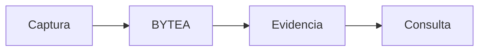

<p align="center"><a href="DATABASE.md"></a> <a href="DATABASE.es.md"></a></p>

# Datos y persistencia

[← Documentación](README.es.md) · [API / Postman](API.es.md)

## Guía de lectura

| Tema | Qué debes saber |
| --- | --- |
| **Originales** | `media_assets.original_bytes`; videos grandes en `media_asset_chunks.content`, ordenados y con hash completo. |
| **Objetos** | `tracked_objects` representa identidad lógica; `object_observations` conserva evidencia y fecha. La ubicación se deriva de observaciones verificadas. |
| **Geometría** | Cajas Muse y máscaras SAM enlazan derivados con el original; tracks guardan PTS y máscaras RLE. |
| **Rostros** | `face_enrollments`, `biometric_consents` y `face_record_enrollments` conservan autorización, versión del modelo y evidencia. |
| **Publicaciones** | `gallery_evidence` conserva versiones inmutables; runs de indexación activan una generación completada. Traducciones EN/ES quedan persistidas. |
| **Perfiles** | El CV es privado y reemplazable; reemplazarlo limpia derivados. La proyección pública no expone archivo ni texto extraído. |
| **Migraciones** | Alembic define el esquema. La revisión desplegada se comprueba en cada release; las fechas del historial no son el estado actual del servidor. |



## Comandos

Ejecutar desde la raíz, con dependencias instaladas. Migraciones y procesamiento requieren el entorno elegido y autorización de sus datos.
```bash
make migrate
```

## Procedimientos y evidencia

La referencia original conserva los detalles técnicos, ejemplos y verificaciones fechadas en su idioma de origen. Las instrucciones de componentes retirados son historia; usa las guías de instalación actuales para operar.
[↗ Referencia original completa](reference/DATABASE.legacy.md)
[ARCHITECTURE ](ARCHITECTURE.es.md) · [WORKSPACE DATA ](WORKSPACE_DATA.es.md) · [SECURITY ](SECURITY.es.md)

<details>
<summary>Secciones históricas</summary>

<a id="database"></a>
[↗ database](reference/DATABASE.legacy.md#database)

<a id="traducciones-persistidas-de-publicaciones--20261030_0027"></a>
[↗ traducciones-persistidas-de-publicaciones--20261030_0027](reference/DATABASE.legacy.md#traducciones-persistidas-de-publicaciones--20261030_0027)

<a id="accountchat-languages--20261031_0028"></a>
[↗ accountchat-languages--20261031_0028](reference/DATABASE.legacy.md#accountchat-languages--20261031_0028)

<a id="safe-gallery-analysis--20261031_0029"></a>
[↗ safe-gallery-analysis--20261031_0029](reference/DATABASE.legacy.md#safe-gallery-analysis--20261031_0029)

</details>
