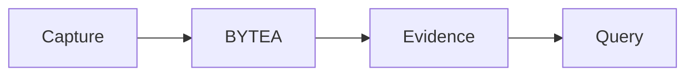

<p align="center"><a href="DATABASE.md"></a> <a href="DATABASE.es.md"></a></p>

# Data and persistence

[← Documentation](README.md) · [API / Postman](API.md)

## Reading guide

| Topic | What to know |
| --- | --- |
| **Originals** | `media_assets.original_bytes`; large videos in ordered `media_asset_chunks.content` with a full hash. |
| **Objects** | `tracked_objects` represents logical identity; `object_observations` retains evidence and time. Location derives from verified observations. |
| **Geometry** | Muse boxes and SAM masks link derivatives to originals; tracks retain PTS and RLE masks. |
| **Faces** | `face_enrollments`, `biometric_consents` and `face_record_enrollments` preserve authorization, model version and evidence. |
| **Publications** | `gallery_evidence` retains immutable versions; indexing runs activate a completed generation. EN/ES translations are persisted. |
| **Profiles** | The CV is private and replaceable; replacement clears derivatives. Public projections never expose its file or extracted text. |
| **Migrations** | Alembic defines the schema. Check deployed revision per release; historical dates are not current server state. |



## Commands

Run from the root with dependencies installed. Migrations and processing require the chosen environment and authorized data.
```bash
make migrate
```

## Procedures and evidence

The original reference preserves technical details, examples and dated checks in their source language. Retired-component instructions are historical; use the current installation guides to operate.
[↗ Complete original reference](reference/DATABASE.legacy.md)
[ARCHITECTURE ](ARCHITECTURE.md) · [WORKSPACE DATA ](WORKSPACE_DATA.md) · [SECURITY ](SECURITY.md)

<details>
<summary>Historical sections</summary>

<a id="database"></a>
[↗ database](reference/DATABASE.legacy.md#database)

<a id="traducciones-persistidas-de-publicaciones--20261030_0027"></a>
[↗ traducciones-persistidas-de-publicaciones--20261030_0027](reference/DATABASE.legacy.md#traducciones-persistidas-de-publicaciones--20261030_0027)

<a id="accountchat-languages--20261031_0028"></a>
[↗ accountchat-languages--20261031_0028](reference/DATABASE.legacy.md#accountchat-languages--20261031_0028)

<a id="safe-gallery-analysis--20261031_0029"></a>
[↗ safe-gallery-analysis--20261031_0029](reference/DATABASE.legacy.md#safe-gallery-analysis--20261031_0029)

</details>
