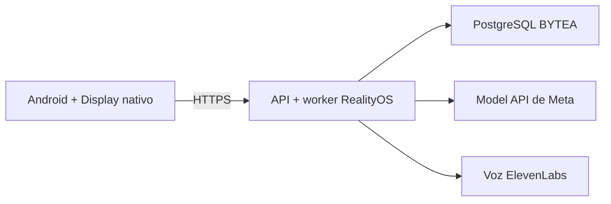

<p align="center">
  <a href="DEPLOYMENT_DIRECT.md"></a>
  <a href="DEPLOYMENT_DIRECT.es.md"></a>
</p>

# Desplegar un servidor con acceso directo a Meta

**Un servidor Ubuntu con Docker y Android como cliente.**

[← Proyecto](../README.es.md) · [Respaldo con gateway](DEPLOYMENT_GATEWAY.es.md) · [Windows local](DEPLOYMENT_LOCALHOST.es.md)



## Prepara

| Necesitas | Para qué |
| --- | --- |
| Ubuntu, Docker Engine, Compose v2 y Git | Ejecutar API, worker, base de datos y proxy. |
| Dominio y registro DNS | Publicar la API mediante HTTPS. |
| Tus claves Meta y ElevenLabs | Comprensión visual, segmentación, transcripción y síntesis reales. |
| Entorno protegido `production` de GitHub | Publicaciones automáticas; consulta los secretos necesarios en la [guía del gateway](DEPLOYMENT_GATEWAY.es.md#production). |

## Arranca

```bash
git clone https://github.com/Luxisoft/realityos-spatial-memory.git
cd realityos-spatial-memory
cp .env.example .env
```

Antes de arrancar, edita el archivo **privado** `.env`: configura valores únicos para `POSTGRES_PASSWORD` y `JWT_SECRET`, tu `MODEL_API_KEY`, `META_MODE=live` y `META_CONNECTION_MODE=direct`. Para este Compose base, añade también `ELEVENLABS_API_KEY` a `.env`. La configuración adicional de producción lee además el archivo privado `.env.elevenlabs` para la API.

```bash
docker compose --env-file .env -f infrastructure/docker-compose.yml up --build -d
```

El proxy escucha en `127.0.0.1:8080` de forma predeterminada; `HTTP_BIND_ADDRESS` y `HTTP_PORT` permiten cambiarlo. PostgreSQL y Redis no publican puertos en el host.

## Verifica antes de conectar Android

```bash
curl -sf http://127.0.0.1:8080/health/ready
curl -sf http://127.0.0.1:8080/v1/openapi.json -o /dev/null
docker compose --env-file .env -f infrastructure/docker-compose.yml exec -T api alembic current
```

Si está instalado el ingreso bajo demanda, comprueba `/v1/openapi.json` además de salud: el ingreso puede responder salud por sí mismo. Tras reemplazar la API, sigue las instrucciones de reinicio del ingreso en [operación](DEPLOYMENT.es.md).

| Ajuste | Uso |
| --- | --- |
| `META_CONNECTION_MODE=direct` | Acceder a Meta desde el servidor RealityOS. |
| `META_GATEWAY_FALLBACK_ENABLED=true` | Usar como respaldo un gateway ya configurado. |
| `META_API_BASE_URL=https://api.meta.ai/v1` | Destino de Model API. |
| `META_MODE=mock` | Pruebas de desarrollo deterministas, identificadas como simuladas. |

Reinicia API/worker tras cambiar su configuración. Las claves de proveedores y las credenciales de base de datos quedan fuera de Git. Los datos persistentes viven en los volúmenes `postgres_data` y `redis_data`.

## HTTPS y publicaciones productivas

El [workflow productivo](../.github/workflows/deploy-production.yml) verifica código, publica imágenes inmutables y despliega API/worker, gateway y proxy. Conserva las conexiones configuradas. Las aplicaciones web están retiradas: `/` y `/display/` responden 410. Android usa `/v1/`; las páginas de confirmación y recuperación de correo siguen disponibles.

<details>
<summary><strong>Primer certificado, Cloudflare y reversión</strong></summary>

Apunta el registro DNS del dominio al servidor correcto. Si Cloudflare Workers/Pages captura ese host, exclúyelo de la ruta o usa DNS-only durante el primer certificado. Cuando exista TLS en el origen, utiliza **Full (strict)**.

El workflow configura Nginx del host y Let's Encrypt; mantén privado el puerto interno de la API. Un 404 de otro sitio en `/.well-known/acme-challenge/` indica que la validación del certificado llega al origen equivocado.

Para revertir código, ejecuta manualmente **Deploy production** con un `release_tag` inmutable existente (SHA del commit). Selecciona imágenes ya construidas; no revierte migraciones ni recupera datos eliminados. Sigue el procedimiento aprobado de copias y migraciones en [operación](DEPLOYMENT.es.md).

</details>

[← Proyecto](../README.es.md) · [English](DEPLOYMENT_DIRECT.es.md) · [Referencia operativa](DEPLOYMENT.es.md)
