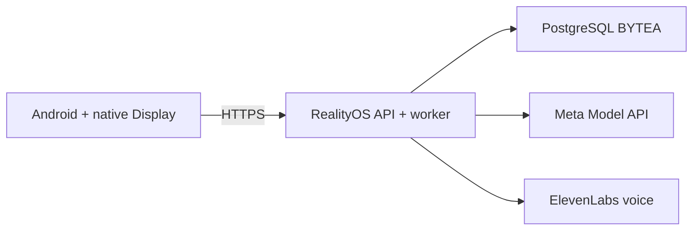

<p align="center">
  <a href="DEPLOYMENT_DIRECT.md"></a>
  <a href="DEPLOYMENT_DIRECT.es.md"></a>
</p>

# Deploy a server with direct Meta access

**One Ubuntu + Docker host, with Android as the client.**

[← Project](../README.md) · [Gateway fallback](DEPLOYMENT_GATEWAY.md) · [Windows local](DEPLOYMENT_LOCALHOST.md)



## Prepare

| You need | Purpose |
| --- | --- |
| Ubuntu, Docker Engine, Compose v2 and Git | Run the API, worker, database and proxy. |
| Domain and DNS record | Publish the API over HTTPS. |
| Your Meta and ElevenLabs keys | Real image understanding, segmentation, transcription and synthesis. |
| Protected GitHub `production` environment | Automated releases; required secrets are listed in the [gateway guide](DEPLOYMENT_GATEWAY.md#production). |

## Start

```bash
git clone https://github.com/Luxisoft/realityos-spatial-memory.git
cd realityos-spatial-memory
cp .env.example .env
```

Before starting, edit the **private** `.env`: set unique `POSTGRES_PASSWORD` and `JWT_SECRET`, your `MODEL_API_KEY`, `META_MODE=live` and `META_CONNECTION_MODE=direct`. For this base Compose setup, provide `ELEVENLABS_API_KEY` in `.env` too. Production's overlay additionally reads the private `.env.elevenlabs` file for the API.

```bash
docker compose --env-file .env -f infrastructure/docker-compose.yml up --build -d
```

The proxy binds to `127.0.0.1:8080` by default; `HTTP_BIND_ADDRESS` and `HTTP_PORT` control it. PostgreSQL and Redis are not published on the host.

## Verify before connecting Android

```bash
curl -sf http://127.0.0.1:8080/health/ready
curl -sf http://127.0.0.1:8080/v1/openapi.json -o /dev/null
docker compose --env-file .env -f infrastructure/docker-compose.yml exec -T api alembic current
```

For an installed on-demand ingress, check `/v1/openapi.json` as well as health: the ingress can answer health itself. After replacing the API, follow the ingress restart instructions in [operations](DEPLOYMENT.md).

| Setting | Use |
| --- | --- |
| `META_CONNECTION_MODE=direct` | Reach Meta from the RealityOS server. |
| `META_GATEWAY_FALLBACK_ENABLED=true` | Use an already configured gateway as standby. |
| `META_API_BASE_URL=https://api.meta.ai/v1` | Model API destination. |
| `META_MODE=mock` | Deterministic, explicitly simulated development tests. |

Restart API/worker after runtime changes. Keep provider keys and database credentials out of Git. Persistent data lives in the `postgres_data` and `redis_data` volumes.

## HTTPS and production releases

The [production workflow](../.github/workflows/deploy-production.yml) verifies code, publishes immutable images and deploys API/worker, gateway and proxy. It preserves configured runtime connections. The browser apps are retired: `/` and `/display/` return 410. Android uses `/v1/`; email confirmation and reset pages remain available.

<details>
<summary><strong>First certificate, Cloudflare and rollback</strong></summary>

Point the domain's DNS record to the intended host. If Cloudflare Workers/Pages captures the hostname, exclude it from that route or use DNS-only mode for the first certificate. Once origin TLS exists, use **Full (strict)**.

The workflow configures host Nginx and Let's Encrypt; keep the internal API port private. A foreign site's 404 at `/.well-known/acme-challenge/` indicates the wrong origin is handling certificate validation.

For code rollback, manually run **Deploy production** with an existing immutable `release_tag` (commit SHA). This selects previously built images; it does not reverse database migrations or restore deleted data. Follow the project's approved backup and migration procedure in [operations](DEPLOYMENT.md).

</details>

[← Project](../README.md) · [Español](DEPLOYMENT_DIRECT.es.md) · [Operations reference](DEPLOYMENT.md)
