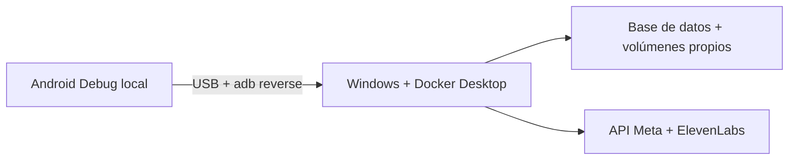

<p align="center">
  <a href="DEPLOYMENT_LOCALHOST.md"></a>
  <a href="DEPLOYMENT_LOCALHOST.es.md"></a>
</p>

# Ejecutar localmente en Windows

**Tu computadora, tus cuentas, tus datos y tus claves de proveedores.**
Esta instalación adicional usa el proyecto Docker aislado `realityos-local` y el archivo privado `.env.local`.

[← Proyecto](../README.es.md) · [Servidor directo](DEPLOYMENT_DIRECT.es.md) · [Gateway](DEPLOYMENT_GATEWAY.es.md)



## Prepara

| Requisito | Detalle |
| --- | --- |
| Windows x64 + Docker Desktop | Contenedores Linux con WSL2. |
| Git + PowerShell | Windows PowerShell 5.1 o PowerShell 7. |
| Recursos Docker | Al menos 4 CPU, 8 GiB de RAM y 25 GiB de disco libre. |
| Tus claves de proveedores | Acceso Meta para Muse Spark, SAM y transcripción; ElevenLabs para voz. |
| Herramientas Android | Java 21, Android SDK 36, ADB y teléfono con depuración USB o emulador. |

El backend no requiere Python, Node ni GPU en el host. Consulta la [instalación Docker en Windows](https://docs.docker.com/desktop/setup/install/windows-install/) y la [guía de WSL2](https://docs.docker.com/desktop/features/wsl/).

## ① Arranca el backend local

Desde PowerShell, en la raíz del repositorio:

```powershell
powershell.exe -NoProfile -ExecutionPolicy Bypass -File .\scripts\local\Start-RealityOS.ps1
```

El iniciador solicita tus claves y correo/contraseña local sin mostrarlos, crea secretos independientes para base de datos/JWT/dispositivos, construye imágenes, aplica migraciones y crea un espacio vacío. Verifica la API y audio real EN/ES. `Bypass` afecta únicamente a ese proceso PowerShell. Si Docker guarda sus datos en otra unidad, añade `-DockerDataDrive 'D:\'`.

**No se importan medios de ejemplo ni credenciales productivas.** Meta y ElevenLabs son proveedores reales; InsightFace corre localmente. El espacio inicial está vacío.

## ② Instala la app Android independiente

Desde la raíz del repositorio, en PowerShell:

```powershell
$env:ANDROID_HOME = 'C:\ruta\a\Android\Sdk'
$env:ANDROID_SDK_ROOT = $env:ANDROID_HOME
Set-Location android
.\gradlew.bat -PlocalDevelopment=true -PrealityosApiBaseUrl=http://localhost:8080/v1 :app:assembleDebug
adb reverse tcp:8080 tcp:8080
adb install -r app\build\outputs\apk\debug\app-debug.apk
```

Su identificador es `com.luxisoft.realityos.local`. Se instala junto a la app habitual. Entra con la cuenta local creada; el backend debe confirmar su entorno local. Este acceso no exige Facebook ni verificación facial. Las funciones faciales conservan sus propios permisos y consentimientos.

`adb reverse` conecta el localhost del teléfono con Windows; repítelo al reconectar el USB. La variante local solo permite HTTP de loopback en Debug y no habilita la vista previa automática de dispositivos virtuales. Las gafas reales requieren hardware compatible y configuración DAT.

## ③ Verifica y detén

Vuelve a la raíz del repositorio antes de ejecutar estos scripts:

```powershell
powershell.exe -NoProfile -ExecutionPolicy Bypass -File .\scripts\local\Test-RealityOS.ps1
powershell.exe -NoProfile -ExecutionPolicy Bypass -File .\scripts\local\Test-RealityOS.ps1 -Speech
powershell.exe -NoProfile -ExecutionPolicy Bypass -File .\scripts\local\Stop-RealityOS.ps1
```

| Comprobación | Dirección predeterminada |
| --- | --- |
| Contrato API | `http://localhost:8080/v1/openapi.json` |
| Salud | `http://localhost:8080/health/ready` |
| App de usuario | Android Debug local; sin panel del navegador ni web Display. |

<details>
<summary><strong>Configuración y resolución de problemas</strong></summary>

El iniciador local conserva estos ajustes en `.env.local`:

```dotenv
ENVIRONMENT=local
LOCAL_LOGIN_ENABLED=true
META_MODE=live
FACE_ENGINE=insightface
META_CONNECTION_MODE=direct
META_GATEWAY_FALLBACK_ENABLED=false
```

El gateway no es una dependencia local. Nunca copies archivos `.env` de producción a esta instalación. Volver a ejecutar Start conserva cuentas y datos; Stop conserva los volúmenes. Evita `down -v` si quieres mantener los datos.

Si el puerto 8080 está ocupado, cambia `LOCAL_HTTP_PORT` y actualiza la URL de compilación Android y los puertos de `adb reverse`. PostgreSQL y Redis no se exponen en Windows. Revisa errores de la API con:

```powershell
docker compose --project-name realityos-local --env-file .env.local --file infrastructure/docker-compose.local.yml logs --tail 50 api
```

Los fallos de proveedores se muestran explícitamente. Una compilación correcta no demuestra el funcionamiento físico de cámara, audio o gafas.

</details>

[← Proyecto](../README.es.md) · [English](DEPLOYMENT_LOCALHOST.es.md) · [Referencia detallada de Windows](LOCAL_WINDOWS.es.md)
