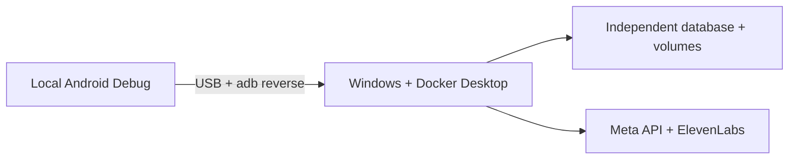

<p align="center">
  <a href="DEPLOYMENT_LOCALHOST.md"></a>
  <a href="DEPLOYMENT_LOCALHOST.es.md"></a>
</p>

# Run locally on Windows

**Your computer, your accounts, your data and your provider keys.**
This additional installation uses the isolated Docker project `realityos-local` and private `.env.local`.

[← Project](../README.md) · [Direct server](DEPLOYMENT_DIRECT.md) · [Gateway](DEPLOYMENT_GATEWAY.md)



## Prepare

| Requirement | Details |
| --- | --- |
| Windows x64 + Docker Desktop | Linux containers with the WSL2 backend. |
| Git + PowerShell | Windows PowerShell 5.1 or PowerShell 7. |
| Docker resources | At least 4 CPUs, 8 GiB RAM and 25 GiB free disk. |
| Your provider keys | Meta access for Muse Spark, SAM and transcription; ElevenLabs for speech. |
| Android tools | Java 21, Android SDK 36, ADB and a USB-debuggable phone or emulator. |

No host Python, Node or GPU is needed to start the backend. See Docker's [Windows installation](https://docs.docker.com/desktop/setup/install/windows-install/) and [WSL2 guide](https://docs.docker.com/desktop/features/wsl/).

## ① Start the local backend

From PowerShell at the repository root:

```powershell
powershell.exe -NoProfile -ExecutionPolicy Bypass -File .\scripts\local\Start-RealityOS.ps1
```

The launcher asks privately for your keys and local email/password, creates independent database/JWT/device secrets, builds images, applies migrations and creates an empty workspace. It checks the API and real EN/ES speech. `Bypass` affects this PowerShell process only. If Docker data is on another drive, add `-DockerDataDrive 'D:\'`.

**No sample media or production credentials are imported.** Meta and ElevenLabs are real providers; InsightFace runs locally. The initial workspace is empty.

## ② Install the separate Android app

From the repository root in PowerShell:

```powershell
$env:ANDROID_HOME = 'C:\path\to\Android\Sdk'
$env:ANDROID_SDK_ROOT = $env:ANDROID_HOME
Set-Location android
.\gradlew.bat -PlocalDevelopment=true -PrealityosApiBaseUrl=http://localhost:8080/v1 :app:assembleDebug
adb reverse tcp:8080 tcp:8080
adb install -r app\build\outputs\apk\debug\app-debug.apk
```

The application ID is `com.luxisoft.realityos.local`. It installs alongside the regular app. Sign in with the local account you created; the backend must confirm its local realm. Local entry does not require Facebook or facial verification. Facial features still require their own permissions and consent.

`adb reverse` connects the phone's localhost to Windows; run it again after reconnecting USB. The local variant permits loopback HTTP only in Debug and does not enable automatic virtual-device preview. Real glasses require compatible hardware and DAT setup.

## ③ Verify and stop

Return to the repository root before running these scripts:

```powershell
powershell.exe -NoProfile -ExecutionPolicy Bypass -File .\scripts\local\Test-RealityOS.ps1
powershell.exe -NoProfile -ExecutionPolicy Bypass -File .\scripts\local\Test-RealityOS.ps1 -Speech
powershell.exe -NoProfile -ExecutionPolicy Bypass -File .\scripts\local\Stop-RealityOS.ps1
```

| Check | Default address |
| --- | --- |
| API contract | `http://localhost:8080/v1/openapi.json` |
| Health | `http://localhost:8080/health/ready` |
| User app | Local Android Debug; no browser panel or web Display. |

<details>
<summary><strong>Configuration and troubleshooting</strong></summary>

The local launcher keeps these settings in `.env.local`:

```dotenv
ENVIRONMENT=local
LOCAL_LOGIN_ENABLED=true
META_MODE=live
FACE_ENGINE=insightface
META_CONNECTION_MODE=direct
META_GATEWAY_FALLBACK_ENABLED=false
```

The gateway is not a local dependency. Never copy production `.env` files into this setup. Re-running Start preserves accounts and data; Stop preserves volumes. Avoid `down -v` when keeping data.

If port 8080 is occupied, change `LOCAL_HTTP_PORT` and update the Android build URL and `adb reverse` ports. PostgreSQL and Redis are not exposed on Windows. Inspect API errors with:

```powershell
docker compose --project-name realityos-local --env-file .env.local --file infrastructure/docker-compose.local.yml logs --tail 50 api
```

Provider failures are reported explicitly. A successful build does not prove physical camera, audio or glasses behavior.

</details>

[← Project](../README.md) · [Español](DEPLOYMENT_LOCALHOST.es.md) · [Detailed Windows reference (Spanish)](LOCAL_WINDOWS.md)
