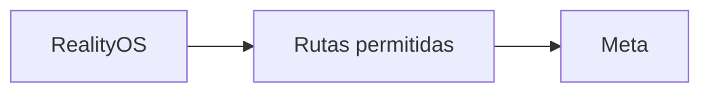

<p align="center"><a href="GATEWAY.md"></a> <a href="GATEWAY.es.md"></a></p>

# Gateway Meta

[← Documentación](README.es.md) · [API / Postman](API.es.md)

## Guía de lectura

| Tema | Qué debes saber |
| --- | --- |
| **Función** | Egreso restringido en FRONTEND; no es un proxy general ni la antigua interfaz web. |
| **Rutas** | Solo `GET /v1/models`, `POST /v1/responses`, `POST /v1/asr/transcribe`, `POST /v1/files`, `DELETE /v1/files/{id}`. |
| **Credenciales** | `X-RealityOS-Gateway-Token` independiente y allowlist IP. El gateway añade Bearer Meta; no guarda cuerpos. |
| **Selección** | `META_CONNECTION_MODE=direct` o `gateway`; `META_GATEWAY_FALLBACK_ENABLED=true` habilita respaldo. Reiniciar API/worker tras cambiar runtime. |
| **Reintentos** | No repetir streams aceptados ni subidas ambiguas. Fallos 400/422 se devuelven; revisar origen antes de reenviar. |
| **Subidas** | Hasta 1 GiB en gateway; un CDN puede imponer menos. Para archivos grandes, usar ruta privada o DNS directo autorizado. |



## Comandos

Ejecutar desde la raíz, con dependencias instaladas. Migraciones y procesamiento requieren el entorno elegido y autorización de sus datos.
```bash
make gateway-api
```

## Procedimientos y evidencia

La referencia original conserva los detalles técnicos, ejemplos y verificaciones fechadas en su idioma de origen. Las instrucciones de componentes retirados son historia; usa las guías de instalación actuales para operar.
[↗ Referencia original completa](reference/GATEWAY.legacy.md)
[DEPLOYMENT GATEWAY ](DEPLOYMENT_GATEWAY.es.md) · [DEPLOYMENT DIRECT ](DEPLOYMENT_DIRECT.es.md) · [TTS ](TTS.es.md)

<details>
<summary>Secciones históricas</summary>

<a id="meta-egress-gateway"></a>
[↗ meta-egress-gateway](reference/GATEWAY.legacy.md#meta-egress-gateway)

<a id="boundary"></a>
[↗ boundary](reference/GATEWAY.legacy.md#boundary)

<a id="connection-selection-2026-11-01"></a>
[↗ connection-selection-2026-11-01](reference/GATEWAY.legacy.md#connection-selection-2026-11-01)

<a id="frontend-deployment"></a>
[↗ frontend-deployment](reference/GATEWAY.legacy.md#frontend-deployment)

<a id="required-github-environment-secrets"></a>
[↗ required-github-environment-secrets](reference/GATEWAY.legacy.md#required-github-environment-secrets)

<a id="local-check"></a>
[↗ local-check](reference/GATEWAY.legacy.md#local-check)

<a id="síntesis-fuera-del-gateway"></a>
[↗ síntesis-fuera-del-gateway](reference/GATEWAY.legacy.md#síntesis-fuera-del-gateway)

</details>
