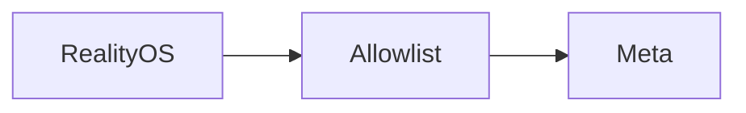

<p align="center"><a href="GATEWAY.md"></a> <a href="GATEWAY.es.md"></a></p>

# Meta gateway

[← Documentation](README.md) · [API / Postman](API.md)

## Reading guide

| Topic | What to know |
| --- | --- |
| **Purpose** | Restricted egress on FRONTEND; neither a general proxy nor the retired browser UI. |
| **Routes** | Only `GET /v1/models`, `POST /v1/responses`, `POST /v1/asr/transcribe`, `POST /v1/files`, `DELETE /v1/files/{id}`. |
| **Credentials** | Independent `X-RealityOS-Gateway-Token` and IP allowlist. Gateway adds Meta Bearer; request bodies are not stored. |
| **Selection** | `META_CONNECTION_MODE=direct` or `gateway`; `META_GATEWAY_FALLBACK_ENABLED=true` enables fallback. Restart API/worker after runtime changes. |
| **Retries** | Never replay accepted streams or ambiguous uploads. Return 400/422 failures; inspect the cause before resending. |
| **Uploads** | Up to 1 GiB at the gateway; a CDN may impose less. Large files need an authorized private or DNS-only route. |



## Commands

Run from the root with dependencies installed. Migrations and processing require the chosen environment and authorized data.
```bash
make gateway-api
```

## Procedures and evidence

The original reference preserves technical details, examples and dated checks in their source language. Retired-component instructions are historical; use the current installation guides to operate.
[↗ Complete original reference](reference/GATEWAY.legacy.md)
[DEPLOYMENT GATEWAY ](DEPLOYMENT_GATEWAY.md) · [DEPLOYMENT DIRECT ](DEPLOYMENT_DIRECT.md) · [TTS ](TTS.md)

<details>
<summary>Historical sections</summary>

<a id="meta-egress-gateway"></a>
[↗ meta-egress-gateway](reference/GATEWAY.legacy.md#meta-egress-gateway)

<a id="boundary"></a>
[↗ boundary](reference/GATEWAY.legacy.md#boundary)

<a id="connection-selection-2026-11-01"></a>
[↗ connection-selection-2026-11-01](reference/GATEWAY.legacy.md#connection-selection-2026-11-01)

<a id="frontend-deployment"></a>
[↗ frontend-deployment](reference/GATEWAY.legacy.md#frontend-deployment)

<a id="required-github-environment-secrets"></a>
[↗ required-github-environment-secrets](reference/GATEWAY.legacy.md#required-github-environment-secrets)

<a id="local-check"></a>
[↗ local-check](reference/GATEWAY.legacy.md#local-check)

<a id="síntesis-fuera-del-gateway"></a>
[↗ síntesis-fuera-del-gateway](reference/GATEWAY.legacy.md#síntesis-fuera-del-gateway)

</details>
