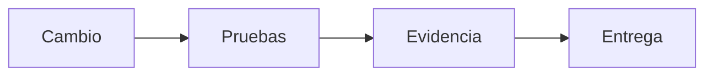

 

# Comprobaciones de aceptación

[← Documentación](README.es.md) · [API / Postman](API.es.md)

## Guía de lectura

| Tema | Qué debes saber |
| --- | --- |
| **API y permisos** | Verificar autenticación, roles, aislamiento de espacios y lectura de medios; no marcar aprobado sin ejecución. |
| **Evidencia** | Comprobar original BYTEA, idempotencia, última observación, ausencia de evidencia y consultas sin captura. |
| **Biometría** | Verificar consentimiento, autorización y candidatos; muestras sintéticas no miden precisión representativa. |
| **Cliente** | Comprobar EN/ES, carga/error, permisos, navegación y APK; pruebas físicas requieren registro independiente. |
| **Publicación** | Revisar secretos, enlaces, artefactos, resultado CI y requisitos de hackathon. El checklist original mantiene sus marcas históricas. |

## Procedimientos y evidencia

La referencia original conserva los detalles técnicos, ejemplos y verificaciones fechadas en su idioma de origen. Las instrucciones de componentes retirados son historia; usa las guías de instalación actuales para operar.
[↗ Referencia original completa](reference/IMPLEMENTATION_CHECKLIST.legacy.md)
[API ](API.es.md) · [IMPLEMENTATION STATUS ](IMPLEMENTATION_STATUS.es.md) · [HACKATHON ](HACKATHON.es.md)

Secciones históricas

[↗ checklist-por-fases--realityos](reference/IMPLEMENTATION_CHECKLIST.legacy.md#checklist-por-fases--realityos)

[↗ fase-0--fundaciones](reference/IMPLEMENTATION_CHECKLIST.legacy.md#fase-0--fundaciones)

[↗ fase-1--api-persistencia-y-seguridad](reference/IMPLEMENTATION_CHECKLIST.legacy.md#fase-1--api-persistencia-y-seguridad)

[↗ fase-2--memoria-y-consultas](reference/IMPLEMENTATION_CHECKLIST.legacy.md#fase-2--memoria-y-consultas)

[↗ fase-3--meta-jobs-y-vídeo](reference/IMPLEMENTATION_CHECKLIST.legacy.md#fase-3--meta-jobs-y-vídeo)

[↗ fase-4--panel-web](reference/IMPLEMENTATION_CHECKLIST.legacy.md#fase-4--panel-web)

[↗ fase-5--android-y-display](reference/IMPLEMENTATION_CHECKLIST.legacy.md#fase-5--android-y-display)

[↗ fase-6--operación-demo-y-entrega](reference/IMPLEMENTATION_CHECKLIST.legacy.md#fase-6--operación-demo-y-entrega)

[↗ criterios-finales-de-aceptación](reference/IMPLEMENTATION_CHECKLIST.legacy.md#criterios-finales-de-aceptación)

