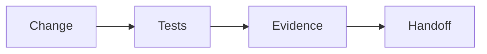

 

# Acceptance checks

[← Documentation](README.md) · [API / Postman](API.md)

## Reading guide

| Topic | What to know |
| --- | --- |
| **API and permissions** | Verify authentication, roles, workspace isolation and media access; do not mark passed without execution. |
| **Evidence** | Check BYTEA originals, idempotency, last observation, missing evidence and queries without capture. |
| **Biometrics** | Verify consent, authorization and candidates; synthetic samples do not measure representative accuracy. |
| **Client** | Check EN/ES, loading/errors, permissions, navigation and APK; physical checks require a separate record. |
| **Publication** | Review secrets, links, artifacts, CI result and hackathon requirements. Original checklist retains its historical marks. |

## Procedures and evidence

The original reference preserves technical details, examples and dated checks in their source language. Retired-component instructions are historical; use the current installation guides to operate.
[↗ Complete original reference](reference/IMPLEMENTATION_CHECKLIST.legacy.md)
[API ](API.md) · [IMPLEMENTATION STATUS ](IMPLEMENTATION_STATUS.md) · [HACKATHON ](HACKATHON.md)

Historical sections

[↗ checklist-por-fases--realityos](reference/IMPLEMENTATION_CHECKLIST.legacy.md#checklist-por-fases--realityos)

[↗ fase-0--fundaciones](reference/IMPLEMENTATION_CHECKLIST.legacy.md#fase-0--fundaciones)

[↗ fase-1--api-persistencia-y-seguridad](reference/IMPLEMENTATION_CHECKLIST.legacy.md#fase-1--api-persistencia-y-seguridad)

[↗ fase-2--memoria-y-consultas](reference/IMPLEMENTATION_CHECKLIST.legacy.md#fase-2--memoria-y-consultas)

[↗ fase-3--meta-jobs-y-vídeo](reference/IMPLEMENTATION_CHECKLIST.legacy.md#fase-3--meta-jobs-y-vídeo)

[↗ fase-4--panel-web](reference/IMPLEMENTATION_CHECKLIST.legacy.md#fase-4--panel-web)

[↗ fase-5--android-y-display](reference/IMPLEMENTATION_CHECKLIST.legacy.md#fase-5--android-y-display)

[↗ fase-6--operación-demo-y-entrega](reference/IMPLEMENTATION_CHECKLIST.legacy.md#fase-6--operación-demo-y-entrega)

[↗ criterios-finales-de-aceptación](reference/IMPLEMENTATION_CHECKLIST.legacy.md#criterios-finales-de-aceptación)

