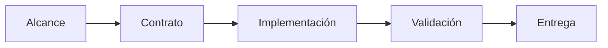

 

# Plan y evolución

[← Documentación](README.es.md) · [API / Postman](API.es.md)

## Guía de lectura

| Tema | Qué debes saber |
| --- | --- |
| **Plan original** | La secuencia original se conserva como historia; sus ramas y clientes retirados no son instrucciones vigentes. |
| **Cambio actual** | Definir recorrido y contrato; conservar biometría aislada, BYTEA, permisos y consentimiento. |
| **Verificación** | Pruebas relevantes, contrato, lint y build del componente; separar validación de hardware de compilación. |
| **Entrega** | Cambios autorizados directamente a main, CI normal y trabajo concurrente preservado. |
| **Pendientes** | Consultar estado fechado y requisitos de entrega; no convertir tareas planeadas en funciones verificadas. |

## Procedimientos y evidencia

La referencia original conserva los detalles técnicos, ejemplos y verificaciones fechadas en su idioma de origen. Las instrucciones de componentes retirados son historia; usa las guías de instalación actuales para operar.
[↗ Referencia original completa](reference/IMPLEMENTATION_PLAN.legacy.md)
[ARCHITECTURE ](ARCHITECTURE.es.md) · [IMPLEMENTATION CHECKLIST ](IMPLEMENTATION_CHECKLIST.es.md) · [IMPLEMENTATION STATUS ](IMPLEMENTATION_STATUS.es.md)

Secciones históricas

[↗ plan-de-ejecución--realityos](reference/IMPLEMENTATION_PLAN.legacy.md#plan-de-ejecución--realityos)

[↗ fase-0--fundaciones-y-trazabilidad](reference/IMPLEMENTATION_PLAN.legacy.md#fase-0--fundaciones-y-trazabilidad)

[↗ fase-1--backend-funcional-y-seguridad](reference/IMPLEMENTATION_PLAN.legacy.md#fase-1--backend-funcional-y-seguridad)

[↗ fase-2--memoria-espacial-y-recuperación](reference/IMPLEMENTATION_PLAN.legacy.md#fase-2--memoria-espacial-y-recuperación)

[↗ fase-3--pipeline-meta-mock-y-vídeo-acotado](reference/IMPLEMENTATION_PLAN.legacy.md#fase-3--pipeline-meta-mock-y-vídeo-acotado)

[↗ fase-4--panel-administrativo-web](reference/IMPLEMENTATION_PLAN.legacy.md#fase-4--panel-administrativo-web)

[↗ fase-5--android-wearables-y-display](reference/IMPLEMENTATION_PLAN.legacy.md#fase-5--android-wearables-y-display)

[↗ fase-6--operación-demostración-y-calidad](reference/IMPLEMENTATION_PLAN.legacy.md#fase-6--operación-demostración-y-calidad)

[↗ decisiones-transversales](reference/IMPLEMENTATION_PLAN.legacy.md#decisiones-transversales)

