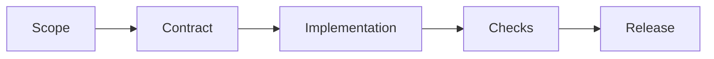

 

# Plan and evolution

[← Documentation](README.md) · [API / Postman](API.md)

## Reading guide

| Topic | What to know |
| --- | --- |
| **Original plan** | The original sequence is retained as history; retired branches and clients are not current instructions. |
| **Current change** | Define journey and contract; preserve isolated biometrics, BYTEA, permissions and consent. |
| **Verification** | Relevant tests, contract, lint and component build; distinguish hardware validation from compilation. |
| **Delivery** | Authorized changes directly to main, normal CI and concurrent work preserved. |
| **Outstanding** | Consult dated status and submission requirements; do not present planned tasks as verified features. |

## Procedures and evidence

The original reference preserves technical details, examples and dated checks in their source language. Retired-component instructions are historical; use the current installation guides to operate.
[↗ Complete original reference](reference/IMPLEMENTATION_PLAN.legacy.md)
[ARCHITECTURE ](ARCHITECTURE.md) · [IMPLEMENTATION CHECKLIST ](IMPLEMENTATION_CHECKLIST.md) · [IMPLEMENTATION STATUS ](IMPLEMENTATION_STATUS.md)

Historical sections

[↗ plan-de-ejecución--realityos](reference/IMPLEMENTATION_PLAN.legacy.md#plan-de-ejecución--realityos)

[↗ fase-0--fundaciones-y-trazabilidad](reference/IMPLEMENTATION_PLAN.legacy.md#fase-0--fundaciones-y-trazabilidad)

[↗ fase-1--backend-funcional-y-seguridad](reference/IMPLEMENTATION_PLAN.legacy.md#fase-1--backend-funcional-y-seguridad)

[↗ fase-2--memoria-espacial-y-recuperación](reference/IMPLEMENTATION_PLAN.legacy.md#fase-2--memoria-espacial-y-recuperación)

[↗ fase-3--pipeline-meta-mock-y-vídeo-acotado](reference/IMPLEMENTATION_PLAN.legacy.md#fase-3--pipeline-meta-mock-y-vídeo-acotado)

[↗ fase-4--panel-administrativo-web](reference/IMPLEMENTATION_PLAN.legacy.md#fase-4--panel-administrativo-web)

[↗ fase-5--android-wearables-y-display](reference/IMPLEMENTATION_PLAN.legacy.md#fase-5--android-wearables-y-display)

[↗ fase-6--operación-demostración-y-calidad](reference/IMPLEMENTATION_PLAN.legacy.md#fase-6--operación-demostración-y-calidad)

[↗ decisiones-transversales](reference/IMPLEMENTATION_PLAN.legacy.md#decisiones-transversales)

