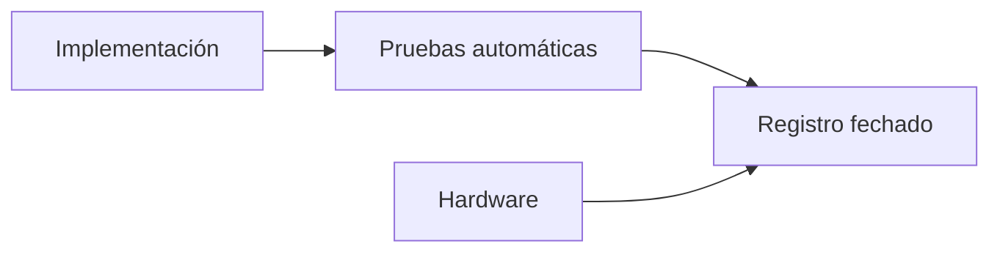

 

# Estado y evidencia de implementación

[← Documentación](README.es.md) · [API / Postman](API.es.md)

## Guía de lectura

| Tema | Qué debes saber |
| --- | --- |
| **Lectura del registro** | Las entradas originales conservan fechas, comandos, resultados y rollbacks. Una versión antigua no describe necesariamente producción actual. |
| **Implementado** | API, Android/DAT, biometría aislada, expedientes versionados, social y memoria visual tienen implementación y verificaciones fechadas. |
| **Proveedor actual** | ElevenLabs para síntesis; Muse Voice Transcribe para STT. Las entradas de síntesis local son históricas. |
| **Alcance de pruebas** | Unitarias, contratos y renderizado no demuestran hardware. Mantener pendientes las verificaciones físicas no realizadas. |
| **Entrega** | Video final, inscripción y derechos requieren evidencia separada; consultar la revisión de hackathon. |

## Procedimientos y evidencia

La referencia original conserva los detalles técnicos, ejemplos y verificaciones fechadas en su idioma de origen. Las instrucciones de componentes retirados son historia; usa las guías de instalación actuales para operar.
[↗ Referencia original completa](reference/IMPLEMENTATION_STATUS.legacy.md)
[IMPLEMENTATION CHECKLIST ](IMPLEMENTATION_CHECKLIST.es.md) · [DEMO ](DEMO.es.md) · [HACKATHON ](HACKATHON.es.md)

Secciones históricas

[↗ implementation-status--2026-10-28](reference/IMPLEMENTATION_STATUS.legacy.md#implementation-status--2026-10-28)

[↗ verified-in-this-workspace](reference/IMPLEMENTATION_STATUS.legacy.md#verified-in-this-workspace)

[↗ production-verification](reference/IMPLEMENTATION_STATUS.legacy.md#production-verification)

[↗ public-deployment-verification](reference/IMPLEMENTATION_STATUS.legacy.md#public-deployment-verification)

[↗ implemented-and-production-deployed-device-qa-remains](reference/IMPLEMENTATION_STATUS.legacy.md#implemented-and-production-deployed-device-qa-remains)

[↗ 2026-10-30--gallery-ai-index](reference/IMPLEMENTATION_STATUS.legacy.md#2026-10-30--gallery-ai-index)

[↗ not-implemented](reference/IMPLEMENTATION_STATUS.legacy.md#not-implemented)

[↗ reorganización-estructural--2026-10-30](reference/IMPLEMENTATION_STATUS.legacy.md#reorganización-estructural--2026-10-30)

[↗ búsqueda-señalizada-revisión-de-subidas-y-carrusel--2026-10-30](reference/IMPLEMENTATION_STATUS.legacy.md#búsqueda-señalizada-revisión-de-subidas-y-carrusel--2026-10-30)

[↗ recuperación-de-imágenes-y-seguimiento-del-chat--2026-10-30](reference/IMPLEMENTATION_STATUS.legacy.md#recuperación-de-imágenes-y-seguimiento-del-chat--2026-10-30)

[↗ información-visible-y-localizada-del-recurso-del-chat--2026-10-30](reference/IMPLEMENTATION_STATUS.legacy.md#información-visible-y-localizada-del-recurso-del-chat--2026-10-30)

[↗ traducciones-persistidas-al-publicar--2026-10-30](reference/IMPLEMENTATION_STATUS.legacy.md#traducciones-persistidas-al-publicar--2026-10-30)

[↗ historial-actualizado-y-recuperación-automática-de-idiomas--2026-10-30](reference/IMPLEMENTATION_STATUS.legacy.md#historial-actualizado-y-recuperación-automática-de-idiomas--2026-10-30)

[↗ idioma-de-cuenta-y-respuestas-del-chat--2026-10-31](reference/IMPLEMENTATION_STATUS.legacy.md#idioma-de-cuenta-y-respuestas-del-chat--2026-10-31)

[↗ recuperación-segura-de-búsqueda--2026-10-31](reference/IMPLEMENTATION_STATUS.legacy.md#recuperación-segura-de-búsqueda--2026-10-31)

[↗ búsqueda-biométrica-por-foto-o-video--2026-10-31](reference/IMPLEMENTATION_STATUS.legacy.md#búsqueda-biométrica-por-foto-o-video--2026-10-31)

[↗ meta-display-conectado-con-perfil-y-trabajo--2026-10-31](reference/IMPLEMENTATION_STATUS.legacy.md#meta-display-conectado-con-perfil-y-trabajo--2026-10-31)

[↗ zoom-estable-en-el-visor-del-buscador-chat--2026-10-31](reference/IMPLEMENTATION_STATUS.legacy.md#zoom-estable-en-el-visor-del-buscador-chat--2026-10-31)

[↗ recuperación-del-procesamiento-de-búsqueda--2026-10-31](reference/IMPLEMENTATION_STATUS.legacy.md#recuperación-del-procesamiento-de-búsqueda--2026-10-31)

[↗ navegación-ray-ban-meta-simplificada--2026-11-01](reference/IMPLEMENTATION_STATUS.legacy.md#navegación-ray-ban-meta-simplificada--2026-11-01)

[↗ sensores-y-cámara-del-simulador-ray-ban--2026-11-01](reference/IMPLEMENTATION_STATUS.legacy.md#sensores-y-cámara-del-simulador-ray-ban--2026-11-01)

[↗ toques-de-foto-y-cerrar-en-el-simulador--2026-11-01](reference/IMPLEMENTATION_STATUS.legacy.md#toques-de-foto-y-cerrar-en-el-simulador--2026-11-01)

[↗ idioma-completo-de-interfaz-chat-y-voz--2026-11-01](reference/IMPLEMENTATION_STATUS.legacy.md#idioma-completo-de-interfaz-chat-y-voz--2026-11-01)

[↗ segunda-revisión-de-idiomas--2026-11-01](reference/IMPLEMENTATION_STATUS.legacy.md#segunda-revisión-de-idiomas--2026-11-01)

[↗ seamlessm4t-v2-para-respuestas-de-audio--2026-11-01](reference/IMPLEMENTATION_STATUS.legacy.md#seamlessm4t-v2-para-respuestas-de-audio--2026-11-01)

[↗ tercera-revisión-idioma-de-reproducción-y-metadatos-del-display--2026-11-01](reference/IMPLEMENTATION_STATUS.legacy.md#tercera-revisión-idioma-de-reproducción-y-metadatos-del-display--2026-11-01)

[↗ conexión-directa-y-seamless-local--2026-11-01](reference/IMPLEMENTATION_STATUS.legacy.md#conexión-directa-y-seamless-local--2026-11-01)

[↗ alternativa-windows--docker-con-proveedores-reales--2026-11-01](reference/IMPLEMENTATION_STATUS.legacy.md#alternativa-windows--docker-con-proveedores-reales--2026-11-01)

[↗ apertura-de-cámara-desde-buscar-en-la-vista-previa--2026-11-01](reference/IMPLEMENTATION_STATUS.legacy.md#apertura-de-cámara-desde-buscar-en-la-vista-previa--2026-11-01)

[↗ señalización-facial-legible-y-perfil-nativo--2026-11-01](reference/IMPLEMENTATION_STATUS.legacy.md#señalización-facial-legible-y-perfil-nativo--2026-11-01)

[↗ carga-verificada-de-fotos-al-navegar-en-display--2026-11-01](reference/IMPLEMENTATION_STATUS.legacy.md#carga-verificada-de-fotos-al-navegar-en-display--2026-11-01)

[↗ voz-sin-modelo-residente--2026-11-02](reference/IMPLEMENTATION_STATUS.legacy.md#voz-sin-modelo-residente--2026-11-02)

[↗ eliminación-de-síntesis-local--2026-11-02](reference/IMPLEMENTATION_STATUS.legacy.md#eliminación-de-síntesis-local--2026-11-02)

[↗ cabecera-global-compacta-y-referencias-internas--2026-11-02](reference/IMPLEMENTATION_STATUS.legacy.md#cabecera-global-compacta-y-referencias-internas--2026-11-02)

[↗ cuentas-e-integración-por-espacios--2026-11-02](reference/IMPLEMENTATION_STATUS.legacy.md#cuentas-e-integración-por-espacios--2026-11-02)

[↗ segunda-auditoría-de-cuentas-y-espacios--2026-11-02](reference/IMPLEMENTATION_STATUS.legacy.md#segunda-auditoría-de-cuentas-y-espacios--2026-11-02)

[↗ tercera-revisión-integral--2026-11-02](reference/IMPLEMENTATION_STATUS.legacy.md#tercera-revisión-integral--2026-11-02)

[↗ enlace-facial-a-expedientes--2026-11-03](reference/IMPLEMENTATION_STATUS.legacy.md#enlace-facial-a-expedientes--2026-11-03)

[↗ revisión-enlace-facial-r2--2026-11-03](reference/IMPLEMENTATION_STATUS.legacy.md#revisión-enlace-facial-r2--2026-11-03)

[↗ revisión-r3-stop-limpio-del-api--2026-11-03](reference/IMPLEMENTATION_STATUS.legacy.md#revisión-r3-stop-limpio-del-api--2026-11-03)

[↗ android-como-única-app-y-auth-por-correo--2026-11-02](reference/IMPLEMENTATION_STATUS.legacy.md#android-como-única-app-y-auth-por-correo--2026-11-02)

[↗ rediseño-gráfico-de-cuentas-android--2026-11-03](reference/IMPLEMENTATION_STATUS.legacy.md#rediseño-gráfico-de-cuentas-android--2026-11-03)

[↗ acceso-inicial-y-explora-realityos--2026-11-03](reference/IMPLEMENTATION_STATUS.legacy.md#acceso-inicial-y-explora-realityos--2026-11-03)

[↗ nombre-del-remitente-de-correo--2026-11-03](reference/IMPLEMENTATION_STATUS.legacy.md#nombre-del-remitente-de-correo--2026-11-03)

## Corrección de correo y cuentas duplicadas — 2026-11-03

La entrada de implementación del mismo día registra el nuevo `POST /v1/auth/change-pending-email`: Android cambia el correo de una cuenta pendiente con su usuario y contraseña, conservando el ID. Invalida enlaces anteriores y los reenvíos usan la nueva dirección. Un fallo SMTP revierte el cambio. Se excluyen cuentas confirmadas, activas y provisionadas; los duplicados ofrecen recuperación, reenvío o corrección de datos.

El registro informa 419 pruebas backend/gateway (27 de cuentas), 212 pruebas Android, formato/lint y builds Debug/Release. Siete pruebas de gateway pasaron desde un directorio aislado después de problemas de acceso al `.env` de producción. Las capturas incluyen ES/EN, 320/390/480 dp y texto al 200 %. Continúan pendientes la QA física y una recepción real de correo después del cambio; no se enviaron correos de prueba ni se cambió manualmente el correo de un usuario real.

Release documentado: `realityos-backend:email-correction-20261103`, salud, OpenAPI y Alembic `20261103_0033` verificados, sin migración. Rollback: `.runtime/email-correction-20261103-rollback.json`. Estos resultados pertenecen a ese cambio, no a una nueva ejecución durante la revisión documental. [Registro completo y hash APK](IMPLEMENTATION_STATUS.md#email-replacement-and-duplicate-accounts--2026-11-03).

## Identidad de cuenta al corregir correo — 2026-11-03

El registro rechazado por duplicado podía conservar un usuario propuesto que no
existía y provocar un 401 antes del envío. Android separa ahora la cuenta
existente del correo nuevo; conserva el identificador del registro exitoso o el
correo de confirmación y permite corregir directamente desde el aviso de
cuenta duplicada. `username` en `/v1/auth/change-pending-email` acepta usuario o
correo actual y siempre verifica la contraseña. Se mantienen el mismo ID,
los controles de duplicados y el reemplazo atómico de correo/enlaces.

Errores diferenciados en ES/EN para credenciales, cuenta no elegible, límite de
intentos, envío y conexión. Un rechazo de credenciales al corregir el correo no
borra una sesión autenticada distinta. Recuperar cuenta utiliza el correo
existente, nunca el nuevo. No se modificaron cuentas manualmente ni se enviaron
correos reales durante las pruebas.

Pasaron 37 pruebas focalizadas de backend/contrato/documentación/transporte
(30 de cuentas) y 216 de Android. Capturas nativas del formulario y error, también
a 320 dp con texto al 200 %. Pendientes: teléfono físico y recepción real.

API/worker: `realityos-backend:email-identity-20261103`; salud, OpenAPI local y
público, rechazo de credenciales y Alembic `20261103_0033 (head)` verificados.
Sin migración; gateway y runtime conservados. Rollback:
`.runtime/email-identity-20261103-rollback.json`.

El despliegue CI anterior instaló Kombu 5.7 con redis-py 5.3.1 y dejó el worker
reiniciándose. Se restauraron primero los servicios a la imagen funcional.
`celery[redis]` incorpora las restricciones del transporte al resolver paquetes;
la imagen final usa Kombu 5.6.2/redis-py 5.3.1, pasa `pip check` y responde a
inspección del worker. La nueva regresión de transporte falla en la imagen
incompatible anterior. Ver las fuentes oficiales enlazadas en la versión inglesa.

Formato, lint, estructura y builds Debug/Release aprobados. Se reemplazó el único APK Debug instalable.
