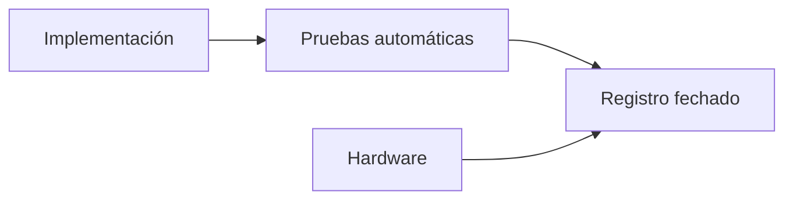

 

# Estado y evidencia de implementación

[← Documentación](README.es.md) · [API / Postman](API.es.md)

## Guía de lectura

| Tema | Qué debes saber |
| --- | --- |
| **Lectura del registro** | Las entradas originales conservan fechas, comandos, resultados y rollbacks. Una versión antigua no describe necesariamente producción actual. |
| **Implementado** | API, Android/DAT, biometría aislada, expedientes versionados, social y memoria visual tienen implementación y verificaciones fechadas. |
| **Proveedor actual** | ElevenLabs para síntesis; Muse Voice Transcribe para STT. Las entradas de síntesis local son históricas. |
| **Alcance de pruebas** | Unitarias, contratos y renderizado no demuestran hardware. Mantener pendientes las verificaciones físicas no realizadas. |
| **Entrega** | Video final, inscripción y derechos requieren evidencia separada; consultar la revisión de hackathon. |

## Procedimientos y evidencia

La referencia original conserva los detalles técnicos, ejemplos y verificaciones fechadas en su idioma de origen. Las instrucciones de componentes retirados son historia; usa las guías de instalación actuales para operar.
[↗ Referencia original completa](reference/IMPLEMENTATION_STATUS.legacy.md)
[IMPLEMENTATION CHECKLIST ](IMPLEMENTATION_CHECKLIST.es.md) · [DEMO ](DEMO.es.md) · [HACKATHON ](HACKATHON.es.md)

Secciones históricas

[↗ implementation-status--2026-10-28](reference/IMPLEMENTATION_STATUS.legacy.md#implementation-status--2026-10-28)

[↗ verified-in-this-workspace](reference/IMPLEMENTATION_STATUS.legacy.md#verified-in-this-workspace)

[↗ production-verification](reference/IMPLEMENTATION_STATUS.legacy.md#production-verification)

[↗ public-deployment-verification](reference/IMPLEMENTATION_STATUS.legacy.md#public-deployment-verification)

[↗ implemented-and-production-deployed-device-qa-remains](reference/IMPLEMENTATION_STATUS.legacy.md#implemented-and-production-deployed-device-qa-remains)

[↗ 2026-10-30--gallery-ai-index](reference/IMPLEMENTATION_STATUS.legacy.md#2026-10-30--gallery-ai-index)

[↗ not-implemented](reference/IMPLEMENTATION_STATUS.legacy.md#not-implemented)

[↗ reorganización-estructural--2026-10-30](reference/IMPLEMENTATION_STATUS.legacy.md#reorganización-estructural--2026-10-30)

[↗ búsqueda-señalizada-revisión-de-subidas-y-carrusel--2026-10-30](reference/IMPLEMENTATION_STATUS.legacy.md#búsqueda-señalizada-revisión-de-subidas-y-carrusel--2026-10-30)

[↗ recuperación-de-imágenes-y-seguimiento-del-chat--2026-10-30](reference/IMPLEMENTATION_STATUS.legacy.md#recuperación-de-imágenes-y-seguimiento-del-chat--2026-10-30)

[↗ información-visible-y-localizada-del-recurso-del-chat--2026-10-30](reference/IMPLEMENTATION_STATUS.legacy.md#información-visible-y-localizada-del-recurso-del-chat--2026-10-30)

[↗ traducciones-persistidas-al-publicar--2026-10-30](reference/IMPLEMENTATION_STATUS.legacy.md#traducciones-persistidas-al-publicar--2026-10-30)

[↗ historial-actualizado-y-recuperación-automática-de-idiomas--2026-10-30](reference/IMPLEMENTATION_STATUS.legacy.md#historial-actualizado-y-recuperación-automática-de-idiomas--2026-10-30)

[↗ idioma-de-cuenta-y-respuestas-del-chat--2026-10-31](reference/IMPLEMENTATION_STATUS.legacy.md#idioma-de-cuenta-y-respuestas-del-chat--2026-10-31)

[↗ recuperación-segura-de-búsqueda--2026-10-31](reference/IMPLEMENTATION_STATUS.legacy.md#recuperación-segura-de-búsqueda--2026-10-31)

[↗ búsqueda-biométrica-por-foto-o-video--2026-10-31](reference/IMPLEMENTATION_STATUS.legacy.md#búsqueda-biométrica-por-foto-o-video--2026-10-31)

[↗ meta-display-conectado-con-perfil-y-trabajo--2026-10-31](reference/IMPLEMENTATION_STATUS.legacy.md#meta-display-conectado-con-perfil-y-trabajo--2026-10-31)

[↗ zoom-estable-en-el-visor-del-buscador-chat--2026-10-31](reference/IMPLEMENTATION_STATUS.legacy.md#zoom-estable-en-el-visor-del-buscador-chat--2026-10-31)

[↗ recuperación-del-procesamiento-de-búsqueda--2026-10-31](reference/IMPLEMENTATION_STATUS.legacy.md#recuperación-del-procesamiento-de-búsqueda--2026-10-31)

[↗ navegación-ray-ban-meta-simplificada--2026-11-01](reference/IMPLEMENTATION_STATUS.legacy.md#navegación-ray-ban-meta-simplificada--2026-11-01)

[↗ sensores-y-cámara-del-simulador-ray-ban--2026-11-01](reference/IMPLEMENTATION_STATUS.legacy.md#sensores-y-cámara-del-simulador-ray-ban--2026-11-01)

[↗ toques-de-foto-y-cerrar-en-el-simulador--2026-11-01](reference/IMPLEMENTATION_STATUS.legacy.md#toques-de-foto-y-cerrar-en-el-simulador--2026-11-01)

[↗ idioma-completo-de-interfaz-chat-y-voz--2026-11-01](reference/IMPLEMENTATION_STATUS.legacy.md#idioma-completo-de-interfaz-chat-y-voz--2026-11-01)

[↗ segunda-revisión-de-idiomas--2026-11-01](reference/IMPLEMENTATION_STATUS.legacy.md#segunda-revisión-de-idiomas--2026-11-01)

[↗ seamlessm4t-v2-para-respuestas-de-audio--2026-11-01](reference/IMPLEMENTATION_STATUS.legacy.md#seamlessm4t-v2-para-respuestas-de-audio--2026-11-01)

[↗ tercera-revisión-idioma-de-reproducción-y-metadatos-del-display--2026-11-01](reference/IMPLEMENTATION_STATUS.legacy.md#tercera-revisión-idioma-de-reproducción-y-metadatos-del-display--2026-11-01)

[↗ conexión-directa-y-seamless-local--2026-11-01](reference/IMPLEMENTATION_STATUS.legacy.md#conexión-directa-y-seamless-local--2026-11-01)

[↗ alternativa-windows--docker-con-proveedores-reales--2026-11-01](reference/IMPLEMENTATION_STATUS.legacy.md#alternativa-windows--docker-con-proveedores-reales--2026-11-01)

[↗ apertura-de-cámara-desde-buscar-en-la-vista-previa--2026-11-01](reference/IMPLEMENTATION_STATUS.legacy.md#apertura-de-cámara-desde-buscar-en-la-vista-previa--2026-11-01)

[↗ señalización-facial-legible-y-perfil-nativo--2026-11-01](reference/IMPLEMENTATION_STATUS.legacy.md#señalización-facial-legible-y-perfil-nativo--2026-11-01)

[↗ carga-verificada-de-fotos-al-navegar-en-display--2026-11-01](reference/IMPLEMENTATION_STATUS.legacy.md#carga-verificada-de-fotos-al-navegar-en-display--2026-11-01)

[↗ voz-sin-modelo-residente--2026-11-02](reference/IMPLEMENTATION_STATUS.legacy.md#voz-sin-modelo-residente--2026-11-02)

[↗ eliminación-de-síntesis-local--2026-11-02](reference/IMPLEMENTATION_STATUS.legacy.md#eliminación-de-síntesis-local--2026-11-02)

[↗ cabecera-global-compacta-y-referencias-internas--2026-11-02](reference/IMPLEMENTATION_STATUS.legacy.md#cabecera-global-compacta-y-referencias-internas--2026-11-02)

[↗ cuentas-e-integración-por-espacios--2026-11-02](reference/IMPLEMENTATION_STATUS.legacy.md#cuentas-e-integración-por-espacios--2026-11-02)

[↗ segunda-auditoría-de-cuentas-y-espacios--2026-11-02](reference/IMPLEMENTATION_STATUS.legacy.md#segunda-auditoría-de-cuentas-y-espacios--2026-11-02)

[↗ tercera-revisión-integral--2026-11-02](reference/IMPLEMENTATION_STATUS.legacy.md#tercera-revisión-integral--2026-11-02)

[↗ enlace-facial-a-expedientes--2026-11-03](reference/IMPLEMENTATION_STATUS.legacy.md#enlace-facial-a-expedientes--2026-11-03)

[↗ revisión-enlace-facial-r2--2026-11-03](reference/IMPLEMENTATION_STATUS.legacy.md#revisión-enlace-facial-r2--2026-11-03)

[↗ revisión-r3-stop-limpio-del-api--2026-11-03](reference/IMPLEMENTATION_STATUS.legacy.md#revisión-r3-stop-limpio-del-api--2026-11-03)

[↗ android-como-única-app-y-auth-por-correo--2026-11-02](reference/IMPLEMENTATION_STATUS.legacy.md#android-como-única-app-y-auth-por-correo--2026-11-02)

[↗ rediseño-gráfico-de-cuentas-android--2026-11-03](reference/IMPLEMENTATION_STATUS.legacy.md#rediseño-gráfico-de-cuentas-android--2026-11-03)

[↗ acceso-inicial-y-explora-realityos--2026-11-03](reference/IMPLEMENTATION_STATUS.legacy.md#acceso-inicial-y-explora-realityos--2026-11-03)

[↗ nombre-del-remitente-de-correo--2026-11-03](reference/IMPLEMENTATION_STATUS.legacy.md#nombre-del-remitente-de-correo--2026-11-03)

## Corrección de correo y cuentas duplicadas — 2026-11-03

La entrada de implementación del mismo día registra el nuevo `POST /v1/auth/change-pending-email`: Android cambia el correo de una cuenta pendiente con su usuario y contraseña, conservando el ID. Invalida enlaces anteriores y los reenvíos usan la nueva dirección. Un fallo SMTP revierte el cambio. Se excluyen cuentas confirmadas, activas y provisionadas; los duplicados ofrecen recuperación, reenvío o corrección de datos.

El registro informa 419 pruebas backend/gateway (27 de cuentas), 212 pruebas Android, formato/lint y builds Debug/Release. Siete pruebas de gateway pasaron desde un directorio aislado después de problemas de acceso al `.env` de producción. Las capturas incluyen ES/EN, 320/390/480 dp y texto al 200 %. Continúan pendientes la QA física y una recepción real de correo después del cambio; no se enviaron correos de prueba ni se cambió manualmente el correo de un usuario real.

Release documentado: `realityos-backend:email-correction-20261103`, salud, OpenAPI y Alembic `20261103_0033` verificados, sin migración. Rollback: `.runtime/email-correction-20261103-rollback.json`. Estos resultados pertenecen a ese cambio, no a una nueva ejecución durante la revisión documental. [Registro completo y hash APK](IMPLEMENTATION_STATUS.md#email-replacement-and-duplicate-accounts--2026-11-03).

## Identidad de cuenta al corregir correo — 2026-11-03

El registro rechazado por duplicado podía conservar un usuario propuesto que no
existía y provocar un 401 antes del envío. Android separa ahora la cuenta
existente del correo nuevo; conserva el identificador del registro exitoso o el
correo de confirmación y permite corregir directamente desde el aviso de
cuenta duplicada. `username` en `/v1/auth/change-pending-email` acepta usuario o
correo actual y siempre verifica la contraseña. Se mantienen el mismo ID,
los controles de duplicados y el reemplazo atómico de correo/enlaces.

Errores diferenciados en ES/EN para credenciales, cuenta no elegible, límite de
intentos, envío y conexión. Un rechazo de credenciales al corregir el correo no
borra una sesión autenticada distinta. Recuperar cuenta utiliza el correo
existente, nunca el nuevo. No se modificaron cuentas manualmente ni se enviaron
correos reales durante las pruebas.

Pasaron 37 pruebas focalizadas de backend/contrato/documentación/transporte
(30 de cuentas) y 216 de Android. Capturas nativas del formulario y error, también
a 320 dp con texto al 200 %. Pendientes: teléfono físico y recepción real.

API/worker: `realityos-backend:email-identity-20261103`; salud, OpenAPI local y
público, rechazo de credenciales y Alembic `20261103_0033 (head)` verificados.
Sin migración; gateway y runtime conservados. Rollback:
`.runtime/email-identity-20261103-rollback.json`.

El despliegue CI anterior instaló Kombu 5.7 con redis-py 5.3.1 y dejó el worker
reiniciándose. Se restauraron primero los servicios a la imagen funcional.
`celery[redis]` incorpora las restricciones del transporte al resolver paquetes;
la imagen final usa Kombu 5.6.2/redis-py 5.3.1, pasa `pip check` y responde a
inspección del worker. La nueva regresión de transporte falla en la imagen
incompatible anterior. Ver las fuentes oficiales enlazadas en la versión inglesa.

Formato, lint, estructura y builds Debug/Release aprobados. Se reemplazó el único APK Debug instalable.

## Datos personales según el origen de la cuenta — 2026-11-03

Las cuentas por correo editan nombre, ubicación actual, localidad de origen,
fecha de nacimiento y género desde Editar perfil. La fecha admite calendario y
borrado opcional, desde 1900 hasta hoy; la edad se calcula. Los campos viven en
`user_profiles`, separados de `facebook_profiles`. PATCH conserva campos
omitidos y exige propietario autenticado con cuenta por contraseña sin identidad
Facebook. Invitados y cuentas Facebook no pueden eludir el control mediante API.
El perfil propio publica `profile_source` y `personal_details_editable` para la
interfaz; esas capacidades no se incluyen en perfiles públicos.

Facebook consulta los datos en cada inicio de sesión y también actualiza el
nombre de usuarios que regresan. Un fallo Graph conserva los últimos datos
válidos e indica `profile_synced=false`; una lectura exitosa elimina campos que
Meta ya no devuelve. La interfaz muestra esos datos de solo lectura y explica
su sincronización. Biografía, contacto, enlaces y CV conservan su edición.
No se modificaron biometría, consentimientos ni comportamiento de enrolamiento.

Campos/permisos contrastados con el SDK oficial de Meta (enlace en la versión
inglesa); la referencia web devolvió 429. Se conservan endpoints y firmas SDK.
Pendiente el login real de Facebook en teléfono: las regresiones usan respuestas
Graph sintéticas, incluyendo dos inicios, campos retirados y fallo del proveedor.

API/worker: `realityos-backend:profile-details-20261103-r3`; migración aditiva
`20261103_0034` aplicada antes del reinicio. Verificados salud, OpenAPI local y
público, columnas ORM, rechazo de escritura anónima y worker. Runtime/gateway
conservados; sin dump, relleno de perfiles ni edición manual de cuentas.
Rollback `.runtime/profile-details-20261103-r3-rollback.json`: revierte código
y conserva las columnas compatibles. Recibo privado en
`.runtime/profile-details-20261103-r3/verified.json`. Pasan 445 pruebas de
backend/gateway, con propiedad, bloqueo Facebook, fechas, PATCH parcial,
sincronización repetida y migración sobre bases nuevas/existentes.

Android: 220 pruebas aprobadas, con PATCH real contra MockWebServer, campos Facebook bloqueados, borrado de fecha, actualización de cabecera y 320 dp/texto al 200 %. Capturas nativas ES/EN revisadas. La prueba usa OkHttp para PATCH porque URLConnection de la JVM de escritorio no admite ese método; el transporte Android de producción no cambia.

Formato, lint, estructura y builds Debug/Release aprobados. APK Debug instalable reemplazado en la ruta habitual. Pendientes: dispositivo físico e inicio real con Facebook.

## Demo Postman servidor/local — 2026-11-03

La colección incluye **Server requests** y **Localhost requests**, con
96 variables declaradas y 324 solicitudes entre ambos destinos. Cada carpeta
usa URL, credenciales, tokens, IDs y control de escritura independientes.
Funciona sin entorno; los dos entornos opcionales reflejan las variables de
su destino. A petición del propietario se incluyen credenciales públicas de
prueba e IDs explícitos de usuario/espacio desde `simulator/postman/demo.json`.
No se exportan otras credenciales ni tokens de sesión.

Se provisionó la cuenta demo del servidor en su propio espacio vacío con rol
de consulta, sin membresías en espacios existentes. Newman ejecutó el inicio
rápido y la renovación contra el API público: siete respuestas HTTP 200 y
nueve aserciones aprobadas; identidad, único espacio, resultado vacío y uso de
la sesión renovada verificados. No se crearon medios ni se enviaron correos.

Validación: 451 pruebas backend/gateway, scripts de 324 solicitudes Postman,
166 controles de escritura, regeneración sin diferencias, formato/lint y
estructura aprobados. Cobertura de sesiones separadas, errores de acceso y
renovación, colisiones de cuentas, creación idempotente, permisos y aislamiento
de espacios. Sin cambios de fuentes backend/Android ni contrato API.

La preparación local es explícita con `scripts/local/Enable-PostmanDemo.ps1`,
usa solo el proyecto Compose local y crea otras credenciales demo. Creación,
login, renovación y permisos probados con base aislada; la ejecución física en
Windows Docker Desktop sigue pendiente. Instrucciones en [API / Postman](API.es.md).

## Postman en inglés y sesiones automáticas — 2026-11-03

La colección y ambos entornos opcionales tienen nombres, descripciones, ejemplos
y mensajes de scripts en inglés. Se conservan las 324 solicitudes, con 98 variables
separadas por destino. Send inicia sesión automáticamente, comprueba la sesión y
renueva tokens caducados. Cambiar API o cuenta inicia otra sesión. Un fallo de
autenticación detiene la petición; se conservan permisos y controles de escritura.

Pasaron 11 pruebas de documentación/permisos demo, 324 comprobaciones de scripts,
166 controles de escritura, regeneración, formato/lint y arquitectura. Newman
verificó consulta directa con login automático, usuario, refresh y espacios contra
el servidor real: cinco aserciones y cero fallos. El propietario autorizó posteriormente publicar la colección de los espacios existentes; ver la actualización siguiente.

## Colección pública del jurado con datos existentes — 2026-11-03

La descarga principal contiene 39 solicitudes en Police, Nursing y Memory, con
45 variables: las tres cuentas existentes y sus contraseñas, espacios, expedientes,
publicaciones y preguntas precargados. El propietario autorizó expresamente su
publicación. No se crearon cuentas, espacios, datos ni servidores. Conservan sus
roles de administrador; proveedores, JWT, DB, integraciones y las otras seis
contraseñas de trabajadores permanecen privados.

Basta importar y pulsar Send; login y renovación son automáticos. La referencia
completa conserva las 324 plantillas API y la configuración servidor/localhost.
Pasaron 12 pruebas de documentación/permisos, resolución offline de las 39
solicitudes, 324 scripts, 166 controles de escritura, esquema Postman, regeneración,
formato/lint y arquitectura. Newman comprobó usuarios, expedientes, aislamiento de
espacios y publicaciones: 38 peticiones pasaron de inmediato; Memoria recibió un
503 temporal y respondió 200 con cuatro coincidencias de galería al repetirla
(50,5 segundos). Se ejercitaron correctamente las 39; no se afirma que el proveedor
IA esté libre de fallos. Evidencia en `.runtime/postman-public-verification.json`
y `.runtime/postman-memory-retry.json`. Sin cambios de contrato backend/Android.

## Checklist de aceptación y datos QA preparados — 2026-11-03

El [checklist manual](IMPLEMENTATION_CHECKLIST.es.md) contiene 77 casos de
aceptación y seis de cierre/envío, con los mismos IDs en español e inglés.
Define pasos, cuentas, resultados y evidencia para teléfono Android físico,
Display con Mock Device Kit, correo y Facebook reales. Todas las casillas
permanecen pendientes; aprobar el 100 % exige evidencia de los 77 casos para
el build y entorno identificados. Gafas físicas y Windows local quedan fuera.

Las [láminas de cámara](QA_VISUAL_FIXTURES.es.md) reutilizan retratos y escenas
sintéticos existentes; se abren en la computadora sin descargar retratos al
teléfono. Dos PDF sintéticos en `simulator/acceptance/` permiten probar el
reemplazo del CV. Las nueve cuentas de escenario conservan sus datos.

Se prepararon cuatro cuentas QA aisladas: administrador, registro, consulta y
una cuenta externa. Cada una tiene avatar y una publicación privada original
accesible. Admin y miembro tienen consentimiento y enrolamiento sintético
explícito; reader y outsider no. Se verificaron por HTTP los roles, medios,
rechazo sin consentimiento, aislamiento frente a los tres escenarios y una
búsqueda real que devuelve al miembro QA esperado. Esto acredita preparación,
no ejecución de cámara o pantallas. Evidencia privada:
`.runtime/acceptance-readiness.json`; accesos en `.runtime/accesos-prueba.txt`;
registro de ejecución pendiente en `.runtime/acceptance-run.csv`.

Sin cambios de código backend/Android, contrato ni esquema; no se reconstruyó
ni desplegó una imagen o APK por esta documentación. Continúan pendientes las
pruebas manuales de teléfono, correo, Facebook y Display y el envío al portal.

## Carpetas Postman servidor/local restauradas — 2026-11-03

La colección principal vuelve a tener exactamente dos carpetas: Server requests
(200 solicitudes) y Localhost requests (163), con el catálogo completo y los
inicios rápidos precargados. URL, cuentas, tokens y espacios son independientes.
El inicio rápido servidor usa la cuenta existente de Memoria; las 39 consultas
del jurado permanecen en Server requests → 00 Live scenarios. Localhost conserva
su cuenta propia en http://localhost:8080 y el preparador Enable-PostmanDemo.ps1
vuelve a indicar la colección principal. Los entornos opcionales reflejan cada
destino y no son necesarios para importar la colección.

Pasaron 14 pruebas, incluido el inicio rápido local generado ejecutado contra el
cliente de prueba de la aplicación, permisos, aislamiento y ambos catálogos.
Se comprobaron offline los 363 scripts, separación de destinos, esquema,
regeneración, formato/lint y arquitectura. Login automático, usuario, espacios
y expedientes del servidor real respondieron 200 con los IDs esperados (tres
aserciones Newman, cero fallos). No se ejecutó Windows físico en esta corrección;
localhost requiere su backend y cuenta preparados. Sin cambios de contrato,
datos del servidor ni Android.

## Conexiones privadas R2/S3 — 2026-11-03

Implementados conectores por cuenta, secretos cifrados, explorador paginado, descargas limitadas, importaciones con procedencia/reintentos y sincronización manual o programada. Android añade Perfil → Mis conexiones, selección de destino, vistas previas, importación, consultas y reemplazo del CV. Se reutilizan publicaciones, duplicados y consentimiento biométrico; los originales importados siguen en BYTEA.

Migración aditiva `20261103_0035`; planificador Celery Beat en instalaciones servidor/local. Postman conserva sus dos destinos y ahora incluye 393 solicitudes. Guía: [STORAGE_CONNECTIONS](STORAGE_CONNECTIONS.es.md).

Validación ejecutada: 474 regresiones backend/gateway (21 del conector), 222 pruebas unitarias Android, ktlint, lint sin errores, compilaciones Debug/Release, contrato/Postman y DDL PostgreSQL offline (tres tablas aditivas). El checklist ES/EN incorpora K01–K12: 89 casos de aceptación y seis de cierre. Inventario offline de 426 recursos sintéticos preparado en `.runtime/bucket-demo-manifest.json`. La carga y lectura real de R2 requieren credenciales del bucket y todavía no se han ejecutado. Pruebas físicas de Android pendientes. No confundir el inventario offline con una migración R2 completada.

El despliegue automático de [producción](https://github.com/Luxisoft/realityos-spatial-memory/actions/runs/41666700365) terminó correctamente para `81a69d2`: API/worker/scheduler publicados, Alembic `20261103_0035 (head)`, HTTPS readiness 200 y contrato OpenAPI idéntico. Las tres cuentas del jurado obtuvieron 200 al consultar sus conexiones; todavía están vacías hasta preparar R2. Release y rollback conservados en `.runtime/storage-connections-20261103-{release,rollback}.json`; para revertir, detener el nuevo scheduler y aplicar el rollback con las mismas capas Compose de producción. No se ejecutó un despliegue Docker manual: CI realizó la activación autorizada por el push.
