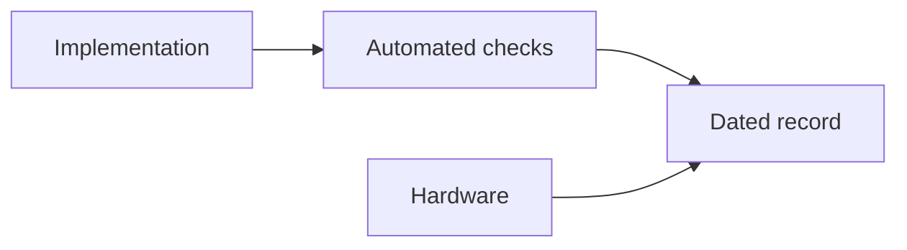

 

# Implementation status and evidence

[← Documentation](README.md) · [API / Postman](API.md)

## Reading guide

| Topic | What to know |
| --- | --- |
| **Reading the log** | Original entries retain dates, commands, outcomes and rollbacks. An old release does not necessarily describe current production. |
| **Implemented** | API, Android/DAT, isolated biometrics, versioned records, social and visual memory have implementation and dated checks. |
| **Current provider** | ElevenLabs for synthesis; Muse Voice Transcribe for STT. Local-synthesis entries are historical. |
| **Test scope** | Unit tests, contracts and rendering do not establish hardware behavior. Keep unperformed physical checks pending. |
| **Submission** | Final video, registration and rights require separate evidence; consult the hackathon review. |

## Procedures and evidence

The original reference preserves technical details, examples and dated checks in their source language. Retired-component instructions are historical; use the current installation guides to operate.
[↗ Complete original reference](reference/IMPLEMENTATION_STATUS.legacy.md)
[IMPLEMENTATION CHECKLIST ](IMPLEMENTATION_CHECKLIST.md) · [DEMO ](DEMO.md) · [HACKATHON ](HACKATHON.md)

Historical sections

[↗ implementation-status--2026-10-28](reference/IMPLEMENTATION_STATUS.legacy.md#implementation-status--2026-10-28)

[↗ verified-in-this-workspace](reference/IMPLEMENTATION_STATUS.legacy.md#verified-in-this-workspace)

[↗ production-verification](reference/IMPLEMENTATION_STATUS.legacy.md#production-verification)

[↗ public-deployment-verification](reference/IMPLEMENTATION_STATUS.legacy.md#public-deployment-verification)

[↗ implemented-and-production-deployed-device-qa-remains](reference/IMPLEMENTATION_STATUS.legacy.md#implemented-and-production-deployed-device-qa-remains)

[↗ 2026-10-30--gallery-ai-index](reference/IMPLEMENTATION_STATUS.legacy.md#2026-10-30--gallery-ai-index)

[↗ not-implemented](reference/IMPLEMENTATION_STATUS.legacy.md#not-implemented)

[↗ reorganización-estructural--2026-10-30](reference/IMPLEMENTATION_STATUS.legacy.md#reorganización-estructural--2026-10-30)

[↗ búsqueda-señalizada-revisión-de-subidas-y-carrusel--2026-10-30](reference/IMPLEMENTATION_STATUS.legacy.md#búsqueda-señalizada-revisión-de-subidas-y-carrusel--2026-10-30)

[↗ recuperación-de-imágenes-y-seguimiento-del-chat--2026-10-30](reference/IMPLEMENTATION_STATUS.legacy.md#recuperación-de-imágenes-y-seguimiento-del-chat--2026-10-30)

[↗ información-visible-y-localizada-del-recurso-del-chat--2026-10-30](reference/IMPLEMENTATION_STATUS.legacy.md#información-visible-y-localizada-del-recurso-del-chat--2026-10-30)

[↗ traducciones-persistidas-al-publicar--2026-10-30](reference/IMPLEMENTATION_STATUS.legacy.md#traducciones-persistidas-al-publicar--2026-10-30)

[↗ historial-actualizado-y-recuperación-automática-de-idiomas--2026-10-30](reference/IMPLEMENTATION_STATUS.legacy.md#historial-actualizado-y-recuperación-automática-de-idiomas--2026-10-30)

[↗ idioma-de-cuenta-y-respuestas-del-chat--2026-10-31](reference/IMPLEMENTATION_STATUS.legacy.md#idioma-de-cuenta-y-respuestas-del-chat--2026-10-31)

[↗ recuperación-segura-de-búsqueda--2026-10-31](reference/IMPLEMENTATION_STATUS.legacy.md#recuperación-segura-de-búsqueda--2026-10-31)

[↗ búsqueda-biométrica-por-foto-o-video--2026-10-31](reference/IMPLEMENTATION_STATUS.legacy.md#búsqueda-biométrica-por-foto-o-video--2026-10-31)

[↗ meta-display-conectado-con-perfil-y-trabajo--2026-10-31](reference/IMPLEMENTATION_STATUS.legacy.md#meta-display-conectado-con-perfil-y-trabajo--2026-10-31)

[↗ zoom-estable-en-el-visor-del-buscador-chat--2026-10-31](reference/IMPLEMENTATION_STATUS.legacy.md#zoom-estable-en-el-visor-del-buscador-chat--2026-10-31)

[↗ recuperación-del-procesamiento-de-búsqueda--2026-10-31](reference/IMPLEMENTATION_STATUS.legacy.md#recuperación-del-procesamiento-de-búsqueda--2026-10-31)

[↗ navegación-ray-ban-meta-simplificada--2026-11-01](reference/IMPLEMENTATION_STATUS.legacy.md#navegación-ray-ban-meta-simplificada--2026-11-01)

[↗ sensores-y-cámara-del-simulador-ray-ban--2026-11-01](reference/IMPLEMENTATION_STATUS.legacy.md#sensores-y-cámara-del-simulador-ray-ban--2026-11-01)

[↗ toques-de-foto-y-cerrar-en-el-simulador--2026-11-01](reference/IMPLEMENTATION_STATUS.legacy.md#toques-de-foto-y-cerrar-en-el-simulador--2026-11-01)

[↗ idioma-completo-de-interfaz-chat-y-voz--2026-11-01](reference/IMPLEMENTATION_STATUS.legacy.md#idioma-completo-de-interfaz-chat-y-voz--2026-11-01)

[↗ segunda-revisión-de-idiomas--2026-11-01](reference/IMPLEMENTATION_STATUS.legacy.md#segunda-revisión-de-idiomas--2026-11-01)

[↗ seamlessm4t-v2-para-respuestas-de-audio--2026-11-01](reference/IMPLEMENTATION_STATUS.legacy.md#seamlessm4t-v2-para-respuestas-de-audio--2026-11-01)

[↗ tercera-revisión-idioma-de-reproducción-y-metadatos-del-display--2026-11-01](reference/IMPLEMENTATION_STATUS.legacy.md#tercera-revisión-idioma-de-reproducción-y-metadatos-del-display--2026-11-01)

[↗ conexión-directa-y-seamless-local--2026-11-01](reference/IMPLEMENTATION_STATUS.legacy.md#conexión-directa-y-seamless-local--2026-11-01)

[↗ alternativa-windows--docker-con-proveedores-reales--2026-11-01](reference/IMPLEMENTATION_STATUS.legacy.md#alternativa-windows--docker-con-proveedores-reales--2026-11-01)

[↗ apertura-de-cámara-desde-buscar-en-la-vista-previa--2026-11-01](reference/IMPLEMENTATION_STATUS.legacy.md#apertura-de-cámara-desde-buscar-en-la-vista-previa--2026-11-01)

[↗ señalización-facial-legible-y-perfil-nativo--2026-11-01](reference/IMPLEMENTATION_STATUS.legacy.md#señalización-facial-legible-y-perfil-nativo--2026-11-01)

[↗ carga-verificada-de-fotos-al-navegar-en-display--2026-11-01](reference/IMPLEMENTATION_STATUS.legacy.md#carga-verificada-de-fotos-al-navegar-en-display--2026-11-01)

[↗ voz-sin-modelo-residente--2026-11-02](reference/IMPLEMENTATION_STATUS.legacy.md#voz-sin-modelo-residente--2026-11-02)

[↗ eliminación-de-síntesis-local--2026-11-02](reference/IMPLEMENTATION_STATUS.legacy.md#eliminación-de-síntesis-local--2026-11-02)

[↗ cabecera-global-compacta-y-referencias-internas--2026-11-02](reference/IMPLEMENTATION_STATUS.legacy.md#cabecera-global-compacta-y-referencias-internas--2026-11-02)

[↗ cuentas-e-integración-por-espacios--2026-11-02](reference/IMPLEMENTATION_STATUS.legacy.md#cuentas-e-integración-por-espacios--2026-11-02)

[↗ segunda-auditoría-de-cuentas-y-espacios--2026-11-02](reference/IMPLEMENTATION_STATUS.legacy.md#segunda-auditoría-de-cuentas-y-espacios--2026-11-02)

[↗ tercera-revisión-integral--2026-11-02](reference/IMPLEMENTATION_STATUS.legacy.md#tercera-revisión-integral--2026-11-02)

[↗ enlace-facial-a-expedientes--2026-11-03](reference/IMPLEMENTATION_STATUS.legacy.md#enlace-facial-a-expedientes--2026-11-03)

[↗ revisión-enlace-facial-r2--2026-11-03](reference/IMPLEMENTATION_STATUS.legacy.md#revisión-enlace-facial-r2--2026-11-03)

[↗ revisión-r3-stop-limpio-del-api--2026-11-03](reference/IMPLEMENTATION_STATUS.legacy.md#revisión-r3-stop-limpio-del-api--2026-11-03)

[↗ android-como-única-app-y-auth-por-correo--2026-11-02](reference/IMPLEMENTATION_STATUS.legacy.md#android-como-única-app-y-auth-por-correo--2026-11-02)

[↗ rediseño-gráfico-de-cuentas-android--2026-11-03](reference/IMPLEMENTATION_STATUS.legacy.md#rediseño-gráfico-de-cuentas-android--2026-11-03)

[↗ acceso-inicial-y-explora-realityos--2026-11-03](reference/IMPLEMENTATION_STATUS.legacy.md#acceso-inicial-y-explora-realityos--2026-11-03)

[↗ nombre-del-remitente-de-correo--2026-11-03](reference/IMPLEMENTATION_STATUS.legacy.md#nombre-del-remitente-de-correo--2026-11-03)

## Email replacement and duplicate accounts — 2026-11-03

Android now replaces the pending account's email through
`POST /v1/auth/change-pending-email`, using its registration username/password.
The same user ID and credentials remain; previous confirmation links become
invalid, and subsequent resends use the new address. SMTP failure rolls back
the replacement. Confirmed, active and provisioned accounts cannot use this
registration-only operation. A duplicate email/username blocks registration
before insertion and offers recovery, confirmation resend or different details.

Verified: 419 backend/gateway tests (27 account tests), 212 Android tests,
format/lint and Debug/Release builds. Six gateway cases initially could not
read the production `.env`; all seven gateway tests passed from the isolated
test directory. New native screenshots cover ES/EN, 320/390/480 dp and 200% text.
Device QA and real mailbox receipt after the fix remain pending; no test mail
was sent and no production user's email was manually changed.

Production: `realityos-backend:email-correction-20261103`; actual API readiness,
public/local OpenAPI, credential rejection, mail sender and Alembic
`20261103_0033 (head)` verified. Runtime, gateway and resource limits preserved;
no migration. Debug APK SHA-256:
`ddc472c9620a8fc64d2a6960abf135e3957b5612928ee1f1cbed632b718c748f`.
Rollback: `.runtime/email-correction-20261103-rollback.json`.
Receipt: `.runtime/email-correction-20261103/verified.json`.

## Correcting the existing account identity — 2026-11-03

A rejected duplicate registration could leave its proposed username in the
email correction form, producing HTTP 401 before any mail was sent. Android
now separates the existing account identifier from the new address. It uses
the successfully registered username or the address submitted for confirmation;
the duplicate-account card also opens correction directly with the occupied
identifier. `/v1/auth/change-pending-email` accepts either the existing username
or current email in `username`, always verifies the password, and retains the
same account, duplicate checks and atomic email/link replacement.

The form explains credential rejection, ineligible accounts, throttling, delivery
failure and network errors in EN/ES. Email-correction credential errors no longer
clear an unrelated authenticated session. Recovery uses the existing address,
never the proposed replacement. No production account was manually changed and
no real confirmation email was sent during validation.

Verified: 37 focused backend/contract/documentation/transport tests, including
30 account tests, and 216 Android tests. Native snapshots cover the correction
form and credential error, including 320 dp at 200% text. Physical handset QA
and real inbox delivery remain pending.

Production: `realityos-backend:email-identity-20261103`, API/worker readiness,
public/local OpenAPI, invalid email-identifier rejection and Alembic
`20261103_0033 (head)` verified. No schema migration; gateway and runtime preserved.
Rollback: `.runtime/email-identity-20261103-rollback.json`.

During validation, the preceding CI release installed Kombu 5.7 with redis-py
5.3.1, leaving its worker restarting. Both services were restored to the last
working image before this release. Declaring `celery[redis]` makes dependency
resolution include Kombu's Redis constraints; the final image resolves Kombu
5.6.2 with redis-py 5.3.1, passes `pip check` and responds to worker inspection.
The new offline transport regression fails on the incompatible CI image.
Upstream dependency declarations: [Celery Redis extra](https://github.com/celery/celery/blob/v5.6.3/requirements/extras/redis.txt),
[Kombu Redis extra](https://github.com/celery/kombu/blob/v5.7.0/requirements/extras/redis.txt).

Formatting, lint, architecture checks and Debug/Release builds passed. The single installable Debug APK was replaced.
