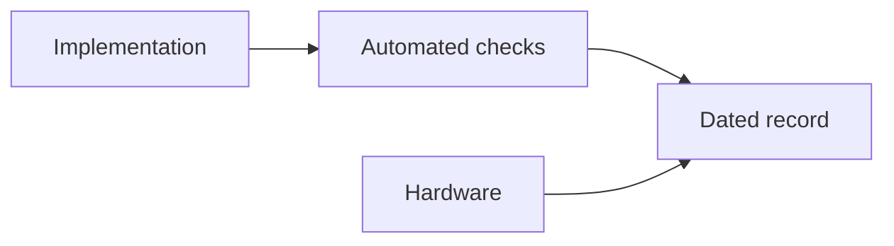

 

# Implementation status and evidence

[← Documentation](README.md) · [API / Postman](API.md)

## Reading guide

| Topic | What to know |
| --- | --- |
| **Reading the log** | Original entries retain dates, commands, outcomes and rollbacks. An old release does not necessarily describe current production. |
| **Implemented** | API, Android/DAT, isolated biometrics, versioned records, social and visual memory have implementation and dated checks. |
| **Current provider** | ElevenLabs for synthesis; Muse Voice Transcribe for STT. Local-synthesis entries are historical. |
| **Test scope** | Unit tests, contracts and rendering do not establish hardware behavior. Keep unperformed physical checks pending. |
| **Submission** | Final video, registration and rights require separate evidence; consult the hackathon review. |

## Procedures and evidence

The original reference preserves technical details, examples and dated checks in their source language. Retired-component instructions are historical; use the current installation guides to operate.
[↗ Complete original reference](reference/IMPLEMENTATION_STATUS.legacy.md)
[IMPLEMENTATION CHECKLIST ](IMPLEMENTATION_CHECKLIST.md) · [DEMO ](DEMO.md) · [HACKATHON ](HACKATHON.md)

Historical sections

[↗ implementation-status--2026-10-28](reference/IMPLEMENTATION_STATUS.legacy.md#implementation-status--2026-10-28)

[↗ verified-in-this-workspace](reference/IMPLEMENTATION_STATUS.legacy.md#verified-in-this-workspace)

[↗ production-verification](reference/IMPLEMENTATION_STATUS.legacy.md#production-verification)

[↗ public-deployment-verification](reference/IMPLEMENTATION_STATUS.legacy.md#public-deployment-verification)

[↗ implemented-and-production-deployed-device-qa-remains](reference/IMPLEMENTATION_STATUS.legacy.md#implemented-and-production-deployed-device-qa-remains)

[↗ 2026-10-30--gallery-ai-index](reference/IMPLEMENTATION_STATUS.legacy.md#2026-10-30--gallery-ai-index)

[↗ not-implemented](reference/IMPLEMENTATION_STATUS.legacy.md#not-implemented)

[↗ reorganización-estructural--2026-10-30](reference/IMPLEMENTATION_STATUS.legacy.md#reorganización-estructural--2026-10-30)

[↗ búsqueda-señalizada-revisión-de-subidas-y-carrusel--2026-10-30](reference/IMPLEMENTATION_STATUS.legacy.md#búsqueda-señalizada-revisión-de-subidas-y-carrusel--2026-10-30)

[↗ recuperación-de-imágenes-y-seguimiento-del-chat--2026-10-30](reference/IMPLEMENTATION_STATUS.legacy.md#recuperación-de-imágenes-y-seguimiento-del-chat--2026-10-30)

[↗ información-visible-y-localizada-del-recurso-del-chat--2026-10-30](reference/IMPLEMENTATION_STATUS.legacy.md#información-visible-y-localizada-del-recurso-del-chat--2026-10-30)

[↗ traducciones-persistidas-al-publicar--2026-10-30](reference/IMPLEMENTATION_STATUS.legacy.md#traducciones-persistidas-al-publicar--2026-10-30)

[↗ historial-actualizado-y-recuperación-automática-de-idiomas--2026-10-30](reference/IMPLEMENTATION_STATUS.legacy.md#historial-actualizado-y-recuperación-automática-de-idiomas--2026-10-30)

[↗ idioma-de-cuenta-y-respuestas-del-chat--2026-10-31](reference/IMPLEMENTATION_STATUS.legacy.md#idioma-de-cuenta-y-respuestas-del-chat--2026-10-31)

[↗ recuperación-segura-de-búsqueda--2026-10-31](reference/IMPLEMENTATION_STATUS.legacy.md#recuperación-segura-de-búsqueda--2026-10-31)

[↗ búsqueda-biométrica-por-foto-o-video--2026-10-31](reference/IMPLEMENTATION_STATUS.legacy.md#búsqueda-biométrica-por-foto-o-video--2026-10-31)

[↗ meta-display-conectado-con-perfil-y-trabajo--2026-10-31](reference/IMPLEMENTATION_STATUS.legacy.md#meta-display-conectado-con-perfil-y-trabajo--2026-10-31)

[↗ zoom-estable-en-el-visor-del-buscador-chat--2026-10-31](reference/IMPLEMENTATION_STATUS.legacy.md#zoom-estable-en-el-visor-del-buscador-chat--2026-10-31)

[↗ recuperación-del-procesamiento-de-búsqueda--2026-10-31](reference/IMPLEMENTATION_STATUS.legacy.md#recuperación-del-procesamiento-de-búsqueda--2026-10-31)

[↗ navegación-ray-ban-meta-simplificada--2026-11-01](reference/IMPLEMENTATION_STATUS.legacy.md#navegación-ray-ban-meta-simplificada--2026-11-01)

[↗ sensores-y-cámara-del-simulador-ray-ban--2026-11-01](reference/IMPLEMENTATION_STATUS.legacy.md#sensores-y-cámara-del-simulador-ray-ban--2026-11-01)

[↗ toques-de-foto-y-cerrar-en-el-simulador--2026-11-01](reference/IMPLEMENTATION_STATUS.legacy.md#toques-de-foto-y-cerrar-en-el-simulador--2026-11-01)

[↗ idioma-completo-de-interfaz-chat-y-voz--2026-11-01](reference/IMPLEMENTATION_STATUS.legacy.md#idioma-completo-de-interfaz-chat-y-voz--2026-11-01)

[↗ segunda-revisión-de-idiomas--2026-11-01](reference/IMPLEMENTATION_STATUS.legacy.md#segunda-revisión-de-idiomas--2026-11-01)

[↗ seamlessm4t-v2-para-respuestas-de-audio--2026-11-01](reference/IMPLEMENTATION_STATUS.legacy.md#seamlessm4t-v2-para-respuestas-de-audio--2026-11-01)

[↗ tercera-revisión-idioma-de-reproducción-y-metadatos-del-display--2026-11-01](reference/IMPLEMENTATION_STATUS.legacy.md#tercera-revisión-idioma-de-reproducción-y-metadatos-del-display--2026-11-01)

[↗ conexión-directa-y-seamless-local--2026-11-01](reference/IMPLEMENTATION_STATUS.legacy.md#conexión-directa-y-seamless-local--2026-11-01)

[↗ alternativa-windows--docker-con-proveedores-reales--2026-11-01](reference/IMPLEMENTATION_STATUS.legacy.md#alternativa-windows--docker-con-proveedores-reales--2026-11-01)

[↗ apertura-de-cámara-desde-buscar-en-la-vista-previa--2026-11-01](reference/IMPLEMENTATION_STATUS.legacy.md#apertura-de-cámara-desde-buscar-en-la-vista-previa--2026-11-01)

[↗ señalización-facial-legible-y-perfil-nativo--2026-11-01](reference/IMPLEMENTATION_STATUS.legacy.md#señalización-facial-legible-y-perfil-nativo--2026-11-01)

[↗ carga-verificada-de-fotos-al-navegar-en-display--2026-11-01](reference/IMPLEMENTATION_STATUS.legacy.md#carga-verificada-de-fotos-al-navegar-en-display--2026-11-01)

[↗ voz-sin-modelo-residente--2026-11-02](reference/IMPLEMENTATION_STATUS.legacy.md#voz-sin-modelo-residente--2026-11-02)

[↗ eliminación-de-síntesis-local--2026-11-02](reference/IMPLEMENTATION_STATUS.legacy.md#eliminación-de-síntesis-local--2026-11-02)

[↗ cabecera-global-compacta-y-referencias-internas--2026-11-02](reference/IMPLEMENTATION_STATUS.legacy.md#cabecera-global-compacta-y-referencias-internas--2026-11-02)

[↗ cuentas-e-integración-por-espacios--2026-11-02](reference/IMPLEMENTATION_STATUS.legacy.md#cuentas-e-integración-por-espacios--2026-11-02)

[↗ segunda-auditoría-de-cuentas-y-espacios--2026-11-02](reference/IMPLEMENTATION_STATUS.legacy.md#segunda-auditoría-de-cuentas-y-espacios--2026-11-02)

[↗ tercera-revisión-integral--2026-11-02](reference/IMPLEMENTATION_STATUS.legacy.md#tercera-revisión-integral--2026-11-02)

[↗ enlace-facial-a-expedientes--2026-11-03](reference/IMPLEMENTATION_STATUS.legacy.md#enlace-facial-a-expedientes--2026-11-03)

[↗ revisión-enlace-facial-r2--2026-11-03](reference/IMPLEMENTATION_STATUS.legacy.md#revisión-enlace-facial-r2--2026-11-03)

[↗ revisión-r3-stop-limpio-del-api--2026-11-03](reference/IMPLEMENTATION_STATUS.legacy.md#revisión-r3-stop-limpio-del-api--2026-11-03)

[↗ android-como-única-app-y-auth-por-correo--2026-11-02](reference/IMPLEMENTATION_STATUS.legacy.md#android-como-única-app-y-auth-por-correo--2026-11-02)

[↗ rediseño-gráfico-de-cuentas-android--2026-11-03](reference/IMPLEMENTATION_STATUS.legacy.md#rediseño-gráfico-de-cuentas-android--2026-11-03)

[↗ acceso-inicial-y-explora-realityos--2026-11-03](reference/IMPLEMENTATION_STATUS.legacy.md#acceso-inicial-y-explora-realityos--2026-11-03)

[↗ nombre-del-remitente-de-correo--2026-11-03](reference/IMPLEMENTATION_STATUS.legacy.md#nombre-del-remitente-de-correo--2026-11-03)

## Email replacement and duplicate accounts — 2026-11-03

Android now replaces the pending account's email through
`POST /v1/auth/change-pending-email`, using its registration username/password.
The same user ID and credentials remain; previous confirmation links become
invalid, and subsequent resends use the new address. SMTP failure rolls back
the replacement. Confirmed, active and provisioned accounts cannot use this
registration-only operation. A duplicate email/username blocks registration
before insertion and offers recovery, confirmation resend or different details.

Verified: 419 backend/gateway tests (27 account tests), 212 Android tests,
format/lint and Debug/Release builds. Six gateway cases initially could not
read the production `.env`; all seven gateway tests passed from the isolated
test directory. New native screenshots cover ES/EN, 320/390/480 dp and 200% text.
Device QA and real mailbox receipt after the fix remain pending; no test mail
was sent and no production user's email was manually changed.

Production: `realityos-backend:email-correction-20261103`; actual API readiness,
public/local OpenAPI, credential rejection, mail sender and Alembic
`20261103_0033 (head)` verified. Runtime, gateway and resource limits preserved;
no migration. Debug APK SHA-256:
`ddc472c9620a8fc64d2a6960abf135e3957b5612928ee1f1cbed632b718c748f`.
Rollback: `.runtime/email-correction-20261103-rollback.json`.
Receipt: `.runtime/email-correction-20261103/verified.json`.

## Correcting the existing account identity — 2026-11-03

A rejected duplicate registration could leave its proposed username in the
email correction form, producing HTTP 401 before any mail was sent. Android
now separates the existing account identifier from the new address. It uses
the successfully registered username or the address submitted for confirmation;
the duplicate-account card also opens correction directly with the occupied
identifier. `/v1/auth/change-pending-email` accepts either the existing username
or current email in `username`, always verifies the password, and retains the
same account, duplicate checks and atomic email/link replacement.

The form explains credential rejection, ineligible accounts, throttling, delivery
failure and network errors in EN/ES. Email-correction credential errors no longer
clear an unrelated authenticated session. Recovery uses the existing address,
never the proposed replacement. No production account was manually changed and
no real confirmation email was sent during validation.

Verified: 37 focused backend/contract/documentation/transport tests, including
30 account tests, and 216 Android tests. Native snapshots cover the correction
form and credential error, including 320 dp at 200% text. Physical handset QA
and real inbox delivery remain pending.

Production: `realityos-backend:email-identity-20261103`, API/worker readiness,
public/local OpenAPI, invalid email-identifier rejection and Alembic
`20261103_0033 (head)` verified. No schema migration; gateway and runtime preserved.
Rollback: `.runtime/email-identity-20261103-rollback.json`.

During validation, the preceding CI release installed Kombu 5.7 with redis-py
5.3.1, leaving its worker restarting. Both services were restored to the last
working image before this release. Declaring `celery[redis]` makes dependency
resolution include Kombu's Redis constraints; the final image resolves Kombu
5.6.2 with redis-py 5.3.1, passes `pip check` and responds to worker inspection.
The new offline transport regression fails on the incompatible CI image.
Upstream dependency declarations: [Celery Redis extra](https://github.com/celery/celery/blob/v5.6.3/requirements/extras/redis.txt),
[Kombu Redis extra](https://github.com/celery/kombu/blob/v5.7.0/requirements/extras/redis.txt).

Formatting, lint, architecture checks and Debug/Release builds passed. The single installable Debug APK was replaced.

## Personal profile details by account source — 2026-11-03

Email/password accounts can edit display name, current location, hometown,
birthday and gender in the Android profile editor. Birthday accepts an ISO date
from 1900 through today, with a native calendar and optional clearing; age is
derived. Nullable fields live in `user_profiles`, separate from imported
`facebook_profiles`. PATCH preserves omitted fields and accepts changes only
for the authenticated owner with a password account and no Facebook identity.
Guests and Facebook identities cannot bypass this restriction through the API.
`GET /me/profile` exposes `profile_source` and `personal_details_editable` for
the native editor; these capabilities are not included in public profiles.

Facebook profile fields are fetched at every Facebook login. Returning users'
names now refresh too. A failed Graph read keeps the last successfully fetched
details and reports `profile_synced=false`; a successful read clears fields
that Meta no longer supplies. The editor explains the Facebook source and keeps
these fields read-only, while custom biography/contact/links/CV remain editable.
No biometric code, consent UI or import/enrollment behavior was changed.

The fields and permission mapping were checked against the
[official Meta SDK profile definition](https://github.com/meta/facebook-ios-sdk/blob/main/FBSDKCoreKit/FBSDKCoreKit/Profile.swift).
Meta's developer reference returned HTTP 429 during verification; existing
Graph endpoints and SDK signatures were preserved. Actual Facebook login on
a handset remains pending; repeated login, withheld fields and provider failure
were tested with synthetic Graph responses.

Production image: `realityos-backend:profile-details-20261103-r3`. Additive
migration `20261103_0034` applied before starting the updated API/worker. Readiness,
public/local OpenAPI, ORM columns, authenticated-write guard and worker verified;
runtime and gateway preserved. No database dump, profile backfill or manual
account edit. Rollback `.runtime/profile-details-20261103-r3-rollback.json`
restores code while retaining the compatible added columns. Receipt:
`.runtime/profile-details-20261103-r3/verified.json`. All 445 backend/gateway
tests passed, including ownership, Facebook restrictions, date validation,
partial update, repeated sync and both fresh/existing migration paths.

Android: all 220 tests passed, including real PATCH exchanges against MockWebServer, read-only Facebook fields, clearing birthday, header refresh and 320 dp/200% text. EN/ES native screenshots were inspected. The test fixture uses OkHttp for PATCH because the desktop JVM URLConnection rejects that method; production Android transport is unchanged.

Formatting, lint, architecture checks and Debug/Release builds passed. The installable Debug APK was replaced at the standard path. Physical-device and live Facebook verification remain pending.

## Postman server/local demo — 2026-11-03

The collection now contains **Server requests** and **Localhost requests**,
with 96 declared variables and 324 requests across both destinations. Each
folder uses independent URLs, credentials, tokens, IDs and write controls.
The collection works without an environment; the two optional environments
mirror the corresponding variables. Public test credentials and explicit demo
user/workspace IDs come from `simulator/postman/demo.json`, at the owner's
request. Other credentials and session tokens are not exported.

The server demo account was provisioned in its own empty workspace with the
query role, without membership in existing workspaces. Newman ran the quick
start plus token refresh against the public API: seven HTTP 200 responses and
nine assertions passed; the identity, sole workspace, empty result and reuse
of the new session were verified. No media or email was created.

Validation: 451 backend/gateway tests, 324 offline Postman request-script checks,
166 write guards, generation drift check, formatter/lint and structure checks
passed. Tests cover separate session stores, login/refresh failure behavior,
account collision protection, idempotent provisioning, role denial and workspace
isolation. No backend/Android source or API contract changed.

Local setup is explicit via `scripts/local/Enable-PostmanDemo.ps1`, uses only
the isolated local Compose project, and creates different demo credentials.
Provisioning/login/refresh and permissions were tested in the isolated test
database; actual execution on Windows Docker Desktop remains pending.
See [API / Postman](API.md) for the import/run instructions.

## Postman English and automatic sessions — 2026-11-03

The collection and both optional environments now use English names, descriptions,
examples and script messages. All 324 requests remain represented, with 98
variables separated by target. Protected requests automatically sign in on Send,
validate cached sessions and renew expired tokens; changing the configured API or
account starts a new session. Failed authentication stops the outgoing request.
Write guards and workspace permissions remain enforced.

Validation: 11 documentation/demo permission tests, 324 offline script checks,
166 write guards, generation checks, formatting/lint and architecture checks passed.
Newman verified query-first automatic login, current user, explicit refresh and
workspace listing against the real server: five assertions, zero failures.
The owner subsequently authorized public release of the existing-workspace collection; see the update below.

## Public jury collection on existing data — 2026-11-03

The main public Postman download now contains 39 prepared requests in Police,
Nursing and Memory folders. Its 45 variables include the three existing account
passwords and real workspace, record and publication IDs, as explicitly authorized
by the owner. No new account, workspace, dataset or server was created. Accounts
retain their existing administrator roles. Meta/ElevenLabs, JWT, database,
integration credentials and the other six worker passwords remain private.

Import the collection and click Send on any request; no manual login, token,
file or ID entry is needed. Responses come from the existing server. The optional
public environment mirrors those values. The separate reference collection keeps
all 324 API templates and the existing server/localhost configuration.

Validation: 12 documentation/demo permission tests, offline resolution of all
39 jury requests, 324 reference scripts, 166 write guards, Postman v2.1 schema,
reproducible generation, lint/format and architecture checks passed. Live Newman
checked the selected users, records, workspace boundaries and publications: 38
requests passed immediately; the Memory AI query returned a transient 503, then
200 with four gallery matches on a targeted retry (50.5 seconds). All 39 prepared
requests were exercised successfully, without claiming external AI is error-free.
Evidence is in `.runtime/postman-public-verification.json` and
`.runtime/postman-memory-retry.json`. No backend/Android contract changed.

## Acceptance checklist and prepared QA data — 2026-11-03

The [manual checklist](IMPLEMENTATION_CHECKLIST.md) defines 77 acceptance cases
and six closure/submission steps, with matching English and Spanish IDs.
Steps, accounts, expected results and evidence cover a physical Android phone,
Display with Mock Device Kit, real email and Facebook. All boxes remain pending;
100% approval requires evidence for all 77 cases on the identified build and
environment. Physical glasses and Windows local are outside this run.

[Camera cards](QA_VISUAL_FIXTURES.md) reuse existing synthetic portraits and
scenes, opened on a computer without downloading portraits to the phone. Two
synthetic PDFs in `simulator/acceptance/` support CV replacement testing. The
nine scenario accounts retain their existing data.

Four isolated QA accounts are ready: administrator, register, query and an
outsider. Each has an avatar and an accessible original private publication.
Admin and member have explicit synthetic consent/enrollment; reader and
outsider do not. HTTP verification covered roles, media, consent rejection,
isolation from all three scenarios and a real-engine probe returning the
expected QA member. This verifies preparation, not camera or screen testing.
Private evidence: `.runtime/acceptance-readiness.json`; access cards:
`.runtime/accesos-prueba.txt`; pending execution log:
`.runtime/acceptance-run.csv`.

No backend/Android source, contract or schema changed; no image or APK was
rebuilt or deployed for these documentation changes. Manual phone, email,
Facebook and Display tests and the portal submission remain pending.

## Postman server/local folders restored — 2026-11-03

The main collection again has exactly two top-level folders: Server requests
(200 requests) and Localhost requests (163). Both retain the complete catalog and
their prefilled quick starts, with independent URLs, credentials, tokens and
workspace IDs. The server quick start uses the existing Memory evaluation account;
all 39 prepared jury queries remain under Server requests → 00 Live scenarios.
Localhost retains its separate account at http://localhost:8080; the established
Enable-PostmanDemo.ps1 setup now points back to the primary collection. The public
and local optional environments mirror their own destination's variables.

Validation: 14 tests passed, including execution of the generated local quick-start
requests against the application test client, permission/workspace isolation and
regressions for both complete catalogs. Offline scripts checked all 363 requests
and destination separation; schema, generation, lint/format and architecture checks
passed. Real-server automatic login, user, workspaces and record listing returned
200 with the expected existing IDs (three Newman assertions, zero failures).
No Windows installation was run during this correction; localhost needs its local
backend and account prepared. No server contract, data or Android change.

## Private R2/S3 connections — 2026-11-03

Implemented account-owned connections, encrypted credentials, paginated browsing, bounded downloads, imports with provenance/retries and manual/scheduled synchronization. Android adds Profile → My connections, destination selection, previews, imports, queries and CV replacement. Existing publication, duplicate and biometric consent flows remain in use; imported originals stay in BYTEA.

Additive migration `20261103_0035`; Celery Beat scheduler for server/local installations. Postman retains both destinations and now contains 393 requests. Guide: [STORAGE_CONNECTIONS](STORAGE_CONNECTIONS.md).

Executed validation: 474 backend/gateway regressions (21 connector tests), 222 Android unit tests, ktlint, lint with no errors, Debug/Release builds, contract/Postman checks and offline PostgreSQL DDL (three additive tables). ES/EN acceptance includes K01–K12: 89 acceptance cases and six closure steps. An offline inventory of 426 synthetic resources is prepared in `.runtime/bucket-demo-manifest.json`. Real R2 upload/read-back requires bucket credentials and has not run yet. Physical Android tests remain pending. The offline inventory is not a completed R2 migration.

The automatic [production deployment](https://github.com/Luxisoft/realityos-spatial-memory/actions/runs/41666700365) succeeded for `81a69d2`: API/worker/scheduler published, Alembic `20261103_0035 (head)`, HTTPS readiness 200 and an exact OpenAPI match. All three jury accounts received 200 when listing their connections; these remain empty until R2 is prepared. Release and rollback are saved in `.runtime/storage-connections-20261103-{release,rollback}.json`; rollback requires stopping the new scheduler and applying the rollback with the same production Compose layers. No manual Docker deployment was performed: CI activated the push-authorized release.
