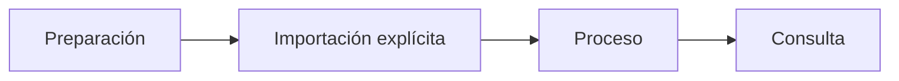

<p align="center"><a href="MANUAL_PHOTO_TEST.md"></a> <a href="MANUAL_PHOTO_TEST.es.md"></a></p>

# Prueba con fotos propias

[← Documentación](README.es.md) · [API / Postman](API.es.md)

## Guía de lectura

| Tema | Qué debes saber |
| --- | --- |
| **Preparar** | `make runtime-dirs` crea carpetas privadas; colocar un archivo no registra, captura ni llama a Meta. |
| **Elegir** | Usar solo material autorizado para una prueba de objetos, sin secretos ni datos privados ajenos. JPEG, PNG, WebP; videos según contrato. |
| **Importar** | El importador solicita contraseña y consentimiento; usa API normal y abre/cierra sesión explícita. |
| **Procesar** | `--process` inicia análisis Muse; SAM por observación es un refinamiento explícito posterior. `--wait-seconds` ajusta espera. |
| **Comprobar** | Consultar desde Android o Postman; repetir con otro lugar para probar historial. Confirmar fecha, fuente y sin afirmar ubicación actual. |



## Comandos

Ejecutar desde la raíz, con dependencias instaladas. Migraciones y procesamiento requieren el entorno elegido y autorización de sus datos.
```bash
make runtime-dirs
.venv/bin/python scripts/import_manual_photos.py --help
```

## Procedimientos y evidencia

La referencia original conserva los detalles técnicos, ejemplos y verificaciones fechadas en su idioma de origen. Las instrucciones de componentes retirados son historia; usa las guías de instalación actuales para operar.
[↗ Referencia original completa](reference/MANUAL_PHOTO_TEST.legacy.md)
[API ](API.es.md) · [DEMO ](DEMO.es.md) · [SECURITY ](SECURITY.es.md)

<details>
<summary>Secciones históricas</summary>

<a id="manual-photo-test"></a>
[↗ manual-photo-test](reference/MANUAL_PHOTO_TEST.legacy.md#manual-photo-test)

<a id="stage-photos"></a>
[↗ stage-photos](reference/MANUAL_PHOTO_TEST.legacy.md#stage-photos)

<a id="register-and-process-deliberately"></a>
[↗ register-and-process-deliberately](reference/MANUAL_PHOTO_TEST.legacy.md#register-and-process-deliberately)

<a id="verify"></a>
[↗ verify](reference/MANUAL_PHOTO_TEST.legacy.md#verify)

</details>
