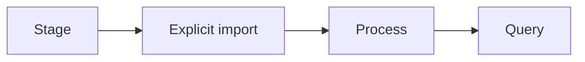

<p align="center"><a href="MANUAL_PHOTO_TEST.md"></a> <a href="MANUAL_PHOTO_TEST.es.md"></a></p>

# Test with your own photos

[← Documentation](README.md) · [API / Postman](API.md)

## Reading guide

| Topic | What to know |
| --- | --- |
| **Prepare** | `make runtime-dirs` creates private folders; staging a file does not register, capture or call Meta. |
| **Choose** | Use only authorized material for an object test, without secrets or unrelated private data. JPEG, PNG, WebP; video according to contract. |
| **Import** | The importer prompts for password and consent; it uses the regular API and explicitly opens/closes a session. |
| **Process** | `--process` starts Muse analysis; per-observation SAM is a later explicit refinement. `--wait-seconds` adjusts waiting. |
| **Verify** | Query from Android or Postman; repeat in another location to test history. Confirm date and source without claiming current location. |



## Commands

Run from the root with dependencies installed. Migrations and processing require the chosen environment and authorized data.
```bash
make runtime-dirs
.venv/bin/python scripts/import_manual_photos.py --help
```

## Procedures and evidence

The original reference preserves technical details, examples and dated checks in their source language. Retired-component instructions are historical; use the current installation guides to operate.
[↗ Complete original reference](reference/MANUAL_PHOTO_TEST.legacy.md)
[API ](API.md) · [DEMO ](DEMO.md) · [SECURITY ](SECURITY.md)

<details>
<summary>Historical sections</summary>

<a id="manual-photo-test"></a>
[↗ manual-photo-test](reference/MANUAL_PHOTO_TEST.legacy.md#manual-photo-test)

<a id="stage-photos"></a>
[↗ stage-photos](reference/MANUAL_PHOTO_TEST.legacy.md#stage-photos)

<a id="register-and-process-deliberately"></a>
[↗ register-and-process-deliberately](reference/MANUAL_PHOTO_TEST.legacy.md#register-and-process-deliberately)

<a id="verify"></a>
[↗ verify](reference/MANUAL_PHOTO_TEST.legacy.md#verify)

</details>
