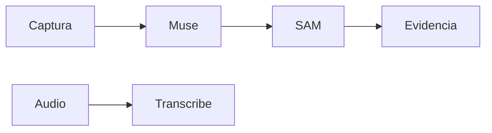

 

# Integración Meta

[← Documentación](README.es.md) · [API / Postman](API.es.md)

## Guía de lectura

| Tema | Qué debes saber |
| --- | --- |
| **Muse Spark 1.3** | Análisis de hechos visibles, interpretación de consultas y preparación de textos EN/ES con contexto autorizado. |
| **SAM 3.1** | Segmentación explícita y análisis de publicaciones en worker. Grupos de hasta 16 objetos; conservar geometría y evidencia originales. |
| **Video** | Files API temporal y streaming SAM; conservar PTS y RLE. Envíos ambiguos quedan inciertos, sin repetición automática. |
| **Traducciones** | Se preparan y guardan al publicar o mediante una acción explícita. Abrir información de evidencia lee textos preparados. |
| **Conexión** | `.env` selecciona `direct` o `gateway`; FRONTEND puede ser respaldo. Clave Meta privada en ambos servidores. |
| **Mock / Live** | Mock determinista y rotulado; Live no cae a mock silenciosamente. Las verificaciones pasadas no prueban un nuevo request Live. |

## Procedimientos y evidencia

La referencia original conserva los detalles técnicos, ejemplos y verificaciones fechadas en su idioma de origen. Las instrucciones de componentes retirados son historia; usa las guías de instalación actuales para operar.
[↗ Referencia original completa](reference/META_INTEGRATION.legacy.md)
[GATEWAY ](GATEWAY.es.md) · [TTS ](TTS.es.md) · [IMPLEMENTATION STATUS ](IMPLEMENTATION_STATUS.es.md)

Secciones históricas

[↗ meta-model-api-integration](reference/META_INTEGRATION.legacy.md#meta-model-api-integration)

[↗ respuestas-de-audio](reference/META_INTEGRATION.legacy.md#respuestas-de-audio)

[↗ direct-connection-and-automatic-fallback--2026-11-01](reference/META_INTEGRATION.legacy.md#direct-connection-and-automatic-fallback--2026-11-01)

