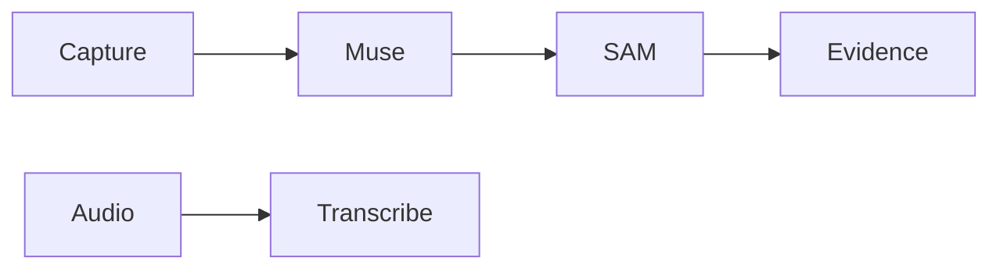

 

# Meta integration

[← Documentation](README.md) · [API / Postman](API.md)

## Reading guide

| Topic | What to know |
| --- | --- |
| **Muse Spark 1.3** | Visible-fact analysis, query interpretation and EN/ES text preparation using authorized context. |
| **SAM 3.1** | Explicit segmentation and worker publication analysis. Batches of up to 16 objects; preserve original geometry and evidence. |
| **Video** | Temporary Files API upload and SAM streaming; preserve PTS and RLE. Ambiguous submissions remain uncertain without automatic replay. |
| **Translations** | Prepared and stored on publication or through an explicit action. Opening evidence information reads prepared text. |
| **Connection** | `.env` selects `direct` or `gateway`; FRONTEND can provide fallback. Meta key stays private on both servers. |
| **Mock / Live** | Deterministic, labelled Mock; Live never silently falls back to mock. Past checks do not prove a new Live request. |

## Procedures and evidence

The original reference preserves technical details, examples and dated checks in their source language. Retired-component instructions are historical; use the current installation guides to operate.
[↗ Complete original reference](reference/META_INTEGRATION.legacy.md)
[GATEWAY ](GATEWAY.md) · [TTS ](TTS.md) · [IMPLEMENTATION STATUS ](IMPLEMENTATION_STATUS.md)

Historical sections

[↗ meta-model-api-integration](reference/META_INTEGRATION.legacy.md#meta-model-api-integration)

[↗ respuestas-de-audio](reference/META_INTEGRATION.legacy.md#respuestas-de-audio)

[↗ direct-connection-and-automatic-fallback--2026-11-01](reference/META_INTEGRATION.legacy.md#direct-connection-and-automatic-fallback--2026-11-01)

