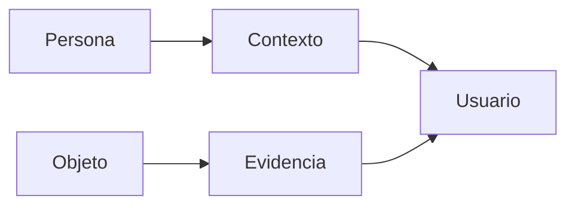

 

# Propósito y capacidades

[← Documentación](README.es.md) · [API / Postman](API.es.md)

## Guía de lectura

| Tema | Qué debes saber |
| --- | --- |
| **Propósito** | Reconocimiento facial, contexto autorizado y memoria visual para múltiples entornos. |
| **Ejemplos** | Policial, enfermería, social y memoria son usos independientes y no exhaustivos; no comparten datos automáticamente. |
| **Evidencia** | Responder con fuente, fecha y geometría; decir visto por última vez y reconocer ausencia o ambigüedad. |
| **Biometría** | Función deliberada con consentimiento, autorización y confirmación humana. No sustituye el flujo de objetos. |
| **Alcance actual** | Android y Display nativo; Muse/SAM/STT y ElevenLabs. No reactivar panel web, web Display ni síntesis local retirados. |
| **Entrega** | Identificar base y aportaciones del evento, mostrar ejecución real y revisar requisitos de hackathon. |

## Procedimientos y evidencia

La referencia original conserva los detalles técnicos, ejemplos y verificaciones fechadas en su idioma de origen. Las instrucciones de componentes retirados son historia; usa las guías de instalación actuales para operar.
[↗ Referencia original completa](reference/REALITYOS_MISSION.legacy.md)
[API ](API.es.md) · [DEMO ](DEMO.es.md) · [HACKATHON ](HACKATHON.es.md)

Secciones históricas

[↗ realityos--misión-de-producto-y-requisitos-vinculantes](reference/REALITYOS_MISSION.legacy.md#realityos--misión-de-producto-y-requisitos-vinculantes)

[↗ problema-y-promesa](reference/REALITYOS_MISSION.legacy.md#problema-y-promesa)

[↗ modos-obligatorios](reference/REALITYOS_MISSION.legacy.md#modos-obligatorios)

[↗ registrar--escritura-explícita](reference/REALITYOS_MISSION.legacy.md#registrar--escritura-explícita)

[↗ consultar--solo-lectura](reference/REALITYOS_MISSION.legacy.md#consultar--solo-lectura)

[↗ arquitectura-objetivo](reference/REALITYOS_MISSION.legacy.md#arquitectura-objetivo)

[↗ modelo-de-datos-no-negociable](reference/REALITYOS_MISSION.legacy.md#modelo-de-datos-no-negociable)

[↗ meta-y-modo-simulado](reference/REALITYOS_MISSION.legacy.md#meta-y-modo-simulado)

[↗ contrato-rest-mínimo](reference/REALITYOS_MISSION.legacy.md#contrato-rest-mínimo)

[↗ seguridad-privacidad-y-demostración](reference/REALITYOS_MISSION.legacy.md#seguridad-privacidad-y-demostración)

