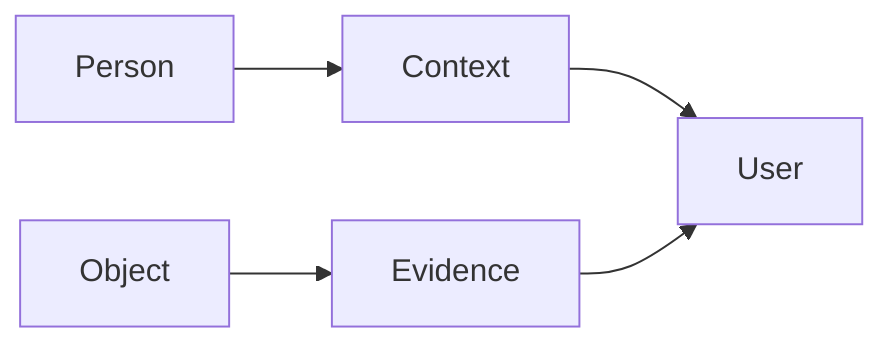

 

# Purpose and capabilities

[← Documentation](README.md) · [API / Postman](API.md)

## Reading guide

| Topic | What to know |
| --- | --- |
| **Purpose** | Facial recognition, authorized context and visual memory across domains. |
| **Examples** | Police, nursing, social and memory are independent, non-exhaustive examples; they do not automatically share data. |
| **Evidence** | Answer with source, date and geometry; say last seen and acknowledge missing or ambiguous evidence. |
| **Biometrics** | Deliberate feature with consent, authorization and human confirmation. Separate from the object flow. |
| **Current scope** | Android and native Display; Muse/SAM/STT and ElevenLabs. Do not restore retired browser panel, web Display or local synthesis. |
| **Submission** | Identify baseline and event contributions, demonstrate real execution and review hackathon requirements. |

## Procedures and evidence

The original reference preserves technical details, examples and dated checks in their source language. Retired-component instructions are historical; use the current installation guides to operate.
[↗ Complete original reference](reference/REALITYOS_MISSION.legacy.md)
[API ](API.md) · [DEMO ](DEMO.md) · [HACKATHON ](HACKATHON.md)

Historical sections

[↗ realityos--misión-de-producto-y-requisitos-vinculantes](reference/REALITYOS_MISSION.legacy.md#realityos--misión-de-producto-y-requisitos-vinculantes)

[↗ problema-y-promesa](reference/REALITYOS_MISSION.legacy.md#problema-y-promesa)

[↗ modos-obligatorios](reference/REALITYOS_MISSION.legacy.md#modos-obligatorios)

[↗ registrar--escritura-explícita](reference/REALITYOS_MISSION.legacy.md#registrar--escritura-explícita)

[↗ consultar--solo-lectura](reference/REALITYOS_MISSION.legacy.md#consultar--solo-lectura)

[↗ arquitectura-objetivo](reference/REALITYOS_MISSION.legacy.md#arquitectura-objetivo)

[↗ modelo-de-datos-no-negociable](reference/REALITYOS_MISSION.legacy.md#modelo-de-datos-no-negociable)

[↗ meta-y-modo-simulado](reference/REALITYOS_MISSION.legacy.md#meta-y-modo-simulado)

[↗ contrato-rest-mínimo](reference/REALITYOS_MISSION.legacy.md#contrato-rest-mínimo)

[↗ seguridad-privacidad-y-demostración](reference/REALITYOS_MISSION.legacy.md#seguridad-privacidad-y-demostración)

