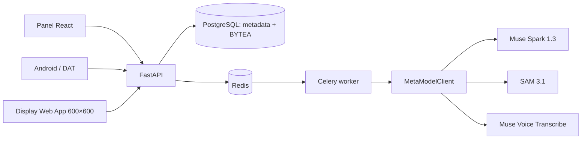

# RealityOS — misión de producto y requisitos vinculantes

**Proyecto:** RealityOS — An Intelligent Spatial Memory  
**Objetivo:** entrega desplegable para Meta AI Developer Hackathon 2026  
**Repositorio:** `Luxisoft/realityos-spatial-memory`  
**Licencia:** Apache License 2.0, sin cambios.

## Problema y promesa

RealityOS conserva evidencia visual de dónde se observó un objeto en un espacio
de trabajo y permite recuperarla más tarde, sin volver a grabar durante una
consulta. Está pensado para Meta Ray-Ban, talleres, almacenes, bodegas,
oficinas y viviendas.

Ante «¿Dónde está el taladro amarillo?», el sistema debe responder que fue
**visto por última vez** en una ubicación concreta, con fecha, confianza de
recuperación y la fotografía de evidencia almacenada con el objeto resaltado.
Nunca debe inferir que el objeto aún permanece allí.

La fuente de verdad de cada fotografía original será PostgreSQL (`BYTEA`), no
una ruta local, URL o bucket externo. Las imágenes generadas nunca pueden ser
evidencia de una observación.

## Modos obligatorios

### Registrar — escritura explícita

- El usuario autorizado elige workspace y ubicación jerárquica: zona, pasillo,
  estantería y nivel.
- Una sesión de captura se inicia y cierra de forma explícita; no hay vigilancia
  continua ni captura automática durante consultas.
- Clientes web y Android pueden cargar fotos; Android usa cámara, audio y las
  capacidades oficialmente disponibles del dispositivo.
- Se crean sesiones, se almacenan binarios originales, se encola el análisis y
  se conserva el historial de observaciones.
- Muse Spark identifica objetos, atributos y relaciones; SAM 3.1 obtiene cajas
  y/o máscaras para objetos seleccionados. Los resultados ambiguos admiten
  verificación y corrección humana.
- Objetos ya conocidos actualizan su última observación calculada, sin borrar
  observaciones anteriores.
- Los clips de vídeo tienen límites configurables, trazabilidad, frames
  representativos extraídos por FFmpeg y procesamiento acotado.

### Consultar — solo lectura

- Un usuario autenticado elige exclusivamente un workspace autorizado y
  pregunta por texto o voz; el idioma por defecto es `es-CO`.
- Transcripción, interpretación, búsqueda y generación de respuesta son etapas
  separadas. Muse Voice Transcribe se usa solo como STT.
- La recuperación devuelve evidencia almacenada: última observación verificada,
  binario original, geometría de resaltado, confianza de recuperación y texto
  para TTS.
- La operación no crea sesiones, capturas, medios, observaciones ni trabajos;
  se restringe en rutas, servicios y permisos de aplicación.
- Ante ausencia o ambigüedad se informa evidencia insuficiente, sin inventar
  ubicaciones.

## Arquitectura objetivo

El monorepo será modular; API y worker comparten contratos, modelos y reglas de
autorización. No se introducirán microservicios innecesarios.

| Área | Tecnología requerida |
| --- | --- |
| API | Python compatible con 3.12, FastAPI, Pydantic v2, SQLAlchemy 2, Alembic, Psycopg, HTTPX |
| Asíncrono | Redis y Celery, con jobs idempotentes |
| Persistencia | PostgreSQL, `pg_trgm` y FTS; interfaz preparada para vectorial sin imponer pgvector |
| Panel | React, TypeScript, Vite, responsive y en español |
| Móvil | Kotlin, Jetpack Compose, Meta Wearables Device Access Toolkit y Mock Device Kit cuando sea posible |
| Display | React + TypeScript independiente, 600×600, controles D-pad/teclado y toolkit oficial compatible |
| Operación | Docker, Compose, proxy, health checks, volúmenes, CI, scripts y HTTPS configurable |

## Modelo de datos no negociable

Las migraciones Alembic crearán como mínimo `users`, `workspaces`,
`workspace_members`, `zones`, `capture_sessions`, `media_assets`,
`tracked_objects`, `object_aliases`, `object_observations`,
`processing_jobs`, `query_history` y `audit_events`.

`media_assets` guarda UUID, workspace, tipo, MIME, bytes originales, SHA-256,
tamaño, dimensiones, fechas y metadatos. Originales, recortes y máscaras son
recursos relacionados. `tracked_objects` representa la identidad lógica;
`object_observations` incluye evidencia, ubicación, geometría, relaciones,
fecha, confianza visual, modelo, origen y estado de verificación. La ubicación
más reciente se deriva de observaciones verificadas; el historial nunca se
sobrescribe.

Se usarán claves foráneas, índices, validación de MIME/tamaño, deduplicación por
hash y sesión, y aislamiento estricto de workspace.

## Meta y modo simulado

`MetaModelClient` será una capa desacoplada, con contratos Pydantic validados,
timeouts, límites, métricas, errores y reintentos con backoff. Nunca expondrá
`MODEL_API_KEY` al navegador ni a Android.

- `META_MODE=mock`: no efectúa llamadas externas; usa fixtures deterministas y
  marca los resultados explícitamente como simulados.
- `META_MODE=live`: usa `https://api.meta.ai/v1`, Bearer token y únicamente
  endpoints y esquemas confirmados mediante la documentación oficial vigente.
  Los fallos se informan sin fabricar éxitos.
- Muse Spark 1.3 analiza imagen, relaciones, intención y respuestas basadas en
  evidencia. SAM 3.1 produce geometría. Muse Voice Transcribe realiza STT.
- Los proveedores mock y live se prueban con el mismo contrato, incluidos
  timeout y error de proveedor.

Las integraciones Wearables se construyen solamente con APIs oficiales
verificadas. Siempre se diferencia Mock Device Kit, simulador Display y gafas
físicas.

## Contrato REST mínimo

Todos los recursos exigen autenticación, RBAC y pertenencia al workspace. OpenAPI
publicado por FastAPI es el contrato autoritativo.

- Auth: `POST /v1/auth/login`, `POST /v1/auth/refresh`, `GET /v1/auth/me`.
- Workspaces: `GET|POST /v1/workspaces`, `GET|POST /v1/workspaces/{id}/zones`.
- Sesiones: `POST /v1/sessions`, `GET /v1/sessions/{id}`, `POST /v1/sessions/{id}/close`.
- Capturas: `POST /v1/captures`, `GET /v1/captures/{id}`, `POST /v1/captures/{id}/process`, `GET /v1/jobs/{id}`.
- Objetos: `GET /v1/objects`, `GET /v1/objects/{id}`, `GET /v1/objects/{id}/history`, `PATCH /v1/observations/{id}`.
- Consultas: `POST /v1/queries`, `POST /v1/queries/audio`.
- Medios: `GET /v1/media/{id}`, `GET /v1/media/{id}/highlighted`.
- Sistema: `GET /health/live`, `GET /health/ready`.

## Seguridad, privacidad y demostración

La plataforma incluye hash de contraseñas, access/refresh tokens con revocación
y expiración, RBAC (`register`, `query`, `admin`), CORS restringido,
límites de carga, consentimiento, auditoría sin secretos, borrado controlado y
configuración distinta para desarrollo/producción. HTTPS es obligatorio en
producción.

El seed reproducible crea **Taller RealityOS**, Bodega A, Estanterías 1–3 y Mesa
de trabajo, con assets sintéticos propios o legales de taladro amarillo,
martillo, llave inglesa, destornillador, caja de herramientas y cargador. Debe
demostrar registro, persistencia `BYTEA`, procesamiento mock, consulta,
resaltado, TTS disponible, Display y que consultar no graba.

Un incremento solo termina cuando compila o inicia según corresponda, pasan sus
pruebas, la documentación refleja el estado real y existe un commit
descriptivo. Dependencias externas o credenciales bloqueadas se registran con
precisión en `docs/IMPLEMENTATION_STATUS.md`; nunca se afirma una integración
o ejecución no comprobada.
