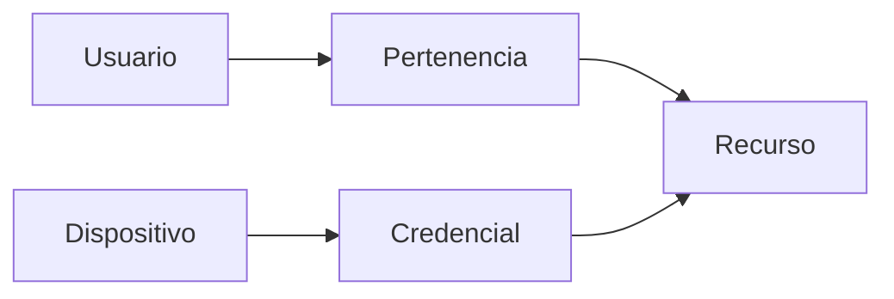

 

# Seguridad y privacidad

[← Documentación](README.es.md) · [API / Postman](API.es.md)

## Guía de lectura

| Tema | Qué debes saber |
| --- | --- |
| **Sesiones** | Contraseñas con scrypt y sal; access tokens vencen y refresh tokens rotan con revocación persistida. |
| **Autorización** | Comprobar pertenencia y rol también al servir medios. Los enlaces firmados tienen alcance y vigencia limitados. |
| **Secretos** | Claves Meta/ElevenLabs, JWT, SMTP y DB solo en runtime privado del servidor. Exportaciones Postman sin credenciales. |
| **Dispositivos** | ID público y clave independiente; solo hash con pepper en servidor. Enrolamiento, rotación y revocación auditados. |
| **Biometría** | Consentimiento y autorización por espacio; revocar consentimiento elimina enrolamientos de usuario. Candidatos requieren confirmación. |
| **Retención** | Existen bajas de recursos y borrado de CV/consentimiento; no equivalen a una política integral de retención, exportación y borrado de clientes. |
| **Operación** | TLS, CORS restringido, claves rotadas y copias privadas verificadas. SHA-256 aporta integridad, no cifrado en reposo. |

## Procedimientos y evidencia

La referencia original conserva los detalles técnicos, ejemplos y verificaciones fechadas en su idioma de origen. Las instrucciones de componentes retirados son historia; usa las guías de instalación actuales para operar.
[↗ Referencia original completa](reference/SECURITY.legacy.md)
[API ](API.es.md) · [WORKSPACE DATA ](WORKSPACE_DATA.es.md) · [HACKATHON ](HACKATHON.es.md)

Secciones históricas

[↗ security-and-privacy](reference/SECURITY.legacy.md#security-and-privacy)

