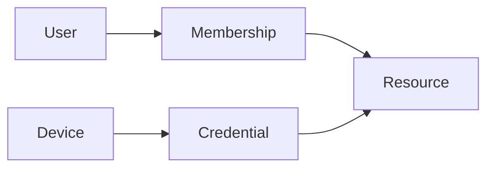

 

# Security and privacy

[← Documentation](README.md) · [API / Postman](API.md)

## Reading guide

| Topic | What to know |
| --- | --- |
| **Sessions** | Salted scrypt passwords; access tokens expire and refresh tokens rotate with persisted revocation. |
| **Authorization** | Check membership and role when serving media too. Signed links have limited scope and lifetime. |
| **Secrets** | Meta/ElevenLabs, JWT, SMTP and DB secrets stay in private server runtime. Postman exports contain no credentials. |
| **Devices** | Public ID and independent key; server stores only a peppered hash. Enrollment, rotation and revocation are audited. |
| **Biometrics** | Consent and workspace authorization; revocation deletes user enrollments. Candidates require confirmation. |
| **Retention** | Resource removal and CV/consent deletion exist; these do not constitute a complete customer retention, export and erasure policy. |
| **Operations** | TLS, constrained CORS, rotated keys and verified private backups. SHA-256 provides integrity, not encryption at rest. |

## Procedures and evidence

The original reference preserves technical details, examples and dated checks in their source language. Retired-component instructions are historical; use the current installation guides to operate.
[↗ Complete original reference](reference/SECURITY.legacy.md)
[API ](API.md) · [WORKSPACE DATA ](WORKSPACE_DATA.md) · [HACKATHON ](HACKATHON.md)

Historical sections

[↗ security-and-privacy](reference/SECURITY.legacy.md#security-and-privacy)

