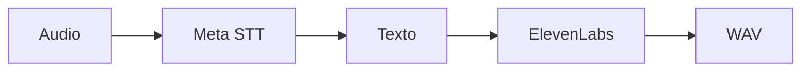

 

# Voz y transcripción

[← Documentación](README.es.md) · [API / Postman](API.es.md)

## Guía de lectura

| Tema | Qué debes saber |
| --- | --- |
| **Entrada** | Muse Voice Transcribe convierte audio a texto; Muse Spark interpreta contexto. |
| **Salida** | `POST /v1/tts`, `{text, language}` con `en`/`es`, devuelve WAV PCM mono de 24 kHz. Usuario o dispositivo autenticado. |
| **Proveedor** | ElevenLabs exclusivamente para síntesis, en servidor y Windows. No hay pesos ni modelo de voz local. |
| **Configuración** | `ELEVENLABS_API_KEY` privada; selección por `ELEVENLABS_VOICE_ID`, `ELEVENLABS_MODEL_ID`, `TTS_TIMEOUT_SECONDS`. |
| **Límites** | Dos generaciones simultáneas por proceso; presupuesto HTTP de 30 s, hasta 300 s de audio y 16 MiB WAV. |
| **Persistencia** | La síntesis no guarda capturas, mensajes ni cachés. Sin reintento automático ambiguo; no confundir con rutas que guardan audio de chat. |

## Procedimientos y evidencia

La referencia original conserva los detalles técnicos, ejemplos y verificaciones fechadas en su idioma de origen. Las instrucciones de componentes retirados son historia; usa las guías de instalación actuales para operar.
[↗ Referencia original completa](reference/TTS.legacy.md)
[API ](API.es.md) · [META INTEGRATION ](META_INTEGRATION.es.md) · [DEPLOYMENT LOCALHOST ](DEPLOYMENT_LOCALHOST.es.md)

Secciones históricas

[↗ voz-por-elevenlabs-y-transcripción-por-meta](reference/TTS.legacy.md#voz-por-elevenlabs-y-transcripción-por-meta)

[↗ contrato-y-configuración](reference/TTS.legacy.md#contrato-y-configuración)

[↗ ejecución](reference/TTS.legacy.md#ejecución)

