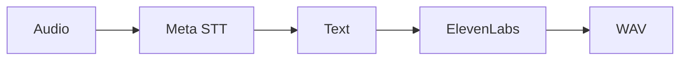

 

# Speech and transcription

[← Documentation](README.md) · [API / Postman](API.md)

## Reading guide

| Topic | What to know |
| --- | --- |
| **Input** | Muse Voice Transcribe turns audio into text; Muse Spark interprets context. |
| **Output** | `POST /v1/tts`, `{text, language}` with `en`/`es`, returns 24 kHz mono PCM WAV. Authenticated user or device. |
| **Provider** | ElevenLabs exclusively for synthesis on server and Windows. No local speech model or weights. |
| **Configuration** | Private `ELEVENLABS_API_KEY`; selection through `ELEVENLABS_VOICE_ID`, `ELEVENLABS_MODEL_ID`, `TTS_TIMEOUT_SECONDS`. |
| **Limits** | Two concurrent generations per process; 30 s HTTP budget, up to 300 s audio and 16 MiB WAV. |
| **Persistence** | Synthesis stores no captures, messages or caches. No automatic ambiguous retries; distinct from routes that store chat audio. |

## Procedures and evidence

The original reference preserves technical details, examples and dated checks in their source language. Retired-component instructions are historical; use the current installation guides to operate.
[↗ Complete original reference](reference/TTS.legacy.md)
[API ](API.md) · [META INTEGRATION ](META_INTEGRATION.md) · [DEPLOYMENT LOCALHOST ](DEPLOYMENT_LOCALHOST.md)

Historical sections

[↗ voz-por-elevenlabs-y-transcripción-por-meta](reference/TTS.legacy.md#voz-por-elevenlabs-y-transcripción-por-meta)

[↗ contrato-y-configuración](reference/TTS.legacy.md#contrato-y-configuración)

[↗ ejecución](reference/TTS.legacy.md#ejecución)

