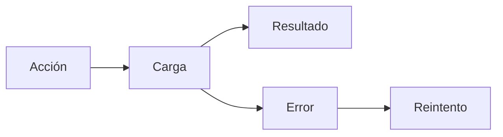

 

# Diseño e interacción

[← Documentación](README.es.md) · [API / Postman](API.es.md)

## Guía de lectura

| Tema | Qué debes saber |
| --- | --- |
| **Sistema visual** | Android mantiene tema gris/azul, tipografía del sistema y controles nativos; DAT usa estilos y capacidades admitidos. |
| **Estados** | Carga, vacío, error, progreso y reintento separados; no anunciar una lista vacía antes de terminar la consulta. |
| **Evidencia** | Imagen completa señalada con fecha, fuente y confianza; detalles extensos en acciones separadas. |
| **Formularios** | Errores junto al campo, foco en el primero, teclado adecuado, autofill y contraseña visible opcional; carga bloquea doble envío. |
| **Accesibilidad** | Objetivos táctiles de 48 dp, texto hasta 200 %, controles etiquetados y gráficos decorativos fuera del lector. ES/EN. |
| **Evaluación** | Capturas Robolectric y pruebas Compose cubren estados y anchos; no sustituyen teclado, cámara ni gafas físicas. |

## Procedimientos y evidencia

La referencia original conserva los detalles técnicos, ejemplos y verificaciones fechadas en su idioma de origen. Las instrucciones de componentes retirados son historia; usa las guías de instalación actuales para operar.
[↗ Referencia original completa](reference/UI_DESIGN.legacy.md)
[WEARABLES ](WEARABLES.es.md) · [DEMO ](DEMO.es.md) · [IMPLEMENTATION STATUS ](IMPLEMENTATION_STATUS.es.md)

Secciones históricas

[↗ identidad-visual-android-y-autenticación](reference/UI_DESIGN.legacy.md#identidad-visual-android-y-autenticación)

[↗ native-meta-display-and-android-host--2026-10-31](reference/UI_DESIGN.legacy.md#native-meta-display-and-android-host--2026-10-31)

[↗ compact-shared-android-profile-header--2026-11-02](reference/UI_DESIGN.legacy.md#compact-shared-android-profile-header--2026-11-02)

[↗ formularios-android-de-cuenta--revisión-gráfica](reference/UI_DESIGN.legacy.md#formularios-android-de-cuenta--revisión-gráfica)

[↗ acceso-inicial-y-explora-realityos--2026-11-03](reference/UI_DESIGN.legacy.md#acceso-inicial-y-explora-realityos--2026-11-03)

[↗ corrección-de-correo-y-datos-ya-registrados--2026-11-03](reference/UI_DESIGN.legacy.md#corrección-de-correo-y-datos-ya-registrados--2026-11-03)

Editar perfil incorpora información personal con iconos nativos, errores junto al campo y calendario de nacimiento para las cuentas por correo. Facebook muestra esos mismos datos de solo lectura con una explicación de sincronización; biografía, contacto, enlaces y CV conservan su edición. Se mantiene el tema, teclado y texto al 200 %, y los campos se bloquean durante el guardado.
