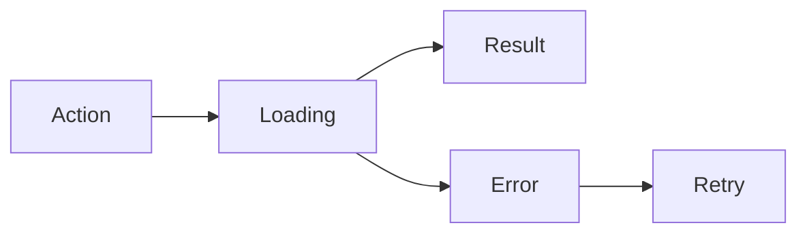

 

# Design and interaction

[← Documentation](README.md) · [API / Postman](API.md)

## Reading guide

| Topic | What to know |
| --- | --- |
| **Visual system** | Android keeps gray/blue tokens, system typography and native controls; DAT uses supported styles and capabilities. |
| **States** | Separate loading, empty, error, progress and retry states; do not announce an empty list before a query completes. |
| **Evidence** | Complete highlighted image with date, source and confidence; longer details in separate actions. |
| **Forms** | Inline errors, focus on the first one, appropriate keyboard, autofill and optional password visibility; loading blocks duplicate sends. |
| **Accessibility** | 48 dp touch targets, text up to 200%, labelled controls and decorative graphics excluded from screen readers. EN/ES. |
| **Evaluation** | Robolectric screenshots and Compose tests cover states and widths; they do not replace physical keyboard, camera or glasses checks. |

## Procedures and evidence

The original reference preserves technical details, examples and dated checks in their source language. Retired-component instructions are historical; use the current installation guides to operate.
[↗ Complete original reference](reference/UI_DESIGN.legacy.md)
[WEARABLES ](WEARABLES.md) · [DEMO ](DEMO.md) · [IMPLEMENTATION STATUS ](IMPLEMENTATION_STATUS.md)

Historical sections

[↗ identidad-visual-android-y-autenticación](reference/UI_DESIGN.legacy.md#identidad-visual-android-y-autenticación)

[↗ native-meta-display-and-android-host--2026-10-31](reference/UI_DESIGN.legacy.md#native-meta-display-and-android-host--2026-10-31)

[↗ compact-shared-android-profile-header--2026-11-02](reference/UI_DESIGN.legacy.md#compact-shared-android-profile-header--2026-11-02)

[↗ formularios-android-de-cuenta--revisión-gráfica](reference/UI_DESIGN.legacy.md#formularios-android-de-cuenta--revisión-gráfica)

[↗ acceso-inicial-y-explora-realityos--2026-11-03](reference/UI_DESIGN.legacy.md#acceso-inicial-y-explora-realityos--2026-11-03)

[↗ corrección-de-correo-y-datos-ya-registrados--2026-11-03](reference/UI_DESIGN.legacy.md#corrección-de-correo-y-datos-ya-registrados--2026-11-03)

Email-account profile editing adds a personal-information section with native icons, inline validation and a calendar for birth date. Facebook profiles show the same details read-only with a synchronization explanation; existing biography, contact, social links and CV remain editable. The editor keeps the app theme, supports the keyboard and 200% text, and disables edits while saving.
