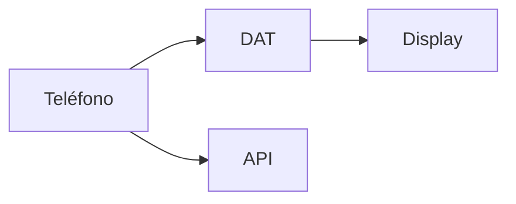

<p align="center"><a href="WEARABLES.md"></a> <a href="WEARABLES.es.md"></a></p>

# Android y gafas Meta

[← Documentación](README.es.md) · [API / Postman](API.es.md)

## Guía de lectura

| Tema | Qué debes saber |
| --- | --- |
| **Host** | Android gestiona Bluetooth, permisos, red y estado. DAT 1.0.1 ofrece cámara, voz y Display nativo. |
| **Buscar** | Foto de objeto o rostro y consulta de voz; sondas efímeras y resultados autorizados. No abre una sesión de captura. |
| **Capturar** | Foto/video explícitos; original privado en Perfil y flujo de revisión de duplicados. La captura de gafas no hereda un grupo anterior. |
| **Debug** | Mock Device Kit simula hardware; CameraX y voz usan el teléfono. Procesamiento Live puede ser real. Release excluye Mock Device Kit. |
| **Evidencia** | Enlaces temporales autorizados, imagen señalada, fecha de última observación y confianza visual. Mostrar estados parciales/simulados. |
| **Validación física** | Comprobar registro Meta, permisos denegados, cámara, micrófono, audio Bluetooth, desconexión y recuperación en hardware real. Compilar no acredita esas pruebas. |



## Comandos

Ejecutar desde la raíz, con dependencias instaladas. Migraciones y procesamiento requieren el entorno elegido y autorización de sus datos.
```bash
make android-check
```

## Procedimientos y evidencia

La referencia original conserva los detalles técnicos, ejemplos y verificaciones fechadas en su idioma de origen. Las instrucciones de componentes retirados son historia; usa las guías de instalación actuales para operar.
[↗ Referencia original completa](reference/WEARABLES.legacy.md)
[API ](API.es.md) · [UI DESIGN ](UI_DESIGN.es.md) · [IMPLEMENTATION STATUS ](IMPLEMENTATION_STATUS.es.md)

<details>
<summary>Secciones históricas</summary>

<a id="meta-ray-ban-display-integration"></a>
[↗ meta-ray-ban-display-integration](reference/WEARABLES.legacy.md#meta-ray-ban-display-integration)

<a id="supported-realityos-flow"></a>
[↗ supported-realityos-flow](reference/WEARABLES.legacy.md#supported-realityos-flow)

<a id="development-setup"></a>
[↗ development-setup](reference/WEARABLES.legacy.md#development-setup)

<a id="hardware-free-phone-preview"></a>
[↗ hardware-free-phone-preview](reference/WEARABLES.legacy.md#hardware-free-phone-preview)

<a id="capability-and-testing-status"></a>
[↗ capability-and-testing-status](reference/WEARABLES.legacy.md#capability-and-testing-status)

<a id="quick-actions-aligned-with-the-app-2026-11-01"></a>
[↗ quick-actions-aligned-with-the-app-2026-11-01](reference/WEARABLES.legacy.md#quick-actions-aligned-with-the-app-2026-11-01)

<a id="phone-camera-navigation-and-device-selection"></a>
[↗ phone-camera-navigation-and-device-selection](reference/WEARABLES.legacy.md#phone-camera-navigation-and-device-selection)

</details>
