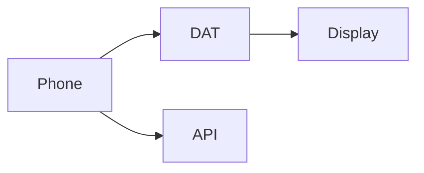

<p align="center"><a href="WEARABLES.md"></a> <a href="WEARABLES.es.md"></a></p>

# Android and Meta glasses

[← Documentation](README.md) · [API / Postman](API.md)

## Reading guide

| Topic | What to know |
| --- | --- |
| **Host** | Android manages Bluetooth, permissions, networking and state. DAT 1.0.1 provides camera, voice and native Display. |
| **Search** | Object/face photo and spoken query; ephemeral probes and authorized results. Does not open a capture session. |
| **Capture** | Explicit photo/video; private original in Profile and duplicate-review flow. Glasses capture does not inherit a previous group. |
| **Debug** | Mock Device Kit simulates hardware; CameraX and speech use the phone. Live processing can be real. Release excludes Mock Device Kit. |
| **Evidence** | Temporary authorized links, highlighted image, last-observed date and visual confidence. Show partial/simulated states. |
| **Physical validation** | Check Meta registration, denied permissions, camera, microphone, Bluetooth audio, disconnect and recovery on real hardware. Compilation does not establish those checks. |



## Commands

Run from the root with dependencies installed. Migrations and processing require the chosen environment and authorized data.
```bash
make android-check
```

## Procedures and evidence

The original reference preserves technical details, examples and dated checks in their source language. Retired-component instructions are historical; use the current installation guides to operate.
[↗ Complete original reference](reference/WEARABLES.legacy.md)
[API ](API.md) · [UI DESIGN ](UI_DESIGN.md) · [IMPLEMENTATION STATUS ](IMPLEMENTATION_STATUS.md)

<details>
<summary>Historical sections</summary>

<a id="meta-ray-ban-display-integration"></a>
[↗ meta-ray-ban-display-integration](reference/WEARABLES.legacy.md#meta-ray-ban-display-integration)

<a id="supported-realityos-flow"></a>
[↗ supported-realityos-flow](reference/WEARABLES.legacy.md#supported-realityos-flow)

<a id="development-setup"></a>
[↗ development-setup](reference/WEARABLES.legacy.md#development-setup)

<a id="hardware-free-phone-preview"></a>
[↗ hardware-free-phone-preview](reference/WEARABLES.legacy.md#hardware-free-phone-preview)

<a id="capability-and-testing-status"></a>
[↗ capability-and-testing-status](reference/WEARABLES.legacy.md#capability-and-testing-status)

<a id="quick-actions-aligned-with-the-app-2026-11-01"></a>
[↗ quick-actions-aligned-with-the-app-2026-11-01](reference/WEARABLES.legacy.md#quick-actions-aligned-with-the-app-2026-11-01)

<a id="phone-camera-navigation-and-device-selection"></a>
[↗ phone-camera-navigation-and-device-selection](reference/WEARABLES.legacy.md#phone-camera-navigation-and-device-selection)

</details>
