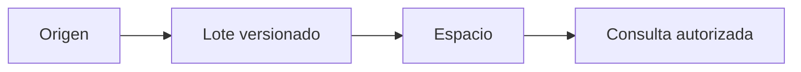

 

# Cuentas, expedientes e importaciones

[← Documentación](README.es.md) · [API / Postman](API.es.md)

## Guía de lectura

| Tema | Qué debes saber |
| --- | --- |
| **Cuenta** | Registro con usuario, correo, nombre y contraseña; confirmar correo antes del acceso. Login acepta correo o usuario en `email`. |
| **Corregir correo** | `POST /v1/auth/change-pending-email` usa usuario/contraseña de una cuenta pendiente; conserva su ID e invalida enlaces anteriores. No modifica cuentas confirmadas, activas o provisionadas. |
| **Conexión** | Un admin crea una conexión; la clave de integración se muestra una vez y se envía por `X-RealityOS-Integration-Key`. |
| **Lote** | Hasta 100 registros y 2 MiB; versiones crecientes, relaciones por IDs externos y transacción atómica. Misma clave/contenido devuelve el resultado original; contenido distinto da 409. |
| **Tipos** | `person`, `case`, `encounter`, `event`, `object`, `prescription`, `allergy`, `administration`. Registros draft/deleted no aparecen en consultas. |
| **Biometría** | Importar una persona no crea usuario ni enrolamiento. Requiere autorización trazable y enrolamiento explícito del retrato. |
| **Comparación clínica** | Compara campos explícitos, vigencia, alergias y antecedentes relacionados. No calcula dosis, convierte unidades, prescribe ni registra administración. |
| **Pruebas** | 47 registros, 27 adjuntos y seis retratos ficticios. Videos de escenas estáticas rotuladas; no prueban seguimiento temporal. Windows comienza vacío. |

## Procedimientos y evidencia

La referencia original conserva los detalles técnicos, ejemplos y verificaciones fechadas en su idioma de origen. Las instrucciones de componentes retirados son historia; usa las guías de instalación actuales para operar.
[↗ Referencia original completa](reference/WORKSPACE_DATA.legacy.md)
[API ](API.es.md) · [DEMO ](DEMO.es.md) · [DATABASE ](DATABASE.es.md)

Secciones históricas

[↗ cuentas-e-integración-de-espacios-de-trabajo](reference/WORKSPACE_DATA.legacy.md#cuentas-e-integración-de-espacios-de-trabajo)

[↗ cuentas](reference/WORKSPACE_DATA.legacy.md#cuentas)

[↗ contrato-rest](reference/WORKSPACE_DATA.legacy.md#contrato-rest)

[↗ consultas-y-trazabilidad](reference/WORKSPACE_DATA.legacy.md#consultas-y-trazabilidad)

[↗ conjunto-del-jurado](reference/WORKSPACE_DATA.legacy.md#conjunto-del-jurado)

[↗ limpieza-y-despliegue](reference/WORKSPACE_DATA.legacy.md#limpieza-y-despliegue)

[↗ alcance-de-la-revisión-del-2-de-noviembre-de-2026](reference/WORKSPACE_DATA.legacy.md#alcance-de-la-revisión-del-2-de-noviembre-de-2026)

