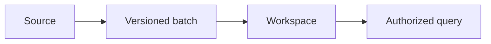

 

# Accounts, records and imports

[← Documentation](README.md) · [API / Postman](API.md)

## Reading guide

| Topic | What to know |
| --- | --- |
| **Account** | Register with username, email, name and password; confirm email before access. Login accepts email or username in `email`. |
| **Correct email** | `POST /v1/auth/change-pending-email` accepts the existing username or current email in `username`, verifies its password, preserves its ID and invalidates previous links. Confirmed, active and provisioned accounts are excluded. |
| **Connection** | An admin creates a connection; the integration key is shown once and sent in `X-RealityOS-Integration-Key`. |
| **Batch** | Up to 100 records and 2 MiB; increasing versions, external-ID relations and atomic transaction. Same key/content returns the original result; different content returns 409. |
| **Kinds** | `person`, `case`, `encounter`, `event`, `object`, `prescription`, `allergy`, `administration`. Draft/deleted records are excluded from queries. |
| **Biometrics** | Importing a person creates neither a user nor an enrollment. Traceable authorization and explicit portrait enrollment are required. |
| **Clinical comparison** | Compares explicit fields, validity, allergies and related history. Does not calculate doses, convert units, prescribe or record administration. |
| **Fixtures** | 47 records, 27 attachments and six fictional portraits. Labelled static-scene videos do not prove temporal tracking. Windows starts empty. |

## Procedures and evidence

The original reference preserves technical details, examples and dated checks in their source language. Retired-component instructions are historical; use the current installation guides to operate.
[↗ Complete original reference](reference/WORKSPACE_DATA.legacy.md)
[API ](API.md) · [DEMO ](DEMO.md) · [DATABASE ](DATABASE.md)

Historical sections

[↗ cuentas-e-integración-de-espacios-de-trabajo](reference/WORKSPACE_DATA.legacy.md#cuentas-e-integración-de-espacios-de-trabajo)

[↗ cuentas](reference/WORKSPACE_DATA.legacy.md#cuentas)

[↗ contrato-rest](reference/WORKSPACE_DATA.legacy.md#contrato-rest)

[↗ consultas-y-trazabilidad](reference/WORKSPACE_DATA.legacy.md#consultas-y-trazabilidad)

[↗ conjunto-del-jurado](reference/WORKSPACE_DATA.legacy.md#conjunto-del-jurado)

[↗ limpieza-y-despliegue](reference/WORKSPACE_DATA.legacy.md#limpieza-y-despliegue)

[↗ alcance-de-la-revisión-del-2-de-noviembre-de-2026](reference/WORKSPACE_DATA.legacy.md#alcance-de-la-revisión-del-2-de-noviembre-de-2026)

