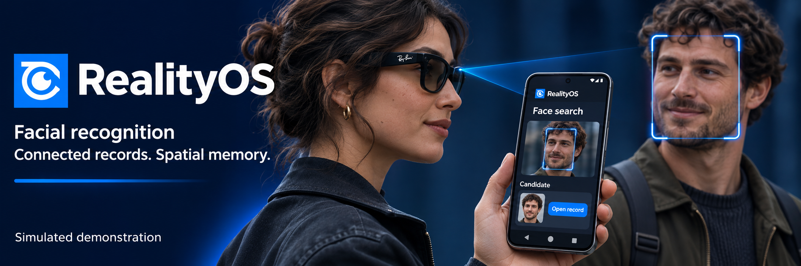
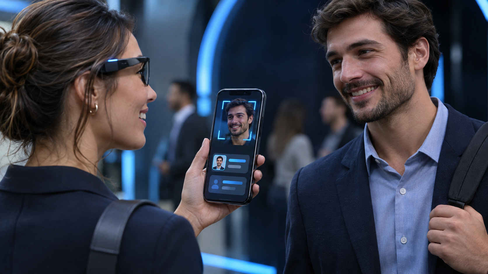
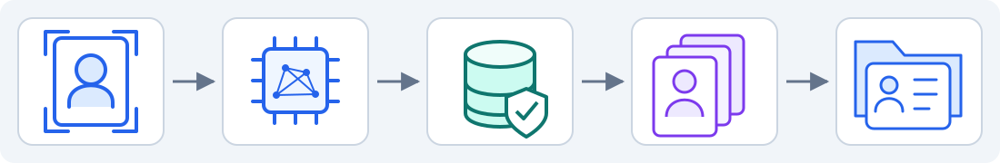
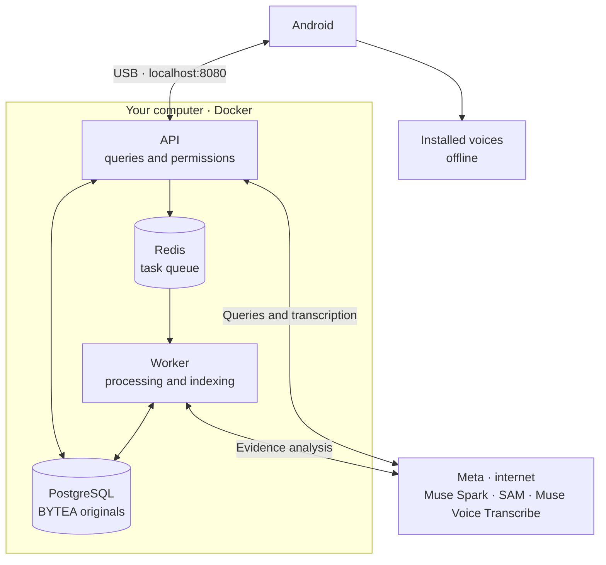

<a id="top"></a>

<p align="center">
  <a href="README.md"></a>
  <a href="../es/README.md"></a>
</p>

# RealityOS

<p align="center">
  
</p>

Android app for saving photos, videos and records in groups and searching evidence with AI. The local server runs PostgreSQL, Redis, API and worker in Docker.

<p align="center">
  <a href="deployment/DEPLOYMENT_LINUX.md"></a>
</p>

## Windows · Git Bash

Run this guide in **Git Bash**, from the project folder. Copy commands without the `$` prompt or a trailing `\`. The button above opens the Linux guide.

### One-time preparation

- Install [Git for Windows](https://gitforwindows.org/) with its Git LFS component. Git retrieves the project and LFS retrieves the included APK and local videos.
- Install [Docker Desktop](https://docs.docker.com/desktop/setup/install/windows-install/) with WSL2 and complete its first launch. Use Linux containers and allocate **4 CPU cores, 8 GiB RAM and 25 GiB free storage**.
- Extract [Platform Tools for Windows](https://dl.google.com/android/repository/platform-tools-latest-windows.zip) into `C:\`, so **`C:\platform-tools\adb.exe`** exists. If you already have that folder, this step is complete. Commands use that path directly.
- Connect an Android 12+ phone by USB, enable USB debugging and accept the authorization prompt on its screen.
- Have your own Meta `MODEL_API_KEY` with access to Muse Spark, SAM and Muse Voice Transcribe.

Check ADB in Git Bash:

```bash
/c/platform-tools/adb.exe version
```

It must print its version. Using the full path avoids `adb: command not found` without changing `PATH`.

<a id="evaluate"></a>
<a id="deploy"></a>

## 1. Get and start the project

**Only if you do not have the repository yet**, open Git Bash in the folder where you want to keep it:

```bash
git lfs install &&
git clone https://github.com/Luxisoft/realityos-spatial-memory.git &&
cd realityos-spatial-memory
```

If you already have it, open Git Bash at the project root, where `README.md` lives, and continue here. Update the code, APK and local videos:

```bash
git lfs install &&
git pull --ff-only &&
git lfs pull
```

Wait for successful completion. `git lfs pull` also downloads the videos in `simulator/media/` required to initialize local data. If Git reports a conflict with local changes, resolve it before continuing; preserve your private files.

To start manually, run from the project folder:

**Windows — Git Bash**

Install Docker Desktop first. On its first launch, open the application and complete its setup, using Linux containers with WSL2. The command below opens an installed Docker Desktop if the engine is unavailable and waits up to two minutes for it to respond.

```bash
powershell.exe -NoProfile -ExecutionPolicy Bypass -File ./scripts/local/Start-RealityOS.ps1
```

If you see `docker_engine` / `The system cannot find the file specified` or the wait expires, open Docker Desktop and resolve any startup or WSL2 message. Run `docker info`: it must show the **Server** section without connection errors. Check `docker context ls` if it still fails and select your local Docker Desktop context before retrying the command. Having the Docker CLI installed is not enough; the engine must be running.

Enter your Meta key when prompted. The launcher generates `.env.local`; keep it private. The first run downloads dependencies and prepares the data. Restarting preserves edits and deletions.

Start, diagnostics and stop commands show an English progress bar based on completed steps. Console output is limited to phase summaries, warnings, errors and success messages; package download logs are hidden. A long build stage can keep the same percentage while it works. Reaching 100% means the command finished; background indexing can continue afterward.

<a id="deploy-muse"></a>

<details>
<summary><strong>Muse · run this installation</strong></summary>

Paste this prompt into Muse with terminal access:

```text
Install RealityOS on Windows following docs/en/README.md from this repository.
Read AGENTS.md and MUSE.md. Use C:\platform-tools\adb.exe and the included
android/app/build/outputs/apk/debug/app-debug.apk retrieved through Git LFS.
Run scripts/local/Start-RealityOS.ps1 and Test-RealityOS.ps1 with PowerShell.
Ask for my Meta key only in the terminal or .env.local, never in chat.
Preserve my changes, credentials, data and other services. Do not operate remote
servers. Check the authorized phone before installing and opening the app.
Report completed checks and any remaining steps.
```

</details>

<a id="android"></a>

## 2. Install and open Android

The APK is already included at `android/app/build/outputs/apk/debug/app-debug.apk`, configured for `http://localhost:8080/v1`. Installing this build does not require Java or Android Studio.

With the backend running and the phone connected, check:

```bash
/c/platform-tools/adb.exe devices
```

Exactly **one phone** must appear with status `device`. If it says `unauthorized`, unlock it and accept authorization. If USB does not detect the phone, follow [Wireless debugging](#android-wifi). Disconnect other devices or emulators before continuing over USB.

From the project root:

```bash
/c/platform-tools/adb.exe reverse tcp:8080 tcp:8080 &&
/c/platform-tools/adb.exe install -r android/app/build/outputs/apk/debug/app-debug.apk &&
/c/platform-tools/adb.exe shell am start -n com.luxisoft.realityos.local/com.luxisoft.realityos.MainActivity
```

Wait for installation to report `Success`. The `&&` operators prevent running the next command if the previous one fails. Repeat `reverse` after reconnecting USB; you can open the app by tapping its icon.

<a id="android-wifi"></a>

<details>
<summary><strong>If USB does not work: wireless debugging</strong></summary>

Connect the computer and phone to the **same Wi-Fi network**. This workflow needs no cable; the app still requires Android 12+. Keep the backend running.

**Before pairing, check the existing connection:**

```bash
/c/platform-tools/adb.exe devices
```

If your phone already appears with status `device`, **go directly to step 4**. Do not repeat `pair`: the previous pairing is still valid. If a new attempt reports `protocol fault` but the phone remains listed as `device`, you can also continue to step 4. That error alone does not identify the cause of the failed attempt.

1. On the phone, open **Developer options → Wireless debugging**, enable it and select **Pair device with pairing code**. Keep that dialog open.
2. In **Git Bash**, from the project root, run the following. Enter the **IP address and port from that dialog**, separated by `:`, then enter the code when ADB prompts for it:

```bash
read -r -p 'Pairing IP:port from phone: ' pairing_address
/c/platform-tools/adb.exe pair "$pairing_address"
```

3. After `Successfully paired`, check whether ADB connected automatically:

```bash
/c/platform-tools/adb.exe devices
```

If the phone appears with status `device`, **continue to step 4**. Its identifier may end in `._adb-tls-connect._tcp`; this is valid.

**Only if it is missing**, return to the main **Wireless debugging** screen and use its **IP address & port**. This is the connection port, different from the port in the pairing-code dialog:

```bash
read -r -p 'Connection IP:port from phone: ' connection_address
/c/platform-tools/adb.exe connect "$connection_address" &&
/c/platform-tools/adb.exe devices
```

4. Leave **exactly one device connected** in `adb devices` and check that its status is `device`. Disconnect other phones and close emulators. From the project root, copy this entire block to install and open the app; ADB selects the connected device automatically:

```bash
/c/platform-tools/adb.exe reverse tcp:8080 tcp:8080 &&
/c/platform-tools/adb.exe install -r android/app/build/outputs/apk/debug/app-debug.apk &&
/c/platform-tools/adb.exe shell am start -n com.luxisoft.realityos.local/com.luxisoft.realityos.MainActivity
```

Keep the wireless connection active to use the backend. If it disconnects or you open another terminal, repeat steps 3–4 with the current address; pairing is not needed again while the computer remains saved. If the connection times out, check that the network allows devices to communicate; guest networks may block this. [Official ADB reference](https://developer.android.com/tools/adb#connect-to-a-device-over-wi-fi).

</details>

<a id="android-build"></a>
<a id="java-windows"></a>

If you change Android, follow the [build guide](integrations/ANDROID.md#build). Docker only builds the backend.

<a id="android-updates"></a>

**For each update:**

| What changed | What to run |
| --- | --- |
| Android code or resources | The server builds and pushes the APK to the repository. Repeat the update and installation commands above; for your own changes, follow the [build guide](#android-build). |
| Backend code or server configuration | Run `Start-RealityOS.ps1` to rebuild/start the local services. Existing data is preserved. |
| Prepared local records, publications or media | Run `git pull`, `git lfs pull` and the local startup script (`Start-RealityOS.ps1` on Windows; `bash scripts/local/start.sh` on Linux). Versioned SQL additions preserve edits, deletions and memberships. |
| The API contract used by Android | Update both the backend and the APK. |
| Documentation only | No app or container rebuild is needed. |

`/c/platform-tools/adb.exe install -r` retains data with the same application ID and signing key. Builds published from this server keep that signature; another computer or CI may use a different one. Do not uninstall automatically after a mismatch. See [ADB installation](https://developer.android.com/tools/adb#move).

`git pull` retrieves the updated APK with Git LFS enabled; `/c/platform-tools/adb.exe install -r` updates the phone. The Debug version name includes the build timestamp. Each Android change requires building and committing the APK alongside the code.

<a id="cases"></a>

[Search photographs](testing/QA_VISUAL_FIXTURES.md): four Police scenes and thirteen social profile avatars for testing the prepared Meta Social Media directory. Open them on the computer for an explicit query capture. The four scenes remain outside group publications and records; social avatars are separate from private references.

Open the app and choose one of the **6 accounts across 2 groups: Police and Meta Social Media**. Groups start collapsed: tap one to see its accounts. Meta Social Media keeps Elena Marquez, Mateo Rios and Sarah Chen as its three access accounts and adds thirteen synthetic social profiles, each with a separate avatar and three private reference photos. Use the existing person search after granting search consent; the group gallery contains one introduction with an avatar and text from each of the three access accounts, plus three videos. Police contains 16 person records with one portrait publication each, plus three videos. Five people have active arrest warrants; two of those also have active proceedings. Four separate missing-person records have active search orders, with no arrest warrants or criminal history. The other seven records have no criminal history, warrants or proceedings. Explore the gallery and records; to publish, select a group, category and tag. Wait for indexing to finish before searching.

| Preview / video | Use |
| --- | --- |
| <a href="../../demo-video/policial_case.mp4"></a> | **Police:** consult group records and evidence. |
| <a href="../../demo-video/profile_found.mp4"></a> | **Profiles:** open a face candidate's authorized information. |

Images and videos are [conceptual illustrations](project/GRAPHICS.md). Click a thumbnail to open its video.

<a id="biometrics"></a>

### Face search

Face search requires explicit consent and enrollment. InsightFace returns candidates for human review; profiles or records open according to permissions.



For spoken replies, install an offline ES/EN voice on Android. Repeat `/c/platform-tools/adb.exe reverse tcp:8080 tcp:8080` after reconnecting the phone.

<a id="architecture"></a>

### Local architecture



## 3. Diagnostics, shutdown and Postman

From the project folder:

| Action | Git Bash |
| --- | --- |
| Diagnostics | `powershell.exe -NoProfile -ExecutionPolicy Bypass -File ./scripts/local/Test-RealityOS.ps1` |
| Stop | `powershell.exe -NoProfile -ExecutionPolicy Bypass -File ./scripts/local/Stop-RealityOS.ps1` |

API: [documentation](http://localhost:8080/docs) · [health](http://localhost:8080/health/ready). Stopping preserves data; `down -v` deletes it. If the Meta key fails, correct `MODEL_API_KEY` in `.env.local` and start again.

**Postman:** import the [collection](../postman/RealityOS.postman_collection.json), choose **No environment → Localhost requests → 00 Quick start** or **00 Local scenarios**. Sign-in is automatic; enable `enable_write_requests=true` to write. **Server requests** is disabled, with no URL or credentials.

<a id="hackathon"></a>

[](https://github.com/Luxisoft/realityos-spatial-memory/actions/workflows/ci.yml)

[Technical reference](INDEX.md) · [Verified status](project/IMPLEMENTATION_STATUS.md) · [Third-party licenses](project/THIRD_PARTY.md) · [Apache 2.0](../../LICENSE)

## Other possible uses

The platform can also serve these two other use cases and many more. These are conceptual illustrations, not groups or data installed in local evaluation.

| Preview / video | Use |
| --- | --- |
| <a href="../../demo-video/nurse_case.mp4"></a> | **Nursing:** review authorized records, notes and attachments. |
| <a href="../../demo-video/memory.mp4"></a> | **Memory:** find where and when an object was last seen. |
